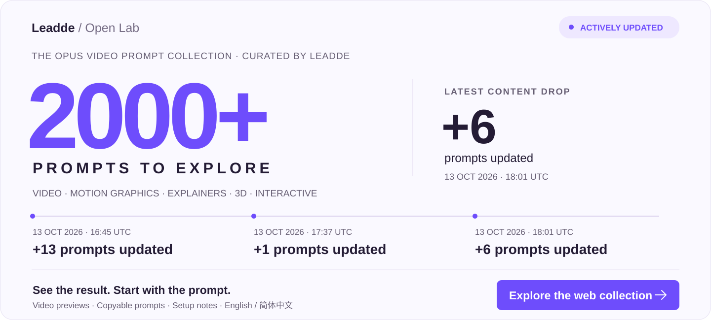

# Awesome Opus 5.5 Video Prompts

**Creator-shared prompts, visual previews, and practical setup notes — curated by Leadde Open Lab.** Find the original prompt and source, watch selected results, and check the tools and inputs before you try them. Return for fresh picks for your next video, animation or 3D project.

**☆ Star this repo to keep the prompts handy for your next project.**

**[Open the web collection →](https://leaddeopenlab.github.io/awesome-opus-5-5-video-prompts/)** · Video previews, prompts & setup · English / 简体中文

[Motion graphics](https://leaddeopenlab.github.io/awesome-opus-5-5-video-prompts/collections/motion-graphics/) · [Explainers](https://leaddeopenlab.github.io/awesome-opus-5-5-video-prompts/collections/explainers/) · [3D worlds](https://leaddeopenlab.github.io/awesome-opus-5-5-video-prompts/collections/3d-worlds/)

[Browse the full repository](#browse-the-full-library) · [Start with a prompt](#start-here) · [Latest additions](#recently-added)

## Featured creations

Read the prompt here on GitHub, or watch the preview and check setup notes on the website.

<table>
<tr>
<td width="50%" valign="top">
 
<strong>Motion Designer Résumé Showreel and Remotion</strong> 

<a href="prompts/2103449416325890146.md">View prompt · GitHub</a> · <a href="https://leaddeopenlab.github.io/awesome-opus-5-5-video-prompts/prompts/remotion-motion-design-showreel/">Watch preview · Website ↗</a> · <a href="https://x.com/ajith_io/status/2103449416325890146">Original post ↗</a>
<!-- pro-tip:start -->
<blockquote><strong>💡 Pro Tip / 核心咒语</strong> <code>dynamic 15-second motion graphics video</code>：把时长和动效形式一起写明，将“做得惊艳”收敛成一个 15 秒作品集片段。</blockquote>
<!-- pro-tip:end -->
</td>
<td width="50%" valign="top">
 
<strong>Vincent's Cats: 3D Starry Night Game</strong> 

<a href="prompts/2103802923465768972.md">View prompt · GitHub</a> · <a href="https://leaddeopenlab.github.io/awesome-opus-5-5-video-prompts/prompts/starry-night-3d-cats-prompt/">Watch preview · Website ↗</a> · <a href="https://x.com/MandelDuck/status/2103802923465768972">Original post ↗</a>
<!-- pro-tip:start -->
<blockquote><strong>💡 Pro Tip / 核心咒语</strong> <code>walk around and spot cats inside of a van gogh painting</code>：将画作风格与“漫游找猫”的具体玩法绑定，给场景设计和交互一个共同目标。</blockquote>
<!-- pro-tip:end -->
</td>
</tr>
<tr>
<td width="50%" valign="top">
 
<strong>Code-Driven Looping UI Motion Graphics</strong> 

<a href="prompts/2103273003555402193.md">View prompt · GitHub</a> · <a href="https://leaddeopenlab.github.io/awesome-opus-5-5-video-prompts/prompts/looping-ui-motion-prompt/">Watch preview · Website ↗</a> · <a href="https://x.com/twoclipping/status/2103273003555402193">Original post ↗</a>
<!-- pro-tip:start -->
<blockquote><strong>💡 Pro Tip / 核心咒语</strong> <code>One shape, never cut</code>：用同一个形状连续变形连接 UI 状态，限制转场方式，避免做成互不相关的幻灯片。</blockquote>
<!-- pro-tip:end -->
</td>
<td width="50%" valign="top">
 
<strong>Opus 5.5 and Manim Educational Video Explaining Derivatives</strong> 

<a href="prompts/2103128559174971663.md">View prompt · GitHub</a> · <a href="https://leaddeopenlab.github.io/awesome-opus-5-5-video-prompts/prompts/manim-derivatives-explainer/">Watch preview · Website ↗</a> · <a href="https://x.com/LinearUncle/status/2103128559174971663">Original post ↗</a>
<!-- pro-tip:start -->
<blockquote><strong>💡 Pro Tip / 核心咒语</strong> <code>Use edge-tts for dubbing</code>：把配音明确交给 edge-tts，与前文 Manim 动画分工；复用时还要检查音画时长是否对齐。</blockquote>
<!-- pro-tip:end -->
</td>
</tr>
<tr>
<td width="50%" valign="top">
 
<strong>1906 San Francisco Market Street Blender Reconstruction</strong> 

<a href="prompts/2102466523164274839.md">View prompt · GitHub</a> · <a href="https://leaddeopenlab.github.io/awesome-opus-5-5-video-prompts/prompts/blender-1906-san-francisco/">Watch preview · Website ↗</a> · <a href="https://x.com/alexalbert__/status/2102466523164274839">Original post ↗</a>
<!-- pro-tip:start -->
<blockquote><strong>💡 Pro Tip / 核心咒语</strong> <code>Before modeling anything, build a source file</code>：先建史料档案再建模，将建筑细节绑定到可核对的来源，而不是凭风格想象历史。</blockquote>
<!-- pro-tip:end -->
</td>
<td width="50%" valign="top">
 
<strong>Animated Pixel Art Wizard in Canvas 2D</strong> 

<a href="prompts/2102476258948927543.md">View prompt · GitHub</a> · <a href="https://leaddeopenlab.github.io/awesome-opus-5-5-video-prompts/prompts/pixel-art-wizard-html-prompt/">Watch preview · Website ↗</a> · <a href="https://x.com/majidmanzarpour/status/2102476258948927543">Original post ↗</a>
<!-- pro-tip:start -->
<blockquote><strong>💡 Pro Tip / 核心咒语</strong> <code>imageSmoothingEnabled = false</code>：关闭画布插值，再配合原文的整数倍缩放与像素网格，避免像素画被缩放成模糊边缘。</blockquote>
<!-- pro-tip:end -->
</td>
</tr>
</table>

## Start here

Pick a result to try. Setup instructions are on each prompt page; these examples have not been reproduced by this repository.

<table>
<tr>
<td width="33%" valign="top">
 
<strong>Easiest start: pixel-art wizard</strong> 
Copy the prompt, save one HTML file, and open it in your browser. No external assets. 
<a href="https://leaddeopenlab.github.io/awesome-opus-5-5-video-prompts/prompts/pixel-art-wizard-html-prompt/">Copy prompt &amp; setup →</a>
<!-- pro-tip:start -->
<blockquote><strong>💡 Pro Tip / 核心咒语</strong> <code>imageSmoothingEnabled = false</code>：关闭画布插值，再配合原文的整数倍缩放与像素网格，避免像素画被缩放成模糊边缘。</blockquote>
<!-- pro-tip:end -->
</td>
<td width="33%" valign="top">
 
<strong>Your product: a 30-second business explainer</strong> 
Replace the business description and brand colors, then preview the HTML animation. 
<a href="https://leaddeopenlab.github.io/awesome-opus-5-5-video-prompts/prompts/business-explainer-html-prompt/">Copy prompt &amp; setup →</a>
<!-- pro-tip:start -->
<blockquote><strong>💡 Pro Tip / 核心咒语</strong> <code>explainer</code>：明确讲解或可视化用途；复用时补充受众、关键结论和例子，并核对知识与数据。</blockquote>
<!-- pro-tip:end -->
</td>
<td width="33%" valign="top">
 
<strong>Teach a concept: derivatives with Manim</strong> 
Generate a narrated lesson with Manim and edge-tts. Python setup required. 
<a href="https://leaddeopenlab.github.io/awesome-opus-5-5-video-prompts/prompts/manim-derivatives-explainer/">Copy prompt &amp; setup →</a>
</td>
</tr>
</table>

## Recently added

<table>
<tr>
<td width="33%" valign="top">
 
<strong>Interactive 3D Snow Globe Comparison</strong> 

<a href="https://x.com/shmopixbzn/status/2110057151171338656">Original post ↗</a> · <a href="prompts/2110057151171338656.md">Prompt ↗</a>
<!-- pro-tip:start -->
<blockquote><strong>💡 Pro Tip / 核心咒语</strong> <code>every shake leaves a lasting, softly accumulating snowfall</code>：要求每次摇晃都留下积雪，让互动改变场景状态，而不只是重复播放雪花特效。</blockquote>
<!-- pro-tip:end -->
</td>
<td width="33%" valign="top">
 
<strong>Paper Rapids: Sunlit Creek Run and Canvas Promo Trailer</strong> 

<a href="https://x.com/jeffbruchado/status/2110038361062723704">Original post ↗</a> · <a href="prompts/2110038361062723704.md">Prompt ↗</a>
<!-- pro-tip:start -->
<blockquote><strong>💡 Pro Tip / 核心咒语</strong> <code>then hands control to the player</code>：把自动预告片与玩家接管写成同一条流程，明确“演示结束后可玩”的交付要求。</blockquote>
<!-- pro-tip:end -->
</td>
<td width="33%" valign="top">
 
<strong>Floor Plan to Interactive 3D Walkthrough via Three.js</strong> 

<a href="https://x.com/everestchris6/status/2110036224320884998">Original post ↗</a> · <a href="prompts/2110036224320884998.md">Prompt ↗</a>
<!-- pro-tip:start -->
<blockquote><strong>💡 Pro Tip / 核心咒语</strong> <code>the critic compares a screenshot of our room with the matching photo</code>：用房间截图逐项对照参考照片，把“像不像”变成具体差异反馈；复用时给迭代设置停止条件。</blockquote>
<!-- pro-tip:end -->
</td>
</tr>
</table>

## Browse the full library

- [Product & Brand Videos](data/categories/product-brand.md) (84)
- [Motion Graphics & Typography](data/categories/motion-graphics.md) (226)
- [UI & Web Animation](data/categories/ui-web.md) (17)
- [Explainers & Education](data/categories/explainers.md) (83)
- [Music & Storytelling](data/categories/music-storytelling.md) (31)
- [3D Worlds & Simulations](data/categories/3d-scenes.md) (93)
- [Games & Interactive Experiences](data/categories/games-interactive.md) (84)

30 homepage picks · Original creator links on every card.

## Product & Brand Videos — homepage picks

<table>
<tr>
<td width="33%" valign="top">
 
<strong>Product Promo Video Generation</strong> 

<a href="https://x.com/felipemoller/status/2103846311149936736">Original post ↗</a> · <a href="prompts/2103846311149936736.md">Prompt ↗</a>
<!-- pro-tip:start -->
<blockquote><strong>💡 Pro Tip / 核心咒语</strong> <code>Use only: JavaScript, Playwright, and FFmpeg</code>：锁定制作与导出工具链，减少模型临时换工具；产品素材和竖屏比例仍需按原文准备。</blockquote>
<!-- pro-tip:end -->
</td>
<td width="33%" valign="top">
 
<strong>Code-Driven Motion Design Video</strong> 

<a href="https://x.com/twoclipping/status/2102554209166000267">Original post ↗</a> · <a href="prompts/2102554209166000267.md">Prompt ↗</a>
<!-- pro-tip:start -->
<blockquote><strong>💡 Pro Tip / 核心咒语</strong> <code>One idea per shot</code>：每个镜头只承载一个信息点，配合原文的节拍结构，减少产品信息和动效相互抢占注意力。</blockquote>
<!-- pro-tip:end -->
</td>
<td width="33%" valign="top">
 
<strong>Code-Based Apple-Style Keynote Motion Design</strong> 

<a href="https://x.com/twoclipping/status/2103835273813496100">Original post ↗</a> · <a href="prompts/2103835273813496100.md">Prompt ↗</a>
<!-- pro-tip:start -->
<blockquote><strong>💡 Pro Tip / 核心咒语</strong> <code>Every scene is made out of the previous one</code>：要求后一场景由前一场景变形而来，让连续性成为转场规则，而不是只要求“苹果风”。</blockquote>
<!-- pro-tip:end -->
</td>
</tr>
<tr>
<td width="33%" valign="top">
 
<strong>Opus 5.5 Ad Inspired by Apple 1984</strong> 

<a href="https://x.com/1littlecoder/status/2103746736980378066">Original post ↗</a> · <a href="prompts/2103746736980378066.md">Prompt ↗</a>
<!-- pro-tip:start -->
<blockquote><strong>💡 Pro Tip / 核心咒语</strong> <code>avoid the border text or frames</code>：在风格参考之外明确排除边框和边缘文字，减少模型把参考广告的装饰一并照搬。</blockquote>
<!-- pro-tip:end -->
</td>
<td width="33%" valign="top">
 
<strong>Remotion Product Intro</strong> 

<a href="https://x.com/HO_BA/status/2103845264649761062">Original post ↗</a> · <a href="prompts/2103845264649761062.md">Prompt ↗</a>
<!-- pro-tip:start -->
<blockquote><strong>💡 Pro Tip / 核心咒语</strong> <code>break them down into components/icons so we can animate those too</code>：把产品截图拆成可独立运动的组件，避免整张截图平移缩放造成静态幻灯片感。</blockquote>
<!-- pro-tip:end -->
</td><td></td>
</tr>
</table>

[Browse all 84 product & brand videos →](data/categories/product-brand.md)

## Motion Graphics & Typography — homepage picks

<table>
<tr>
<td width="33%" valign="top">
 
<strong>Infinite Zoom Vintage Collage Animation</strong> 

<a href="https://x.com/koldo2k/status/2103129343253778767">Original post ↗</a> · <a href="prompts/2103129343253778767.md">Prompt ↗</a>
<!-- pro-tip:start -->
<blockquote><strong>💡 Pro Tip / 核心咒语</strong> <code>misty lake → hand mirror → back to start</code>：把结尾回到起点写进场景路径，使无限缩放有明确闭环，而不是镜头一直向前推进。</blockquote>
<!-- pro-tip:end -->
</td>
<td width="33%" valign="top">
 
<strong>Spotify-Themed Motion Design</strong> 

<a href="https://x.com/brainextends/status/2103801834930606193">Original post ↗</a> · <a href="prompts/2103801834930606193.md">Prompt ↗</a>
<!-- pro-tip:start -->
<blockquote><strong>💡 Pro Tip / 核心咒语</strong> <code>Do not stop at a storyboard, still images, or an implementation plan</code>：明确排除分镜、静帧和计划作为最终交付，要求完成渲染与检查，而不止给出创意。</blockquote>
<!-- pro-tip:end -->
</td>
<td width="33%" valign="top">
 
<strong>Four Seasons Train Window Animation</strong> 

<a href="https://x.com/itsolelehmann/status/2103124033365762215">Original post ↗</a> · <a href="prompts/2103124033365762215.md">Prompt ↗</a>
<!-- pro-tip:start -->
<blockquote><strong>💡 Pro Tip / 核心咒语</strong> <code>4 seasons passing outside a train window</code>：用车窗这个稳定观察框串联四季变化，给短提示词提供清楚的场景和时间主线。</blockquote>
<!-- pro-tip:end -->
</td>
</tr>
</table>

[Browse all 226 motion graphics & typography →](data/categories/motion-graphics.md)

## UI & Web Animation — homepage picks

<table>
<tr>
<td width="33%" valign="top">
 
<strong>Three.js 15s 3D Motion Graphics</strong> 

<a href="https://x.com/hiro19_k/status/2104471436039803295">Original post ↗</a> · <a href="prompts/2104471436039803295.md">Prompt ↗</a>
<!-- pro-tip:start -->
<blockquote><strong>💡 Pro Tip / 核心咒语</strong> <code>No interactivity</code>：明确这是用于首页的播放型动效，减少模型把 3D 展示扩展成无关的交互应用。</blockquote>
<!-- pro-tip:end -->
</td>
<td width="33%" valign="top">
 
<strong>Auren Header Scroll-Scrubbed Hero Section</strong> 

<a href="https://x.com/iamtanzil_/status/2103820321673675031">Original post ↗</a> · <a href="prompts/2103820321673675031.md">Prompt ↗</a>
<!-- pro-tip:start -->
<blockquote><strong>💡 Pro Tip / 核心咒语</strong> <code>maps scroll progress to video.currentTime</code>：把滚动进度直接映射到视频时间，让视觉推进由滚动位置驱动，而不是另起一个播放计时器。</blockquote>
<!-- pro-tip:end -->
</td><td></td>
</tr>
</table>

[Browse all 17 ui & web animation →](data/categories/ui-web.md)

## Explainers & Education — homepage picks

<table>
<tr>
<td width="33%" valign="top">
 
<strong>Recursion Explanation Video</strong> 

<a href="https://x.com/emollick/status/2103688362960019567">Original post ↗</a> · <a href="prompts/2103688362960019567.md">Prompt ↗</a>
<!-- pro-tip:start -->
<blockquote><strong>💡 Pro Tip / 核心咒语</strong> <code>make this self-referential</code>：让解释递归的视频本身也具备自指结构，把抽象概念落实到叙事形式。</blockquote>
<!-- pro-tip:end -->
</td>
<td width="33%" valign="top">
 
<strong>Japan Summer Weather Visualization</strong> 

<a href="https://x.com/GroundControl/status/2103678647777230877">Original post ↗</a> · <a href="prompts/2103678647777230877.md">Prompt ↗</a>
<!-- pro-tip:start -->
<blockquote><strong>💡 Pro Tip / 核心咒语</strong> <code>Pull some online data to see why it was hot and how it compares to other years</code>：先要求真实数据与跨年比较，再做可视化；复用时核对数据来源和年份，避免只有好看的曲线。</blockquote>
<!-- pro-tip:end -->
</td>
<td width="33%" valign="top">
 
<strong>Photon Journey Explainer Animation</strong> 

<a href="https://x.com/AstroTheWizard/status/2103629247751618782">Original post ↗</a> · <a href="prompts/2103629247751618782.md">Prompt ↗</a>
<!-- pro-tip:start -->
<blockquote><strong>💡 Pro Tip / 核心咒语</strong> <code>Give the photon a personality</code>：将光子拟人化，为抽象物理过程建立可跟随的主角；科普表述仍需单独核对。</blockquote>
<!-- pro-tip:end -->
</td>
</tr>
<tr>
<td width="33%" valign="top">
 
<strong>Negroni Cocktail Explainer Motion Graphic in HTML</strong> 

<a href="https://x.com/Ror_Fly/status/2102853258582880547">Original post ↗</a> · <a href="prompts/2102853258582880547.md">Prompt ↗</a>
<!-- pro-tip:start -->
<blockquote><strong>💡 Pro Tip / 核心咒语</strong> <code>empty glass to completed cocktail</code>：用空杯到成品的完整流程限定镜头顺序，让配方讲解有可检查的起点和终点。</blockquote>
<!-- pro-tip:end -->
</td>
<td width="33%" valign="top">
 
<strong>Educational Motion-Graphics on Recursive AI Agent Limitations</strong> 

<a href="https://x.com/M_Adrian2/status/2104542961081983435">Original post ↗</a> · <a href="prompts/2104542961081983435.md">Prompt ↗</a>
<!-- pro-tip:start -->
<blockquote><strong>💡 Pro Tip / 核心咒语</strong> <code>Before animating, study articles from the last three months</code>：先研究近期材料再写动画故事，明确知识内容的时效要求；引用与结论仍要人工核对。</blockquote>
<!-- pro-tip:end -->
</td><td></td>
</tr>
</table>

[Browse all 83 explainers & education →](data/categories/explainers.md)

## Music & Storytelling — homepage picks

<table>
<tr>
<td width="33%" valign="top">
 
<strong>Animated Music Video Prompt for Claude Opus</strong> 

<a href="https://x.com/doubleunplussed/status/2103697580421181894">Original post ↗</a> · <a href="prompts/2103697580421181894.md">Prompt ↗</a>
<!-- pro-tip:start -->
<blockquote><strong>💡 Pro Tip / 核心咒语</strong> <code>Don&#x27;t feel the need to represent everything in the lyrics literally</code>：明确允许隐喻和文化梗，让画面围绕歌词含义展开，而不是逐词机械配图。</blockquote>
<!-- pro-tip:end -->
</td><td></td><td></td>
</tr>
</table>

[Browse all 31 music & storytelling →](data/categories/music-storytelling.md)

## 3D Worlds & Simulations — homepage picks

<table>
<tr>
<td width="33%" valign="top">
 
<strong>Cinematic Browser-Based 3D World</strong> 

<a href="https://x.com/LexnLin/status/2103194052850241739">Original post ↗</a> · <a href="prompts/2103194052850241739.md">Prompt ↗</a>
<!-- pro-tip:start -->
<blockquote><strong>💡 Pro Tip / 核心咒语</strong> <code>This is not a game and not combat-focused</code>：先排除战斗和游戏任务，把制作重点留给漫游、建筑、气氛与视觉发现。</blockquote>
<!-- pro-tip:end -->
</td>
<td width="33%" valign="top">
 
<strong>Pelican Riding a Bicycle Animation</strong> 

<a href="https://x.com/AxtonLiu/status/2103119648271290566">Original post ↗</a> · <a href="prompts/2103119648271290566.md">Prompt ↗</a>
<!-- pro-tip:start -->
<blockquote><strong>💡 Pro Tip / 核心咒语</strong> <code>pelican riding a bicycle</code>：用同一个明确主体和动作作为比较对象；这段未规定动作机制，复用时补充蹬踏与车轮联动。</blockquote>
<!-- pro-tip:end -->
</td>
<td width="33%" valign="top">
 
<strong>Interactive WebGPU Strawberry Cake Soft-Body Physics</strong> 

<a href="https://x.com/ImaStudio_ai/status/2104514806443303238">Original post ↗</a> · <a href="prompts/2104514806443303238.md">Prompt ↗</a>
<!-- pro-tip:start -->
<blockquote><strong>💡 Pro Tip / 核心咒语</strong> <code>No Three.js/Babylon.js, Canvas2D, external assets, video/GIF, or CSS-only deformation</code>：明确排除用预渲染视频或 CSS 形变冒充物理效果；复用时检查真实网格和仿真是否实现。</blockquote>
<!-- pro-tip:end -->
</td>
</tr>
</table>

[Browse all 93 3d worlds & simulations →](data/categories/3d-scenes.md)

## Games & Interactive Experiences — homepage picks

<table>
<tr>
<td width="33%" valign="top">
 
<strong>3D Star Wars Multiplayer Game</strong> 

<a href="https://x.com/0xChuckstock/status/2103804606794879327">Original post ↗</a> · <a href="prompts/2103804606794879327.md">Prompt ↗</a>
<!-- pro-tip:start -->
<blockquote><strong>💡 Pro Tip / 核心咒语</strong> <code>take out key components of the star destroyer</code>：把攻击目标细化为敌舰的关键部件，让场景尺度与战斗目标关联，而不是泛泛生成太空射击。</blockquote>
<!-- pro-tip:end -->
</td>
<td width="33%" valign="top">
 
<strong>Police Chase Arcade Game PRD</strong> 

<a href="https://x.com/froessell/status/2103789415323562325">Original post ↗</a> · <a href="prompts/2103789415323562325.md">Prompt ↗</a>
<!-- pro-tip:start -->
<blockquote><strong>💡 Pro Tip / 核心咒语</strong> <code>The player cannot directly attack</code>：先限制玩家攻击能力，让驾驶、躲避和诱导碰撞成为核心玩法，减少系统方向发散。</blockquote>
<!-- pro-tip:end -->
</td>
<td width="33%" valign="top">
 
<strong>Pixel Art Hearthstone-Style Card Game</strong> 

<a href="https://x.com/aisongman/status/2103763192971461057">Original post ↗</a> · <a href="prompts/2103763192971461057.md">Prompt ↗</a>
<!-- pro-tip:start -->
<blockquote><strong>💡 Pro Tip / 核心咒语</strong> <code>1-on-1 card game like Hearthstone</code>：用一对一卡牌对战限定玩法类型；公开片段没有卡牌规则，复用时补齐回合、费用和胜负条件。</blockquote>
<!-- pro-tip:end -->
</td>
</tr>
<tr>
<td width="33%" valign="top">
 
<strong>Interactive 2D/3D Floor Plan and Interior Design Web Tool</strong> 

<a href="https://x.com/akokoi1/status/2104520072014508316">Original post ↗</a> · <a href="prompts/2104520072014508316.md">Prompt ↗</a>
<!-- pro-tip:start -->
<blockquote><strong>💡 Pro Tip / 核心咒语</strong> <code>according to the dimension markings (mm) in the image</code>：把平面图尺寸和毫米单位设为建模依据，避免房间与家具只在视觉上相似、比例却不一致。</blockquote>
<!-- pro-tip:end -->
</td>
<td width="33%" valign="top">
 
<strong>Interactive Rain Window Calming App</strong> 

<a href="https://x.com/d_llm_kr/status/2104189915693269112">Original post ↗</a> · <a href="prompts/2104189915693269112.md">Prompt ↗</a>
<!-- pro-tip:start -->
<blockquote><strong>💡 Pro Tip / 核心咒语</strong> <code>while listening to the sound of rain</code>：把观看与互动放在雨声陪伴的使用场景中；复用时补充音源和操作方式，避免只得到静态背景。</blockquote>
<!-- pro-tip:end -->
</td><td></td>
</tr>
</table>

[Browse all 84 games & interactive experiences →](data/categories/games-interactive.md)

Browse by tool

- [canvas-interactive](data/categories/canvas-interactive.md) — 84
- [manim](data/categories/manim.md) — 2
- [remotion](data/categories/remotion.md) — 14
- [blender](data/categories/blender.md) — 8
- [external-video-model](data/categories/external-video-model.md) — 11
- [other-animation](data/categories/other-animation.md) — 501

## How to use

1. Pick a result and copy its public prompt from the card or detail page.
2. Supply any inputs listed by the creator, then use the prompt with your Opus agent.
3. Follow the creator’s renderer/tool setup. A shared fragment may need additional instructions.

About this collection &amp; source checks

Opus directs or writes the code for these videos, animations and interactive recordings. The detail page distinguishes prompt-required tools, author-confirmed tools and unconfirmed inferences. Author claims and media consistency checks do not establish repository reproduction. Reference cases may have unverified model version or production details; they are not counted as fully verified cases. We do not reconstruct missing author prompts.

[Review queue](data/docs/REVIEW-QUEUE.md) · [Contribute](data/docs/CONTRIBUTING.md) · [Attribution & corrections](data/docs/RIGHTS.md)

## Credits

Maintained by [LeaddeOpenLab](https://github.com/LeaddeOpenLab) · [Leadde.ai](https://Leadde.ai). All works and prompts belong to their linked creators. Independent collection.
