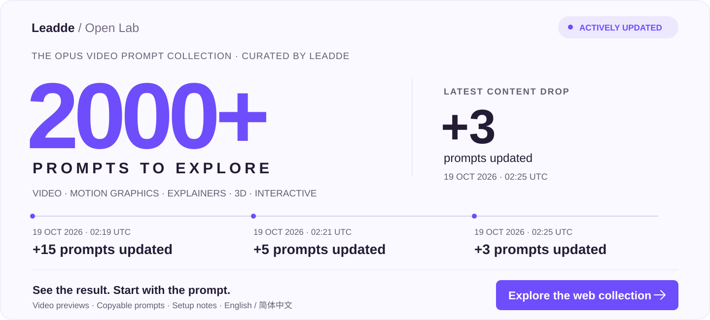
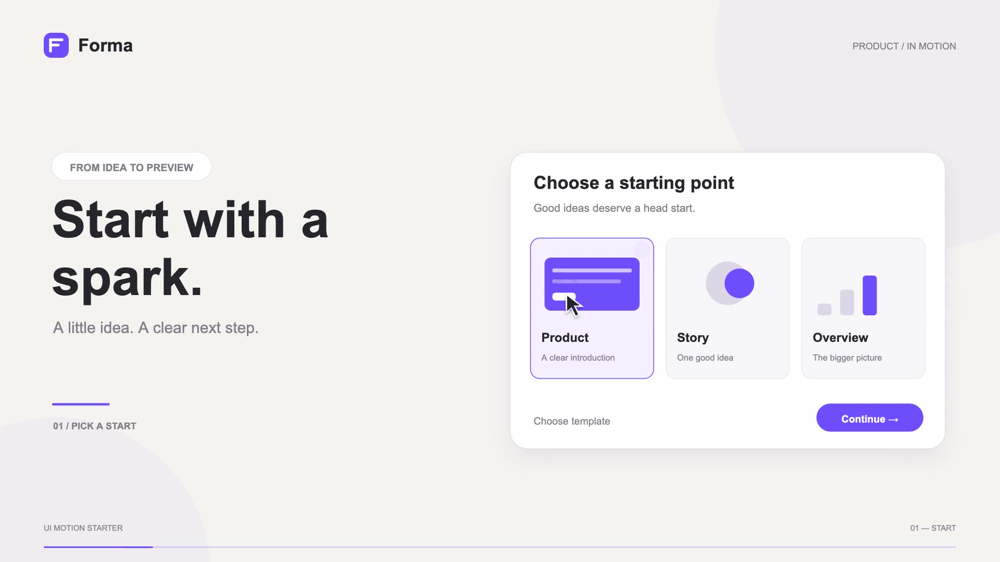
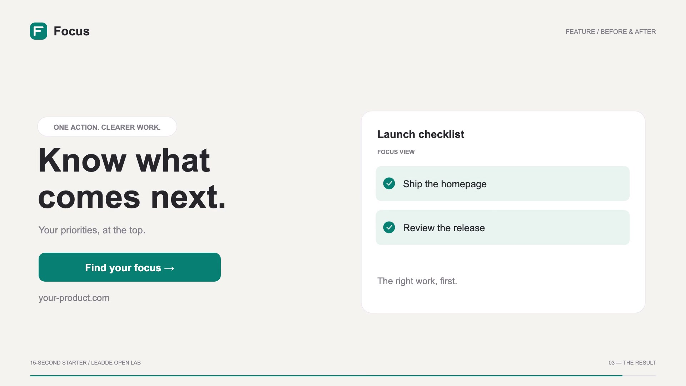
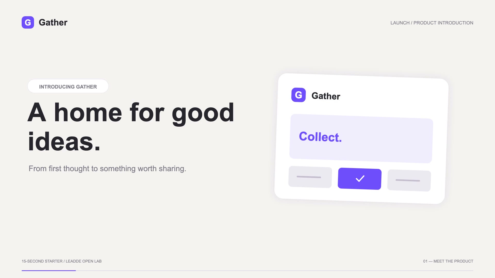
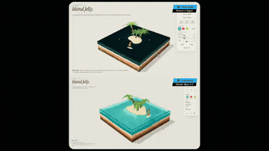
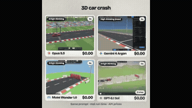
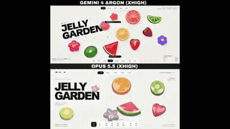
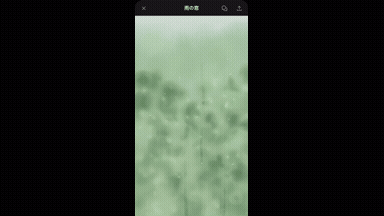

# Awesome Opus 5.5 Video Prompts

**Creator-shared prompts, visual previews, and practical setup notes — curated by Leadde Open Lab.** Find the original prompt and source, watch selected results, and check the tools and inputs before you try them. Return for fresh picks for your next video, animation or 3D project.

**☆ Star this repo to keep the prompts handy for your next project.**

**[Open the web collection →](https://leaddeopenlab.github.io/awesome-opus-5-5-video-prompts/)** · Video previews, prompts & setup · English / 简体中文

[Motion graphics](https://leaddeopenlab.github.io/awesome-opus-5-5-video-prompts/collections/motion-graphics/) · [Explainers](https://leaddeopenlab.github.io/awesome-opus-5-5-video-prompts/collections/explainers/) · [3D worlds](https://leaddeopenlab.github.io/awesome-opus-5-5-video-prompts/collections/3d-worlds/)

[Browse the full repository](#browse-the-full-library) · [Start with a prompt](#start-here) · [Latest additions](#recently-added)

<!-- runnable-templates:start -->
## Try a 15-second template

Choose a use case. Open the preview, change the config, and render your own MP4.

<table>
<tr>
<td width="33%" valign="top">
 
<strong>Product UI</strong> 
Show a complete UI workflow. 
Name · copy · color · screenshot  
<a href="templates/product-ui-15s/example.mp4">▶ Watch 15s</a> · <a href="templates/product-ui-15s/">Get template →</a> 
<a href="templates/product-ui-15s/README.md">English guide</a> · <a href="templates/product-ui-15s/README.zh-CN.md">中文说明</a>
</td>
<td width="33%" valign="top">
 
<strong>Feature Demo</strong> 
Turn a problem into a clear result. 
Tasks · result · copy · color  
<a href="templates/feature-demo-15s/example.mp4">▶ Watch 15s</a> · <a href="templates/feature-demo-15s/">Get template →</a> 
<a href="templates/feature-demo-15s/README.md">English guide</a> · <a href="templates/feature-demo-15s/README.zh-CN.md">中文说明</a>
</td>
<td width="33%" valign="top">
 
<strong>Product Launch</strong> 
Introduce a product and three benefits. 
Benefits · CTA · copy · color  
<a href="templates/product-launch-15s/example.mp4">▶ Watch 15s</a> · <a href="templates/product-launch-15s/">Get template →</a> 
<a href="templates/product-launch-15s/README.md">English guide</a> · <a href="templates/product-launch-15s/README.zh-CN.md">中文说明</a>
</td>
</tr>
</table>

**15 seconds · 1080p · Editable config · MIT**

Preview: open `index.html`. Export MP4: Node.js + Playwright + FFmpeg. Original code animations with fictional demo products.
<!-- runnable-templates:end -->

## Featured creations

Read the prompt here on GitHub, or watch the preview and check setup notes on the website.

<table>
<tr>
<td width="50%" valign="top">
 
<strong>Night Tokyo: Rainy Vending Machine 3D Diorama</strong> 

<a href="prompts/2110107260751884639.md">View prompt · GitHub</a> · <a href="https://leaddeopenlab.github.io/awesome-opus-5-5-video-prompts/prompts/threejs-tokyo-rainy-night-prompt/">Watch preview · Website ↗</a> · <a href="https://x.com/sprinntt/status/2110107260751884639">Original post ↗</a>
</td>
<td width="50%" valign="top">
 
<strong>Claude Motion Designer Showreel</strong> 

<a href="prompts/2110476412213686723.md">View prompt · GitHub</a> · <a href="https://leaddeopenlab.github.io/awesome-opus-5-5-video-prompts/prompts/claude-motion-designer-showreel-prompt/">Watch preview · Website ↗</a> · <a href="https://x.com/0node0/status/2110476412213686723">Original post ↗</a>
</td>
</tr>
<tr>
<td width="50%" valign="top">
 
<strong>Three.js Rubik's Cube Scramble and Solve Animation</strong> 

<a href="prompts/2110588980718940283.md">View prompt · GitHub</a> · <a href="https://leaddeopenlab.github.io/awesome-opus-5-5-video-prompts/prompts/threejs-rubiks-cube-animation-prompt/">Watch preview · Website ↗</a> · <a href="https://x.com/dayvanxd/status/2110588980718940283">Original post ↗</a>
</td>
<td width="50%" valign="top">
 
<strong>Opus 5.5 and Manim Educational Video Explaining Derivatives</strong> 

<a href="prompts/2103128559174971663.md">View prompt · GitHub</a> · <a href="https://leaddeopenlab.github.io/awesome-opus-5-5-video-prompts/prompts/manim-derivatives-explainer/">Watch preview · Website ↗</a> · <a href="https://x.com/LinearUncle/status/2103128559174971663">Original post ↗</a>
<!-- pro-tip:start -->
<blockquote><strong>💡 Pro Tip</strong> <code>Use edge-tts for dubbing</code>: Assign narration to edge-tts and animation to Manim, then check that their durations align.</blockquote>
<!-- pro-tip:end -->
</td>
</tr>
<tr>
<td width="50%" valign="top">
 
<strong>1906 San Francisco Market Street Blender Reconstruction</strong> 

<a href="prompts/2102466523164274839.md">View prompt · GitHub</a> · <a href="https://leaddeopenlab.github.io/awesome-opus-5-5-video-prompts/prompts/blender-1906-san-francisco/">Watch preview · Website ↗</a> · <a href="https://x.com/alexalbert__/status/2102466523164274839">Original post ↗</a>
<!-- pro-tip:start -->
<blockquote><strong>💡 Pro Tip</strong> <code>Before modeling anything, build a source file</code>: Build a historical source file before modeling so architectural details can be checked against evidence.</blockquote>
<!-- pro-tip:end -->
</td>
<td width="50%" valign="top">
 
<strong>Animated Pixel Art Wizard in Canvas 2D</strong> 

<a href="prompts/2102476258948927543.md">View prompt · GitHub</a> · <a href="https://leaddeopenlab.github.io/awesome-opus-5-5-video-prompts/prompts/pixel-art-wizard-html-prompt/">Watch preview · Website ↗</a> · <a href="https://x.com/majidmanzarpour/status/2102476258948927543">Original post ↗</a>
<!-- pro-tip:start -->
<blockquote><strong>💡 Pro Tip</strong> <code>imageSmoothingEnabled = false</code>: Disable canvas interpolation and retain integer scaling and the pixel grid for crisp edges.</blockquote>
<!-- pro-tip:end -->
</td>
</tr>
</table>

## Start here

Pick a result to try. Setup instructions are on each prompt page; these examples have not been reproduced by this repository.

<table>
<tr>
<td width="33%" valign="top">
 
<strong>Easiest start: pixel-art wizard</strong> 
Copy the prompt, save one HTML file, and open it in your browser. No external assets. 
<a href="https://leaddeopenlab.github.io/awesome-opus-5-5-video-prompts/prompts/pixel-art-wizard-html-prompt/">Copy prompt &amp; setup →</a>
<!-- pro-tip:start -->
<blockquote><strong>💡 Pro Tip</strong> <code>imageSmoothingEnabled = false</code>: Disable canvas interpolation and retain integer scaling and the pixel grid for crisp edges.</blockquote>
<!-- pro-tip:end -->
</td>
<td width="33%" valign="top">
 
<strong>Your product: a 30-second business explainer</strong> 
Replace the business description and brand colors, then preview the HTML animation. 
<a href="https://leaddeopenlab.github.io/awesome-opus-5-5-video-prompts/prompts/business-explainer-html-prompt/">Copy prompt &amp; setup →</a>
<!-- pro-tip:start -->
<blockquote><strong>💡 Pro Tip</strong> <code>explainer</code>: State the teaching or visualization purpose, then add audience, key conclusions and examples; verify facts and data.</blockquote>
<!-- pro-tip:end -->
</td>
<td width="33%" valign="top">
 
<strong>Teach a concept: derivatives with Manim</strong> 
Generate a narrated lesson with Manim and edge-tts. Python setup required. 
<a href="https://leaddeopenlab.github.io/awesome-opus-5-5-video-prompts/prompts/manim-derivatives-explainer/">Copy prompt &amp; setup →</a>
</td>
</tr>
</table>

## Recently added

<table>
<tr>
<td width="33%" valign="top">
 
<strong>Island Jelly: Interactive 3D Diorama with Surfing Rooster</strong> 

<a href="https://x.com/EvoLinkAi/status/2111124760038134228">Original post ↗</a> · <a href="prompts/2111124760038134228.md">Prompt ↗</a>
<!-- pro-tip:start -->
<blockquote><strong>💡 Pro Tip</strong> <code>three.js</code>: Name the implementation or rendering tool and prepare its environment; a tool name alone is not a complete workflow.</blockquote>
<!-- pro-tip:end -->
</td>
<td width="33%" valign="top">
 
<strong>3D Car Crash Simulation Benchmark</strong> 

<a href="https://x.com/melvynx/status/2111081760369107300">Original post ↗</a> · <a href="prompts/2111081760369107300.md">Prompt ↗</a>
<!-- pro-tip:start -->
<blockquote><strong>💡 Pro Tip</strong> <code>build a 3D car crash.</code>: Add dimensions, camera views and materials to the spatial brief to reduce guesswork.</blockquote>
<!-- pro-tip:end -->
</td>
<td width="33%" valign="top">
 
<strong>3D Jelly Fruit Interactive Website</strong> 

<a href="https://x.com/0xEver4k/status/2111408548249006439">Original post ↗</a> · <a href="prompts/2111408548249006439.md">Prompt ↗</a>
<!-- pro-tip:start -->
<blockquote><strong>💡 Pro Tip</strong> <code>a 3D jelly fruit website you can cut, squish and shake</code>: Specify how user input changes state so the result is interactive rather than merely viewable.</blockquote>
<!-- pro-tip:end -->
</td>
</tr>
</table>

## Browse the full library

- [Product & Brand Videos](data/categories/product-brand.md) (86)
- [Motion Graphics & Typography](data/categories/motion-graphics.md) (238)
- [UI & Web Animation](data/categories/ui-web.md) (18)
- [Explainers & Education](data/categories/explainers.md) (90)
- [Music & Storytelling](data/categories/music-storytelling.md) (34)
- [3D Worlds & Simulations](data/categories/3d-scenes.md) (154)
- [Games & Interactive Experiences](data/categories/games-interactive.md) (101)

30 homepage picks · Original creator links on every card.

## Product & Brand Videos — homepage picks

<table>
<tr>
<td width="33%" valign="top">
 
<strong>Product Promo Video Generation</strong> 

<a href="https://x.com/felipemoller/status/2103846311149936736">Original post ↗</a> · <a href="prompts/2103846311149936736.md">Prompt ↗</a>
<!-- pro-tip:start -->
<blockquote><strong>💡 Pro Tip</strong> <code>Use only: JavaScript, Playwright, and FFmpeg</code>: Fix the production and export toolchain; prepare the product assets and portrait format specified in the prompt.</blockquote>
<!-- pro-tip:end -->
</td>
<td width="33%" valign="top">
 
<strong>Code-Driven Motion Design Video</strong> 

<a href="https://x.com/twoclipping/status/2102554209166000267">Original post ↗</a> · <a href="prompts/2102554209166000267.md">Prompt ↗</a>
<!-- pro-tip:start -->
<blockquote><strong>💡 Pro Tip</strong> <code>One idea per shot</code>: Give each shot one information point and follow the beat structure so product messaging and motion do not compete.</blockquote>
<!-- pro-tip:end -->
</td>
<td width="33%" valign="top">
 
<strong>Code-Based Apple-Style Keynote Motion Design</strong> 

<a href="https://x.com/twoclipping/status/2103835273813496100">Original post ↗</a> · <a href="prompts/2103835273813496100.md">Prompt ↗</a>
<!-- pro-tip:start -->
<blockquote><strong>💡 Pro Tip</strong> <code>Every scene is made out of the previous one</code>: Require each scene to transform out of the previous one instead of relying only on an Apple-style reference.</blockquote>
<!-- pro-tip:end -->
</td>
</tr>
<tr>
<td width="33%" valign="top">
 
<strong>Opus 5.5 Ad Inspired by Apple 1984</strong> 

<a href="https://x.com/1littlecoder/status/2103746736980378066">Original post ↗</a> · <a href="prompts/2103746736980378066.md">Prompt ↗</a>
<!-- pro-tip:start -->
<blockquote><strong>💡 Pro Tip</strong> <code>avoid the border text or frames</code>: Explicitly exclude borders and edge text so the reference ad&#x27;s decorative elements are not copied wholesale.</blockquote>
<!-- pro-tip:end -->
</td>
<td width="33%" valign="top">
 
<strong>Remotion Product Intro</strong> 

<a href="https://x.com/HO_BA/status/2103845264649761062">Original post ↗</a> · <a href="prompts/2103845264649761062.md">Prompt ↗</a>
<!-- pro-tip:start -->
<blockquote><strong>💡 Pro Tip</strong> <code>break them down into components/icons so we can animate those too</code>: Split product screenshots into independently animated components instead of moving a flat screenshot as one slide.</blockquote>
<!-- pro-tip:end -->
</td><td></td>
</tr>
</table>

[Browse all 86 product & brand videos →](data/categories/product-brand.md)

## Motion Graphics & Typography — homepage picks

<table>
<tr>
<td width="33%" valign="top">
 
<strong>Infinite Zoom Vintage Collage Animation</strong> 

<a href="https://x.com/koldo2k/status/2103129343253778767">Original post ↗</a> · <a href="prompts/2103129343253778767.md">Prompt ↗</a>
<!-- pro-tip:start -->
<blockquote><strong>💡 Pro Tip</strong> <code>misty lake → hand mirror → back to start</code>: Make the final scene return to the opening so the infinite zoom has a defined loop.</blockquote>
<!-- pro-tip:end -->
</td>
<td width="33%" valign="top">
 
<strong>Spotify-Themed Motion Design</strong> 

<a href="https://x.com/brainextends/status/2103801834930606193">Original post ↗</a> · <a href="prompts/2103801834930606193.md">Prompt ↗</a>
<!-- pro-tip:start -->
<blockquote><strong>💡 Pro Tip</strong> <code>Do not stop at a storyboard, still images, or an implementation plan</code>: Explicitly require a rendered and inspected result rather than accepting storyboards, stills or a plan as delivery.</blockquote>
<!-- pro-tip:end -->
</td>
<td width="33%" valign="top">
 
<strong>Four Seasons Train Window Animation</strong> 

<a href="https://x.com/itsolelehmann/status/2103124033365762215">Original post ↗</a> · <a href="prompts/2103124033365762215.md">Prompt ↗</a>
<!-- pro-tip:start -->
<blockquote><strong>💡 Pro Tip</strong> <code>4 seasons passing outside a train window</code>: Use the train window as a stable frame that connects the four seasons into one visual timeline.</blockquote>
<!-- pro-tip:end -->
</td>
</tr>
</table>

[Browse all 238 motion graphics & typography →](data/categories/motion-graphics.md)

## UI & Web Animation — homepage picks

<table>
<tr>
<td width="33%" valign="top">
 
<strong>Three.js 15s 3D Motion Graphics</strong> 

<a href="https://x.com/hiro19_k/status/2104471436039803295">Original post ↗</a> · <a href="prompts/2104471436039803295.md">Prompt ↗</a>
<!-- pro-tip:start -->
<blockquote><strong>💡 Pro Tip</strong> <code>No interactivity</code>: Specify a playback animation for the homepage so the 3D showcase does not expand into an unrelated interactive app.</blockquote>
<!-- pro-tip:end -->
</td>
<td width="33%" valign="top">
 
<strong>Auren Header Scroll-Scrubbed Hero Section</strong> 

<a href="https://x.com/iamtanzil_/status/2103820321673675031">Original post ↗</a> · <a href="prompts/2103820321673675031.md">Prompt ↗</a>
<!-- pro-tip:start -->
<blockquote><strong>💡 Pro Tip</strong> <code>maps scroll progress to video.currentTime</code>: Map scroll progress directly to video time rather than starting an independent playback timer.</blockquote>
<!-- pro-tip:end -->
</td><td></td>
</tr>
</table>

[Browse all 18 ui & web animation →](data/categories/ui-web.md)

## Explainers & Education — homepage picks

<table>
<tr>
<td width="33%" valign="top">
 
<strong>Recursion Explanation Video</strong> 

<a href="https://x.com/emollick/status/2103688362960019567">Original post ↗</a> · <a href="prompts/2103688362960019567.md">Prompt ↗</a>
<!-- pro-tip:start -->
<blockquote><strong>💡 Pro Tip</strong> <code>make this self-referential</code>: Let the recursion explainer itself use a self-referential structure to make the concept concrete.</blockquote>
<!-- pro-tip:end -->
</td>
<td width="33%" valign="top">
 
<strong>Japan Summer Weather Visualization</strong> 

<a href="https://x.com/GroundControl/status/2103678647777230877">Original post ↗</a> · <a href="prompts/2103678647777230877.md">Prompt ↗</a>
<!-- pro-tip:start -->
<blockquote><strong>💡 Pro Tip</strong> <code>Pull some online data to see why it was hot and how it compares to other years</code>: Require real data and year-to-year comparisons before visualization; check sources and dates.</blockquote>
<!-- pro-tip:end -->
</td>
<td width="33%" valign="top">
 
<strong>Photon Journey Explainer Animation</strong> 

<a href="https://x.com/AstroTheWizard/status/2103629247751618782">Original post ↗</a> · <a href="prompts/2103629247751618782.md">Prompt ↗</a>
<!-- pro-tip:start -->
<blockquote><strong>💡 Pro Tip</strong> <code>Give the photon a personality</code>: Personify the photon to give the audience a character to follow; verify the scientific explanation separately.</blockquote>
<!-- pro-tip:end -->
</td>
</tr>
<tr>
<td width="33%" valign="top">
 
<strong>Negroni Cocktail Explainer Motion Graphic in HTML</strong> 

<a href="https://x.com/Ror_Fly/status/2102853258582880547">Original post ↗</a> · <a href="prompts/2102853258582880547.md">Prompt ↗</a>
<!-- pro-tip:start -->
<blockquote><strong>💡 Pro Tip</strong> <code>empty glass to completed cocktail</code>: Define the complete process from empty glass to finished cocktail with a checkable start and finish.</blockquote>
<!-- pro-tip:end -->
</td>
<td width="33%" valign="top">
 
<strong>Educational Motion-Graphics on Recursive AI Agent Limitations</strong> 

<a href="https://x.com/M_Adrian2/status/2104542961081983435">Original post ↗</a> · <a href="prompts/2104542961081983435.md">Prompt ↗</a>
<!-- pro-tip:start -->
<blockquote><strong>💡 Pro Tip</strong> <code>Before animating, study articles from the last three months</code>: Research recent material before scripting the animation, then verify citations and conclusions.</blockquote>
<!-- pro-tip:end -->
</td><td></td>
</tr>
</table>

[Browse all 90 explainers & education →](data/categories/explainers.md)

## Music & Storytelling — homepage picks

<table>
<tr>
<td width="33%" valign="top">
 
<strong>Animated Music Video Prompt for Claude Opus</strong> 

<a href="https://x.com/doubleunplussed/status/2103697580421181894">Original post ↗</a> · <a href="prompts/2103697580421181894.md">Prompt ↗</a>
<!-- pro-tip:start -->
<blockquote><strong>💡 Pro Tip</strong> <code>Don&#x27;t feel the need to represent everything in the lyrics literally</code>: Allow metaphor and cultural references so visuals interpret the lyrics rather than illustrating words mechanically.</blockquote>
<!-- pro-tip:end -->
</td><td></td><td></td>
</tr>
</table>

[Browse all 34 music & storytelling →](data/categories/music-storytelling.md)

## 3D Worlds & Simulations — homepage picks

<table>
<tr>
<td width="33%" valign="top">
 
<strong>Cinematic Browser-Based 3D World</strong> 

<a href="https://x.com/LexnLin/status/2103194052850241739">Original post ↗</a> · <a href="prompts/2103194052850241739.md">Prompt ↗</a>
<!-- pro-tip:start -->
<blockquote><strong>💡 Pro Tip</strong> <code>This is not a game and not combat-focused</code>: Exclude combat and quests to focus the scene on exploration, architecture, atmosphere and discovery.</blockquote>
<!-- pro-tip:end -->
</td>
<td width="33%" valign="top">
 
<strong>Pelican Riding a Bicycle Animation</strong> 

<a href="https://x.com/AxtonLiu/status/2103119648271290566">Original post ↗</a> · <a href="prompts/2103119648271290566.md">Prompt ↗</a>
<!-- pro-tip:start -->
<blockquote><strong>💡 Pro Tip</strong> <code>pelican riding a bicycle</code>: Use the same subject and action for comparison; add pedal and wheel coordination when reusing the short brief.</blockquote>
<!-- pro-tip:end -->
</td>
<td width="33%" valign="top">
 
<strong>Interactive WebGPU Strawberry Cake Soft-Body Physics</strong> 

<a href="https://x.com/ImaStudio_ai/status/2104514806443303238">Original post ↗</a> · <a href="prompts/2104514806443303238.md">Prompt ↗</a>
<!-- pro-tip:start -->
<blockquote><strong>💡 Pro Tip</strong> <code>No Three.js/Babylon.js, Canvas2D, external assets, video/GIF, or CSS-only deformation</code>: Exclude prerecorded video and CSS deformation as substitutes for physics; check that meshes and simulation are implemented.</blockquote>
<!-- pro-tip:end -->
</td>
</tr>
</table>

[Browse all 154 3d worlds & simulations →](data/categories/3d-scenes.md)

## Games & Interactive Experiences — homepage picks

<table>
<tr>
<td width="33%" valign="top">
 
<strong>3D Star Wars Multiplayer Game</strong> 

<a href="https://x.com/0xChuckstock/status/2103804606794879327">Original post ↗</a> · <a href="prompts/2103804606794879327.md">Prompt ↗</a>
<!-- pro-tip:start -->
<blockquote><strong>💡 Pro Tip</strong> <code>take out key components of the star destroyer</code>: Target specific enemy-ship components so combat objectives connect to the scene&#x27;s scale.</blockquote>
<!-- pro-tip:end -->
</td>
<td width="33%" valign="top">
 
<strong>Police Chase Arcade Game PRD</strong> 

<a href="https://x.com/froessell/status/2103789415323562325">Original post ↗</a> · <a href="prompts/2103789415323562325.md">Prompt ↗</a>
<!-- pro-tip:start -->
<blockquote><strong>💡 Pro Tip</strong> <code>The player cannot directly attack</code>: Limit the player&#x27;s attack abilities so driving, evasion and induced collisions remain the core mechanics.</blockquote>
<!-- pro-tip:end -->
</td>
<td width="33%" valign="top">
 
<strong>Pixel Art Hearthstone-Style Card Game</strong> 

<a href="https://x.com/aisongman/status/2103763192971461057">Original post ↗</a> · <a href="prompts/2103763192971461057.md">Prompt ↗</a>
<!-- pro-tip:start -->
<blockquote><strong>💡 Pro Tip</strong> <code>1-on-1 card game like Hearthstone</code>: Specify a one-on-one card battle, then add turn rules, costs and victory conditions missing from the public fragment.</blockquote>
<!-- pro-tip:end -->
</td>
</tr>
<tr>
<td width="33%" valign="top">
 
<strong>Interactive 2D/3D Floor Plan and Interior Design Web Tool</strong> 

<a href="https://x.com/akokoi1/status/2104520072014508316">Original post ↗</a> · <a href="prompts/2104520072014508316.md">Prompt ↗</a>
<!-- pro-tip:start -->
<blockquote><strong>💡 Pro Tip</strong> <code>according to the dimension markings (mm) in the image</code>: Use floor-plan dimensions and millimeter units to keep rooms and furniture proportional.</blockquote>
<!-- pro-tip:end -->
</td>
<td width="33%" valign="top">
 
<strong>Interactive Rain Window Calming App</strong> 

<a href="https://x.com/d_llm_kr/status/2104189915693269112">Original post ↗</a> · <a href="prompts/2104189915693269112.md">Prompt ↗</a>
<!-- pro-tip:start -->
<blockquote><strong>💡 Pro Tip</strong> <code>while listening to the sound of rain</code>: Frame the experience around rain ambience, then provide audio sources and interaction methods.</blockquote>
<!-- pro-tip:end -->
</td><td></td>
</tr>
</table>

[Browse all 101 games & interactive experiences →](data/categories/games-interactive.md)

Browse by tool

- [canvas-interactive](data/categories/canvas-interactive.md) — 101
- [manim](data/categories/manim.md) — 2
- [remotion](data/categories/remotion.md) — 14
- [blender](data/categories/blender.md) — 11
- [external-video-model](data/categories/external-video-model.md) — 13
- [other-animation](data/categories/other-animation.md) — 583

## How to use

1. Pick a result and copy its public prompt from the card or detail page.
2. Supply any inputs listed by the creator, then use the prompt with your Opus agent.
3. Follow the creator’s renderer/tool setup. A shared fragment may need additional instructions.

About this collection &amp; source checks

Opus directs or writes the code for these videos, animations and interactive recordings. The detail page distinguishes prompt-required tools, author-confirmed tools and unconfirmed inferences. Author claims and media consistency checks do not establish repository reproduction. Reference cases may have unverified model version or production details; they are not counted as fully verified cases. We do not reconstruct missing author prompts.

[Review queue](data/docs/REVIEW-QUEUE.md) · [Contribute](data/docs/CONTRIBUTING.md) · [Attribution & corrections](data/docs/RIGHTS.md)

## Credits

Maintained by [LeaddeOpenLab](https://github.com/LeaddeOpenLab) · [Leadde.ai](https://Leadde.ai). All works and prompts belong to their linked creators. Independent collection.
