# 3D Worlds & Simulations

<table>
<tr>
<td width="33%" valign="top">
<a href="../../prompts/2111184182307434810.md">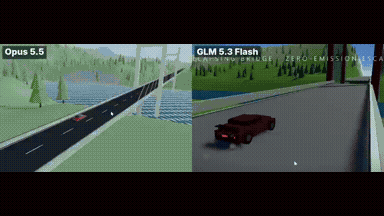</a> 
<strong>Tesla Roadster Collapsing Bridge Escape 3D Simulation</strong> 
Use: Tesla Roadster Collapsing Bridge Three.js Simulation Inputs: User inputs not specified by the author Tools: Three.js 
<a href="https://x.com/daveeyyy_/status/2111184182307434810">Original post ↗</a> · <a href="../../prompts/2111184182307434810.md">Prompt ↗</a>
<!-- pro-tip:start -->
<blockquote><strong>💡 Pro Tip</strong> <code>single HTML file</code>: Specify one HTML deliverable for easy browser playback; still check whether the implementation loads external dependencies.</blockquote>
<!-- pro-tip:end -->
</td>
<td width="33%" valign="top">
<a href="../../prompts/2111153785229693202.md">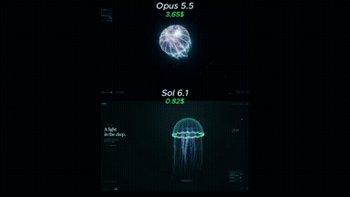</a> 
<strong>Interactive 3D Bioluminescent Jellyfish in Three.js</strong> 
Use: Interactive 3D Bioluminescent Jellyfish Inputs: User inputs not specified by the author Tools: Three.js 
<a href="https://x.com/olezhavich/status/2111153785229693202">Original post ↗</a> · <a href="../../prompts/2111153785229693202.md">Prompt ↗</a>
<!-- pro-tip:start -->
<blockquote><strong>💡 Pro Tip</strong> <code>single self-contained HTML file</code>: Specify one HTML deliverable for easy browser playback; still check whether the implementation loads external dependencies.</blockquote>
<!-- pro-tip:end -->
</td>
<td width="33%" valign="top">
 
<strong>Medieval Map Fluid Simulation and Calligraphy Story</strong> 
Use: Medieval Map Fluid Animation Inputs: User inputs not specified by the author Tools: WebGL 
<a href="https://x.com/cmrani_ba/status/2111135601378632157">Original post ↗</a> · <a href="../../prompts/2111135601378632157.md">Prompt ↗</a>
<!-- pro-tip:start -->
<blockquote><strong>💡 Pro Tip</strong> <code>fluid</code>: Define the simulated phenomenon, then add motion rules, parameters and interaction beyond its appearance.</blockquote>
<!-- pro-tip:end -->
</td>
</tr>
<tr>
<td width="33%" valign="top">
<a href="../../prompts/2111133280854581722.md">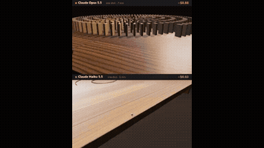</a> 
<strong>300 Wooden Dominoes in a Spiral Comparison</strong> 
Use: Domino Spiral Physics Animation Inputs: User inputs not specified by the author Tools: Tool setup not specified by the source 
<a href="https://x.com/buzzhive_ai/status/2111133280854581722">Original post ↗</a> · <a href="../../prompts/2111133280854581722.md">Prompt ↗</a>
<!-- pro-tip:start -->
<blockquote><strong>💡 Pro Tip</strong> <code>300 wooden dominoes in a spiral, a steel ball knocks over the first one, the wave runs to the center and drops a tiny red flag. Real 3D, 15 seconds.</code>: Add dimensions, camera views and materials to the spatial brief to reduce guesswork.</blockquote>
<!-- pro-tip:end -->
</td>
<td width="33%" valign="top">
<a href="../../prompts/2111109453206438101.md">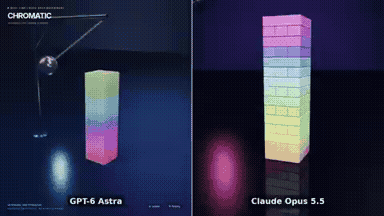</a> 
<strong>3D Wrecking Ball and Tower Physics Simulation</strong> 
Use: Wrecking Ball vs Block Tower 3D Physics Simulation Inputs: User inputs not specified by the author Tools: Three.js 
<a href="https://x.com/ivanainai/status/2111109453206438101">Original post ↗</a> · <a href="../../prompts/2111109453206438101.md">Prompt ↗</a>
<!-- pro-tip:start -->
<blockquote><strong>💡 Pro Tip</strong> <code>single self-contained HTML file</code>: Specify one HTML deliverable for easy browser playback; still check whether the implementation loads external dependencies.</blockquote>
<!-- pro-tip:end -->
</td>
<td width="33%" valign="top">
<a href="../../prompts/2111067204925935905.md">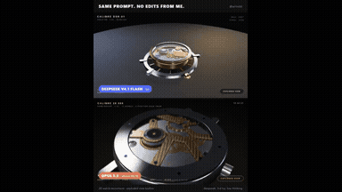</a> 
<strong>Interactive 3D Mechanical Watch Movement in HTML</strong> 
Use: 3D mechanical watch movement simulation with exploded view Inputs: User inputs not specified by the author Tools: Tool setup not specified by the source 
<a href="https://x.com/arixxbt/status/2111067204925935905">Original post ↗</a> · <a href="../../prompts/2111067204925935905.md">Prompt ↗</a>
<!-- pro-tip:start -->
<blockquote><strong>💡 Pro Tip</strong> <code>one HTML file</code>: Specify one HTML deliverable for easy browser playback; still check whether the implementation loads external dependencies.</blockquote>
<!-- pro-tip:end -->
</td>
</tr>
<tr>
<td width="33%" valign="top">
<a href="../../prompts/2110792641277198383.md">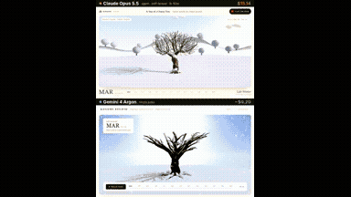</a> 
<strong>A Year of a Cherry Tree in 16 Seconds 3D Simulation</strong> 
Use: Seasonal Cherry Tree 3D Simulation Inputs: User inputs not specified by the author Tools: Tool setup not specified by the source 
<a href="https://x.com/AIMind_Ai/status/2110792641277198383">Original post ↗</a> · <a href="../../prompts/2110792641277198383.md">Prompt ↗</a>
<!-- pro-tip:start -->
<blockquote><strong>💡 Pro Tip</strong> <code>A real 3D scene where one cherry tree goes from snow to blossom, cherries, falling leaves and back to snow, a whole year in 16 seconds.</code>: Add dimensions, camera views and materials to the spatial brief to reduce guesswork.</blockquote>
<!-- pro-tip:end -->
</td>
<td width="33%" valign="top">
<a href="../../prompts/2110758635961712663.md">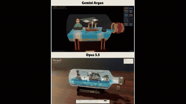</a> 
<strong>Interactive Voxel Ship in a Bottle 3D Scene</strong> 
Use: Voxel Ship in a Bottle Interactive Scene Inputs: User inputs not specified by the author Tools: Tool setup not specified by the source 
<a href="https://x.com/josepcalull/status/2110758635961712663">Original post ↗</a> · <a href="../../prompts/2110758635961712663.md">Prompt ↗</a>
<!-- pro-tip:start -->
<blockquote><strong>💡 Pro Tip</strong> <code>physics</code>: Define the simulated phenomenon, then add motion rules, parameters and interaction beyond its appearance.</blockquote>
<!-- pro-tip:end -->
</td>
<td width="33%" valign="top">
<a href="../../prompts/2110716381968879863.md">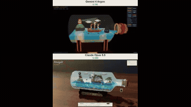</a> 
<strong>Voxel Ship in a Bottle WebGL Scene</strong> 
Use: Voxel Ship in a Bottle Interactive Demo Inputs: User inputs not specified by the author Tools: Chrome / WebGL 
<a href="https://x.com/Bitturing/status/2110716381968879863">Original post ↗</a> · <a href="../../prompts/2110716381968879863.md">Prompt ↗</a>
<!-- pro-tip:start -->
<blockquote><strong>💡 Pro Tip</strong> <code>single HTML file</code>: Specify one HTML deliverable for easy browser playback; still check whether the implementation loads external dependencies.</blockquote>
<!-- pro-tip:end -->
</td>
</tr>
<tr>
<td width="33%" valign="top">
<a href="../../prompts/2110588980718940283.md">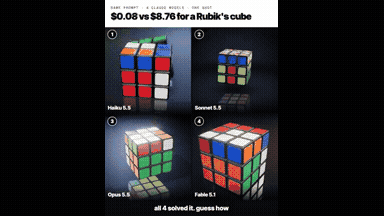</a> 
<strong>Three.js Rubik's Cube Scramble and Solve Animation</strong> 
Use: Rubik's Cube 3D Animation Inputs: User inputs not specified by the author Tools: Three.js 
<a href="https://x.com/dayvanxd/status/2110588980718940283">Original post ↗</a> · <a href="../../prompts/2110588980718940283.md">Prompt ↗</a>
<!-- pro-tip:start -->
<blockquote><strong>💡 Pro Tip</strong> <code>single self-contained HTML file</code>: Specify one HTML deliverable for easy browser playback; still check whether the implementation loads external dependencies.</blockquote>
<!-- pro-tip:end -->
</td>
<td width="33%" valign="top">
<a href="../../prompts/2110442447495127067.md">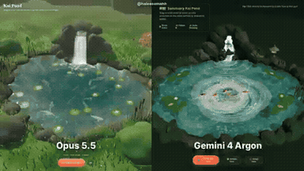</a> 
<strong>Interactive 3D Living Koi Pond in Three.js</strong> 
Use: Interactive 3D Living Koi Pond in Three.js Inputs: User inputs not specified by the author Tools: Three.js / Web Browser 
<a href="https://x.com/Haleeeemahh/status/2110442447495127067">Original post ↗</a> · <a href="../../prompts/2110442447495127067.md">Prompt ↗</a>
<!-- pro-tip:start -->
<blockquote><strong>💡 Pro Tip</strong> <code>single HTML file</code>: Specify one HTML deliverable for easy browser playback; still check whether the implementation loads external dependencies.</blockquote>
<!-- pro-tip:end -->
</td>
<td width="33%" valign="top">
<a href="../../prompts/2110400267783110897.md">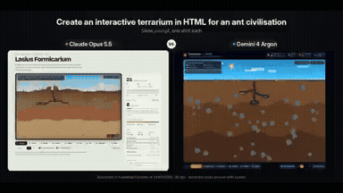</a> 
<strong>Interactive Ant Colony Terrarium in HTML</strong> 
Use: Interactive Ant Colony Terrarium Simulation Inputs: User inputs not specified by the author Tools: Headless Chrome / HTML Canvas 
<a href="https://x.com/BuildFastWithAI/status/2110400267783110897">Original post ↗</a> · <a href="../../prompts/2110400267783110897.md">Prompt ↗</a>
<!-- pro-tip:start -->
<blockquote><strong>💡 Pro Tip</strong> <code>create an interactive terrarium in html for an ant civilisation</code>: Specify how user input changes state so the result is interactive rather than merely viewable.</blockquote>
<!-- pro-tip:end -->
</td>
</tr>
<tr>
<td width="33%" valign="top">
<a href="../../prompts/2110361902064992440.md">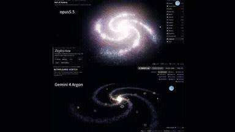</a> 
<strong>Interactive 3D Galaxy Visualization with Three.js</strong> 
Use: Interactive 3D Galaxy Simulation Inputs: User inputs not specified by the author Tools: Three.js 
<a href="https://x.com/Smlay_ero/status/2110361902064992440">Original post ↗</a> · <a href="../../prompts/2110361902064992440.md">Prompt ↗</a>
<!-- pro-tip:start -->
<blockquote><strong>💡 Pro Tip</strong> <code>single-file HTML</code>: Specify one HTML deliverable for easy browser playback; still check whether the implementation loads external dependencies.</blockquote>
<!-- pro-tip:end -->
</td>
<td width="33%" valign="top">
<a href="../../prompts/2110331654522736697.md">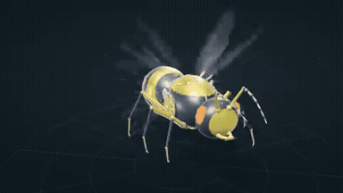</a> 
<strong>Mechanical Wasp 3D Build and Exploded Animation</strong> 
Use: Mechanical Wasp 3D Exploded Animation Inputs: User inputs not specified by the author Tools: Tool setup not specified by the source 
<a href="https://x.com/liamxbtt/status/2110331654522736697">Original post ↗</a> · <a href="../../prompts/2110331654522736697.md">Prompt ↗</a>
<!-- pro-tip:start -->
<blockquote><strong>💡 Pro Tip</strong> <code>generate a mechanical wasp for me</code>: The public fragment gives a creative direction only; add subject motion, visual constraints and delivery format without assuming the full production process.</blockquote>
<!-- pro-tip:end -->
</td>
<td width="33%" valign="top">
<a href="../../prompts/2110329593441796383.md">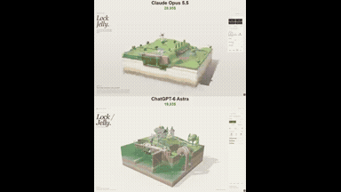</a> 
<strong>Lock Jelly WebGPU Canal Diorama</strong> 
Use: WebGPU Jelly Canal Lock Simulation Inputs: User inputs not specified by the author Tools: WebAudio / WebGPU / WebGPU / WGSL / WGSL 
<a href="https://x.com/vib3coded/status/2110329593441796383">Original post ↗</a> · <a href="../../prompts/2110329593441796383.md">Prompt ↗</a>
<!-- pro-tip:start -->
<blockquote><strong>💡 Pro Tip</strong> <code>single self-contained HTML file</code>: Specify one HTML deliverable for easy browser playback; still check whether the implementation loads external dependencies.</blockquote>
<!-- pro-tip:end -->
</td>
</tr>
<tr>
<td width="33%" valign="top">
 
<strong>Interactive 3D Soft-Body Gummy Bears Simulation with Three.js</strong> 
Use: Interactive 3D Soft-Body Gummy Bear Simulation Inputs: User inputs not specified by the author Tools: Three.js 
<a href="https://x.com/bdall_1/status/2110220253204500492">Original post ↗</a> · <a href="../../prompts/2110220253204500492.md">Prompt ↗</a>
<!-- pro-tip:start -->
<blockquote><strong>💡 Pro Tip</strong> <code>single self-contained HTML file</code>: Specify one HTML deliverable for easy browser playback; still check whether the implementation loads external dependencies.</blockquote>
<!-- pro-tip:end -->
</td>
<td width="33%" valign="top">
<a href="../../prompts/2110131790136401989.md">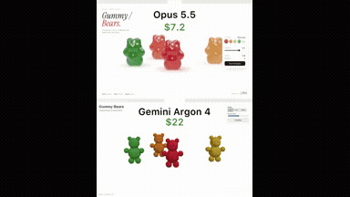</a> 
<strong>Interactive 3D Soft-Body Gummy Bears Simulation in Three.js</strong> 
Use: Interactive 3D Soft-Body Simulation Inputs: User inputs not specified by the author Tools: Three.js 
<a href="https://x.com/semichenkko/status/2110131790136401989">Original post ↗</a> · <a href="../../prompts/2110131790136401989.md">Prompt ↗</a>
<!-- pro-tip:start -->
<blockquote><strong>💡 Pro Tip</strong> <code>single self-contained HTML file</code>: Specify one HTML deliverable for easy browser playback; still check whether the implementation loads external dependencies.</blockquote>
<!-- pro-tip:end -->
</td>
<td width="33%" valign="top">
<a href="../../prompts/2110107260751884639.md">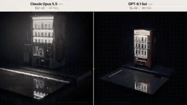</a> 
<strong>Night Tokyo: Rainy Vending Machine 3D Diorama</strong> 
Use: Night Tokyo Rainy Vending Machine Interactive 3D Scene Inputs: No external assets required by the prompt Tools: Claude Code / Three.js / Web Audio API 
<a href="https://x.com/sprinntt/status/2110107260751884639">Original post ↗</a> · <a href="../../prompts/2110107260751884639.md">Prompt ↗</a>
<!-- pro-tip:start -->
<blockquote><strong>💡 Pro Tip</strong> <code>No external assets</code>: Exclude external dependencies to reduce failures caused by missing assets, libraries or network requests.</blockquote>
<!-- pro-tip:end -->
</td>
</tr>
<tr>
<td width="33%" valign="top">
<a href="../../prompts/2110057151171338656.md">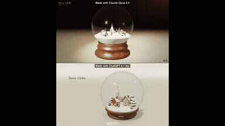</a> 
<strong>Interactive 3D Snow Globe Comparison</strong> 
Use: Interactive 3D Snow Globe Inputs: User inputs not specified by the author Tools: Three.js 
<a href="https://x.com/shmopixbzn/status/2110057151171338656">Original post ↗</a> · <a href="../../prompts/2110057151171338656.md">Prompt ↗</a>
<!-- pro-tip:start -->
<blockquote><strong>💡 Pro Tip</strong> <code>every shake leaves a lasting, softly accumulating snowfall</code>: Require snow to accumulate after each shake so interaction changes scene state instead of replaying an effect.</blockquote>
<!-- pro-tip:end -->
</td>
<td width="33%" valign="top">
 
<strong>Floor Plan to Interactive 3D Walkthrough via Three.js</strong> 
Use: Interactive Architectural Visualization Inputs: User inputs not specified by the author Tools: Three.js 
<a href="https://x.com/everestchris6/status/2110036224320884998">Original post ↗</a> · <a href="../../prompts/2110036224320884998.md">Prompt ↗</a>
<!-- pro-tip:start -->
<blockquote><strong>💡 Pro Tip</strong> <code>the critic compares a screenshot of our room with the matching photo</code>: Compare room screenshots with reference photos and turn differences into revision requests; set a stopping condition.</blockquote>
<!-- pro-tip:end -->
</td>
<td width="33%" valign="top">
<a href="../../prompts/2110015093190570491.md">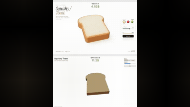</a> 
<strong>Interactive 3D Squishy Toast Memory Foam Simulation</strong> 
Use: Interactive 3D Bread Foam Physics Demo Inputs: User inputs not specified by the author Tools: Three.js 
<a href="https://x.com/semichenkko/status/2110015093190570491">Original post ↗</a> · <a href="../../prompts/2110015093190570491.md">Prompt ↗</a>
<!-- pro-tip:start -->
<blockquote><strong>💡 Pro Tip</strong> <code>single self-contained HTML file</code>: Specify one HTML deliverable for easy browser playback; still check whether the implementation loads external dependencies.</blockquote>
<!-- pro-tip:end -->
</td>
</tr>
<tr>
<td width="33%" valign="top">
<a href="../../prompts/2110014604524896392.md">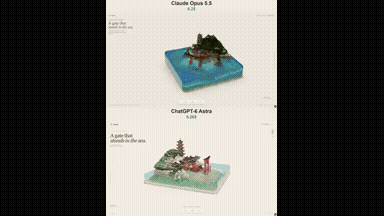</a> 
<strong>Torii at High Tide Interactive 3D WebGL Diorama</strong> 
Use: Torii at High Tide WebGL Diorama Inputs: User inputs not specified by the author Tools: Three.js 
<a href="https://x.com/vib3coded/status/2110014604524896392">Original post ↗</a> · <a href="../../prompts/2110014604524896392.md">Prompt ↗</a>
<!-- pro-tip:start -->
<blockquote><strong>💡 Pro Tip</strong> <code>fixed 60 Hz</code>: Specify update timing or allocation constraints to reduce stutter; verify performance by running the result.</blockquote>
<!-- pro-tip:end -->
</td>
<td width="33%" valign="top">
<a href="../../prompts/2109782159250608604.md">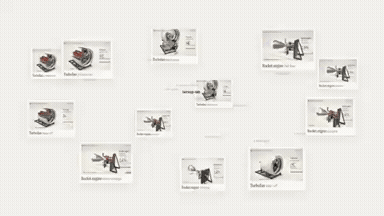</a> 
<strong>Airsup Machine Skill: 3D Interactive Turbofan and Rocket Engine…</strong> 
Use: Physics-driven 3D machine simulation and animated cutaway video Inputs: User inputs not specified by the author Tools: Claude Code / Three.js 
<a href="https://x.com/konstantinsaifo/status/2109782159250608604">Original post ↗</a> · <a href="../../prompts/2109782159250608604.md">Prompt ↗</a>
<!-- pro-tip:start -->
<blockquote><strong>💡 Pro Tip</strong> <code>a turbofan jet engine, the kind that pushes a widebody off the runway</code>: The public fragment gives a creative direction only; add subject motion, visual constraints and delivery format without assuming the full production process.</blockquote>
<!-- pro-tip:end -->
</td>
<td width="33%" valign="top">
 
<strong>Interactive 3D Plasma Lamp in Three.js</strong> 
Use: Interactive 3D Lava Lamp Inputs: Original aeoniumsky lava lamp reference GIF attached to the prompt. Tools: Three.js 
<a href="https://x.com/aeoniumsky/status/2109620598704087055">Original post ↗</a> · <a href="../../prompts/2109620598704087055.md">Prompt ↗</a>
<!-- pro-tip:start -->
<blockquote><strong>💡 Pro Tip</strong> <code>the lava and colours all need to be the same</code>: Bind both lava motion and color to the reference GIF instead of copying only its subject.</blockquote>
<!-- pro-tip:end -->
</td>
</tr>
<tr>
<td width="33%" valign="top">
 
<strong>Interactive WebGPU Plush Penguin Simulation with Soft-Body Physi…</strong> 
Use: Interactive WebGPU Plush Penguin 3D Simulation Inputs: User inputs not specified by the author Tools: WebGPU 
<a href="https://x.com/vib3coded/status/2109288662319919127">Original post ↗</a> · <a href="../../prompts/2109288662319919127.md">Prompt ↗</a>
<!-- pro-tip:start -->
<blockquote><strong>💡 Pro Tip</strong> <code>XPBD</code>: Name the physics model or simulation type, then check parameters, stability and interaction response.</blockquote>
<!-- pro-tip:end -->
</td>
<td width="33%" valign="top">
 
<strong>Interactive WebGPU Plush Hedgehog Simulation</strong> 
Use: WebGPU Plush Hedgehog Physics Simulation Inputs: User inputs not specified by the author Tools: WebGPU 
<a href="https://x.com/N1njaCodex/status/2109259805638455401">Original post ↗</a> · <a href="../../prompts/2109259805638455401.md">Prompt ↗</a>
<!-- pro-tip:start -->
<blockquote><strong>💡 Pro Tip</strong> <code>XPBD</code>: Name the physics model or simulation type, then check parameters, stability and interaction response.</blockquote>
<!-- pro-tip:end -->
</td>
<td width="33%" valign="top">
 
<strong>Midnight Cake Interactive 3D Scene</strong> 
Use: Interactive 3D Cake Application Inputs: User inputs not specified by the author Tools: Tool setup not specified by the source 
<a href="https://x.com/SadAlbert10/status/2109197651518636184">Original post ↗</a> · <a href="../../prompts/2109197651518636184.md">Prompt ↗</a>
<!-- pro-tip:start -->
<blockquote><strong>💡 Pro Tip</strong> <code>i love you, can we build a cool cake</code>: The public fragment gives a creative direction only; add subject motion, visual constraints and delivery format without assuming the full production process.</blockquote>
<!-- pro-tip:end -->
</td>
</tr>
<tr>
<td width="33%" valign="top">
<a href="../../prompts/2109132993617125532.md">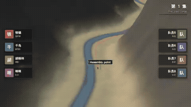</a> 
<strong>Three.js 徒步探险纪实 3D 场景与解说视频生成</strong> 
Use: Hiking Documentary 3D Reconstruction Scene Inputs: User inputs not specified by the author Tools: Claude Haiku 5.5 / Three.js / 火山引擎 TTS 
<a href="https://x.com/shengtang135754/status/2109132993617125532">Original post ↗</a> · <a href="../../prompts/2109132993617125532.md">Prompt ↗</a>
<!-- pro-tip:start -->
<blockquote><strong>💡 Pro Tip</strong> <code>single-file HTML</code>: Specify one HTML deliverable for easy browser playback; still check whether the implementation loads external dependencies.</blockquote>
<!-- pro-tip:end -->
</td>
<td width="33%" valign="top">
<a href="../../prompts/2109060292667982172.md">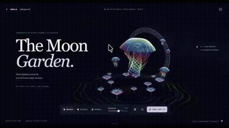</a> 
<strong>Interactive 3D Moon Garden with Three.js and WebGPU</strong> 
Use: Interactive 3D Web Scene Inputs: Deployment endpoint / playground site Tools: Three.js / WebGPU 
<a href="https://x.com/ashebytes/status/2109060292667982172">Original post ↗</a> · <a href="../../prompts/2109060292667982172.md">Prompt ↗</a>
<!-- pro-tip:start -->
<blockquote><strong>💡 Pro Tip</strong> <code>three.js</code>: Name the implementation or rendering tool and prepare its environment; a tool name alone is not a complete workflow.</blockquote>
<!-- pro-tip:end -->
</td>
<td width="33%" valign="top">
<a href="../../prompts/2108914859492483132.md">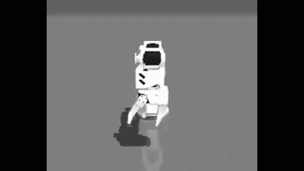</a> 
<strong>6-Joint Robotic Arm Physics Simulation Generated from a Natural…</strong> 
Use: Robotic Arm Kinematics Simulation Inputs: User inputs not specified by the author Tools: Tool setup not specified by the source 
<a href="https://x.com/0x_meden/status/2108914859492483132">Original post ↗</a> · <a href="../../prompts/2108914859492483132.md">Prompt ↗</a>
<!-- pro-tip:start -->
<blockquote><strong>💡 Pro Tip</strong> <code>6-joint robot arm i can build for $122</code>: Specify joint count, manufacturability and cost together, then verify dimensions, pricing and mechanical feasibility.</blockquote>
<!-- pro-tip:end -->
</td>
</tr>
<tr>
<td width="33%" valign="top">
<a href="../../prompts/2108890995459047654.md">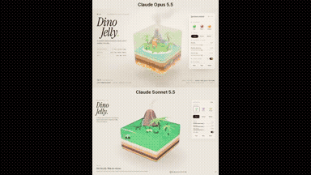</a> 
<strong>Interactive 3D Dino Jelly Diorama in Three.js</strong> 
Use: Interactive 3D WebGL Diorama Inputs: User inputs not specified by the author Tools: Three.js 
<a href="https://x.com/kepochnik/status/2108890995459047654">Original post ↗</a> · <a href="../../prompts/2108890995459047654.md">Prompt ↗</a>
<!-- pro-tip:start -->
<blockquote><strong>💡 Pro Tip</strong> <code>Three.js</code>: Name the implementation or rendering tool and prepare its environment; a tool name alone is not a complete workflow.</blockquote>
<!-- pro-tip:end -->
</td>
<td width="33%" valign="top">
<a href="../../prompts/2108850731750940711.md">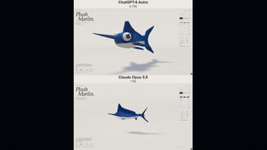</a> 
<strong>WebGPU Plush Marlin Interactive Study</strong> 
Use: Interactive 3D Soft-Body WebGPU Simulation Inputs: User inputs not specified by the author Tools: WebGPU 
<a href="https://x.com/vib3coded/status/2108850731750940711">Original post ↗</a> · <a href="../../prompts/2108850731750940711.md">Prompt ↗</a>
<!-- pro-tip:start -->
<blockquote><strong>💡 Pro Tip</strong> <code>XPBD</code>: Name the physics model or simulation type, then check parameters, stability and interaction response.</blockquote>
<!-- pro-tip:end -->
</td>
<td width="33%" valign="top">
<a href="../../prompts/2108711466303938570.md">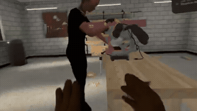</a> 
<strong>Vision Pro Woodshop Safety Simulation via Swift RealityKit</strong> 
Use: Vision Pro Woodshop Simulation Inputs: User inputs not specified by the author Tools: RealityHD / Swift RealityKit 
<a href="https://x.com/hunter_spatial/status/2108711466303938570">Original post ↗</a> · <a href="../../prompts/2108711466303938570.md">Prompt ↗</a>
<!-- pro-tip:start -->
<blockquote><strong>💡 Pro Tip</strong> <code>3D</code>: Add dimensions, camera views and materials to the spatial brief to reduce guesswork.</blockquote>
<!-- pro-tip:end -->
</td>
</tr>
<tr>
<td width="33%" valign="top">
 
<strong>Interactive 3D Camera Lens Cutaway with Three.js</strong> 
Use: Interactive 3D Camera Lens Cutaway Exploder Inputs: User inputs not specified by the author Tools: Claude Code / Three.js 
<a href="https://x.com/aichrislee/status/2108709764817408244">Original post ↗</a> · <a href="../../prompts/2108709764817408244.md">Prompt ↗</a>
<!-- pro-tip:start -->
<blockquote><strong>💡 Pro Tip</strong> <code>one HTML file</code>: Specify one HTML deliverable for easy browser playback; still check whether the implementation loads external dependencies.</blockquote>
<!-- pro-tip:end -->
</td>
<td width="33%" valign="top">
 
<strong>Castle Jelly WebGPU Diorama</strong> 
Use: Interactive Jelly Diorama Inputs: User inputs not specified by the author Tools: Claude Artifacts / WebGPU 
<a href="https://x.com/vib3coded/status/2108649845405929924">Original post ↗</a> · <a href="../../prompts/2108649845405929924.md">Prompt ↗</a>
<!-- pro-tip:start -->
<blockquote><strong>💡 Pro Tip</strong> <code>WebGPU</code>: Name the implementation or rendering tool and prepare its environment; a tool name alone is not a complete workflow.</blockquote>
<!-- pro-tip:end -->
</td>
<td width="33%" valign="top">
<a href="../../prompts/2108626076159357393.md">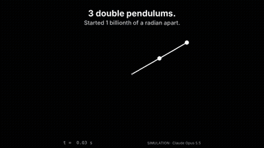</a> 
<strong>Double Pendulum Chaos Simulation with 1e-9 Radian Separation</strong> 
Use: Double Pendulum Chaos Simulation Inputs: User inputs not specified by the author Tools: Python 
<a href="https://x.com/marsautomates/status/2108626076159357393">Original post ↗</a> · <a href="../../prompts/2108626076159357393.md">Prompt ↗</a>
<!-- pro-tip:start -->
<blockquote><strong>💡 Pro Tip</strong> <code>Simulate</code>: Define the simulated phenomenon, then add motion rules, parameters and interaction beyond its appearance.</blockquote>
<!-- pro-tip:end -->
</td>
</tr>
<tr>
<td width="33%" valign="top">
 
<strong>Interactive Three.js Newton's Cradle</strong> 
Use: Newton's Cradle Three.js Simulation Inputs: Attached reference image showing cradle construction. Tools: JavaScript / Three.js 
<a href="https://x.com/ivanainai/status/2108625335122026542">Original post ↗</a> · <a href="../../prompts/2108625335122026542.md">Prompt ↗</a>
<!-- pro-tip:start -->
<blockquote><strong>💡 Pro Tip</strong> <code>fixed camera</code>: Lock the camera to reduce framing drift and make subject motion easier to inspect.</blockquote>
<!-- pro-tip:end -->
</td>
<td width="33%" valign="top">
 
<strong>Meteor Time-Freeze Cinematic Sequence Prompt Orchestrated by Opu…</strong> 
Use: Cinematic sci-fi scene generation via prompt orchestration Inputs: User inputs not specified by the author Tools: Flova.ai / Seedance 2.5 
<a href="https://x.com/MadMax_Series/status/2108577475752054868">Original post ↗</a> · <a href="../../prompts/2108577475752054868.md">Prompt ↗</a>
<!-- pro-tip:start -->
<blockquote><strong>💡 Pro Tip</strong> <code>camera static</code>: Lock the camera to reduce framing drift and make subject motion easier to inspect.</blockquote>
<!-- pro-tip:end -->
</td>
<td width="33%" valign="top">
 
<strong>Interactive WebGPU Plush Cow Material Study</strong> 
Use: Interactive 3D Soft-Body WebGPU Simulation Inputs: User inputs not specified by the author Tools: WebAudio / WebGPU 
<a href="https://x.com/vib3coded/status/2108572856044986846">Original post ↗</a> · <a href="../../prompts/2108572856044986846.md">Prompt ↗</a>
<!-- pro-tip:start -->
<blockquote><strong>💡 Pro Tip</strong> <code>XPBD</code>: Name the physics model or simulation type, then check parameters, stability and interaction response.</blockquote>
<!-- pro-tip:end -->
</td>
</tr>
<tr>
<td width="33%" valign="top">
 
<strong>Procedural 3D F1 Pit Stop in Three.js</strong> 
Use: Procedural 3D F1 Pit Stop Animation Inputs: User inputs not specified by the author Tools: Claude Haiku 5.5 / Three.js 
<a href="https://x.com/rubenssoto_ai/status/2108512810774802657">Original post ↗</a> · <a href="../../prompts/2108512810774802657.md">Prompt ↗</a>
<!-- pro-tip:start -->
<blockquote><strong>💡 Pro Tip</strong> <code>a 30s cinematic F1 pit stop in Three.js. Detailed car, 8-person crew changing all 4 tyres, synthesized audio, fully procedural.</code>: Name the implementation or rendering tool and prepare its environment; a tool name alone is not a complete workflow.</blockquote>
<!-- pro-tip:end -->
</td>
<td width="33%" valign="top">
<a href="../../prompts/2108490153467478249.md">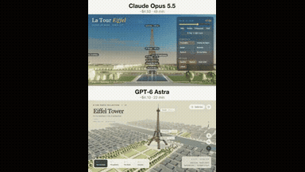</a> 
<strong>Interactive 3D Eiffel Tower Scene in Browser</strong> 
Use: Interactive 3D Eiffel Tower Scene Inputs: User inputs not specified by the author Tools: Tool setup not specified by the source 
<a href="https://x.com/maker_evan/status/2108490153467478249">Original post ↗</a> · <a href="../../prompts/2108490153467478249.md">Prompt ↗</a>
<!-- pro-tip:start -->
<blockquote><strong>💡 Pro Tip</strong> <code>Create the Eiffel Tower and its surroundings in Paris as a detailed interactive 3D browser scene</code>: Specify how user input changes state so the result is interactive rather than merely viewable.</blockquote>
<!-- pro-tip:end -->
</td>
<td width="33%" valign="top">
 
<strong>Plush Hammerhead Interactive WebGPU Simulation</strong> 
Use: Plush Hammerhead WebGPU Demo Inputs: User inputs not specified by the author Tools: WebGPU 
<a href="https://x.com/karanC_12/status/2108489246436962581">Original post ↗</a> · <a href="../../prompts/2108489246436962581.md">Prompt ↗</a>
<!-- pro-tip:start -->
<blockquote><strong>💡 Pro Tip</strong> <code>XPBD</code>: Name the physics model or simulation type, then check parameters, stability and interaction response.</blockquote>
<!-- pro-tip:end -->
</td>
</tr>
<tr>
<td width="33%" valign="top">
<a href="../../prompts/2108486895344767283.md">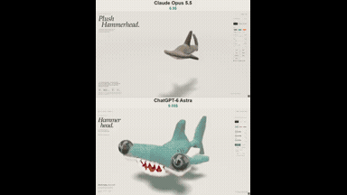</a> 
<strong>Interactive WebGPU Plush Hammerhead Shark</strong> 
Use: Interactive WebGPU Plush Toy Simulation Inputs: User inputs not specified by the author Tools: WebGPU 
<a href="https://x.com/vib3coded/status/2108486895344767283">Original post ↗</a> · <a href="../../prompts/2108486895344767283.md">Prompt ↗</a>
<!-- pro-tip:start -->
<blockquote><strong>💡 Pro Tip</strong> <code>XPBD</code>: Name the physics model or simulation type, then check parameters, stability and interaction response.</blockquote>
<!-- pro-tip:end -->
</td>
<td width="33%" valign="top">
 
<strong>AH-64E Apache Guardian Interactive 3D Presentation</strong> 
Use: AH-64E Apache Guardian 3D Presentation Inputs: User inputs not specified by the author Tools: Tool setup not specified by the source 
<a href="https://x.com/maker_evan/status/2108475056082850278">Original post ↗</a> · <a href="../../prompts/2108475056082850278.md">Prompt ↗</a>
<!-- pro-tip:start -->
<blockquote><strong>💡 Pro Tip</strong> <code>Create a detailed visual 3D presentation of an AH-64E Apache Guardian</code>: Add dimensions, camera views and materials to the spatial brief to reduce guesswork.</blockquote>
<!-- pro-tip:end -->
</td>
<td width="33%" valign="top">
 
<strong>Interactive Educational 3D Jet Engine in the Browser</strong> 
Use: Interactive Educational 3D Jet Engine Inputs: User inputs not specified by the author Tools: Tool setup not specified by the source 
<a href="https://x.com/maker_evan/status/2108459952683811167">Original post ↗</a> · <a href="../../prompts/2108459952683811167.md">Prompt ↗</a>
<!-- pro-tip:start -->
<blockquote><strong>💡 Pro Tip</strong> <code>Build an interactive educational 3D jet engine in the browser</code>: State the teaching or visualization purpose, then add audience, key conclusions and examples; verify facts and data.</blockquote>
<!-- pro-tip:end -->
</td>
</tr>
<tr>
<td width="33%" valign="top">
 
<strong>Tesseract: Six Universes, One Box (HTML5 3D Shader Demo)</strong> 
Use: Tesseract 3D Shader Illusion Inputs: User inputs not specified by the author Tools: HTML5 / WebGL 
<a href="https://x.com/TragoBuilds/status/2108384651362394407">Original post ↗</a> · <a href="../../prompts/2108384651362394407.md">Prompt ↗</a>
<!-- pro-tip:start -->
<blockquote><strong>💡 Pro Tip</strong> <code>do some really wacky demo in html5 something 3d that is an illusion or beatufiul masterpiece of some kind</code>: Add dimensions, camera views and materials to the spatial brief to reduce guesswork.</blockquote>
<!-- pro-tip:end -->
</td>
<td width="33%" valign="top">
<a href="../../prompts/2108347412636938609.md">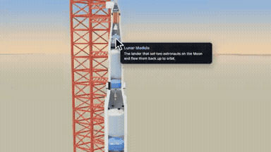</a> 
<strong>Interactive 3D Saturn V Rocket Cutaway in Three.js</strong> 
Use: Interactive 3D Saturn V rocket exploded view Inputs: User inputs not specified by the author Tools: Claude Code / Three.js 
<a href="https://x.com/aichrislee/status/2108347412636938609">Original post ↗</a> · <a href="../../prompts/2108347412636938609.md">Prompt ↗</a>
<!-- pro-tip:start -->
<blockquote><strong>💡 Pro Tip</strong> <code>one HTML file</code>: Specify one HTML deliverable for easy browser playback; still check whether the implementation loads external dependencies.</blockquote>
<!-- pro-tip:end -->
</td>
<td width="33%" valign="top">
<a href="../../prompts/2108256366879981677.md">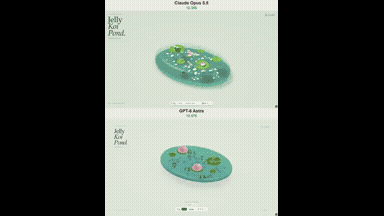</a> 
<strong>Interactive 3D Jelly Koi Pond Simulation</strong> 
Use: Interactive Jelly Koi Pond Inputs: User inputs not specified by the author Tools: HTML5 / WebGL 
<a href="https://x.com/vib3coded/status/2108256366879981677">Original post ↗</a> · <a href="../../prompts/2108256366879981677.md">Prompt ↗</a>
<!-- pro-tip:start -->
<blockquote><strong>💡 Pro Tip</strong> <code>single self-contained HTML file</code>: Specify one HTML deliverable for easy browser playback; still check whether the implementation loads external dependencies.</blockquote>
<!-- pro-tip:end -->
</td>
</tr>
<tr>
<td width="33%" valign="top">
 
<strong>Propane Tank Crush and Explosion WebGPU Simulation</strong> 
Use: WebGPU Propane Tank Crushing and Explosion Simulation Inputs: User inputs not specified by the author Tools: Web Audio API / WebGPU / WGSL 
<a href="https://x.com/theparuchh/status/2108249888571916688">Original post ↗</a> · <a href="../../prompts/2108249888571916688.md">Prompt ↗</a>
<!-- pro-tip:start -->
<blockquote><strong>💡 Pro Tip</strong> <code>single HTML file</code>: Specify one HTML deliverable for easy browser playback; still check whether the implementation loads external dependencies.</blockquote>
<!-- pro-tip:end -->
</td>
<td width="33%" valign="top">
 
<strong>Mountainside Car Chase Previs</strong> 
Use: Car Chase Previs Inputs: User inputs not specified by the author Tools: Blender / Blender MCP 
<a href="https://x.com/tonysurix/status/2108230699224596746">Original post ↗</a> · <a href="../../prompts/2108230699224596746.md">Prompt ↗</a>
<!-- pro-tip:start -->
<blockquote><strong>💡 Pro Tip</strong> <code>in blender make a previs of a car driving thru a mountainside with a another car chasing. record a video and show me here when its done.</code>: Name the implementation or rendering tool and prepare its environment; a tool name alone is not a complete workflow.</blockquote>
<!-- pro-tip:end -->
</td>
<td width="33%" valign="top">
 
<strong>Interactive 3D Coral Reef Diorama Simulation</strong> 
Use: Interactive 3D Coral Reef Diorama Inputs: No external assets required by the prompt Tools: three.js / Three.js / WebAudio API 
<a href="https://x.com/0xRhinoX/status/2108218949808656725">Original post ↗</a> · <a href="../../prompts/2108218949808656725.md">Prompt ↗</a>
<!-- pro-tip:start -->
<blockquote><strong>💡 Pro Tip</strong> <code>No external assets</code>: Exclude external dependencies to reduce failures caused by missing assets, libraries or network requests.</blockquote>
<!-- pro-tip:end -->
</td>
</tr>
<tr>
<td width="33%" valign="top">
<a href="../../prompts/2107870393444729090.md">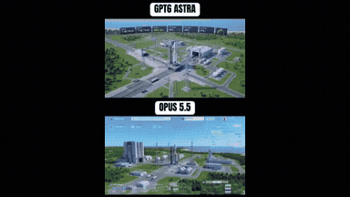</a> 
<strong>Spaceport Digital Twin Dashboard Animation</strong> 
Use: 3D Spaceport Digital Twin Dashboard Inputs: User inputs not specified by the author Tools: Tool setup not specified by the source 
<a href="https://x.com/HamidoFx1/status/2107870393444729090">Original post ↗</a> · <a href="../../prompts/2107870393444729090.md">Prompt ↗</a>
<!-- pro-tip:start -->
<blockquote><strong>💡 Pro Tip</strong> <code>visualization</code>: State the teaching or visualization purpose, then add audience, key conclusions and examples; verify facts and data.</blockquote>
<!-- pro-tip:end -->
</td>
<td width="33%" valign="top">
 
<strong>Interactive 3D Planetary Gearbox CAD Simulation</strong> 
Use: Interactive 3D Planetary Gearbox CAD Demo Inputs: User inputs not specified by the author Tools: Tool setup not specified by the source 
<a href="https://x.com/KanikaBK/status/2107788313390416110">Original post ↗</a> · <a href="../../prompts/2107788313390416110.md">Prompt ↗</a>
<!-- pro-tip:start -->
<blockquote><strong>💡 Pro Tip</strong> <code>create me an interesting CAD 3D of any object</code>: Add dimensions, camera views and materials to the spatial brief to reduce guesswork.</blockquote>
<!-- pro-tip:end -->
</td>
<td width="33%" valign="top">
 
<strong>Squid Jelly: Interactive 3D WebGPU Gummy Squid Simulation</strong> 
Use: Interactive 3D WebGPU Gummy Squid Simulation Inputs: User inputs not specified by the author Tools: WebGPU / WGSL 
<a href="https://x.com/vib3coded/status/2105190658701201725">Original post ↗</a> · <a href="../../prompts/2105190658701201725.md">Prompt ↗</a>
<!-- pro-tip:start -->
<blockquote><strong>💡 Pro Tip</strong> <code>SOFT-BODY PHYSICS</code>: Name the physics model or simulation type, then check parameters, stability and interaction response.</blockquote>
<!-- pro-tip:end -->
</td>
</tr>
<tr>
<td width="33%" valign="top">
 
<strong>Procedural Rube Goldberg Machine via Blender MCP</strong> 
Use: Procedural Rube Goldberg Machine in Blender Inputs: User inputs not specified by the author Tools: Blender / Blender MCP / Cursor 
<a href="https://x.com/Kwazikot/status/2104953406708175097">Original post ↗</a> · <a href="../../prompts/2104953406708175097.md">Prompt ↗</a>
<!-- pro-tip:start -->
<blockquote><strong>💡 Pro Tip</strong> <code>inspect the scene after each major step</code>: Inspect the scene after each major step so geometry errors surface before the final render.</blockquote>
<!-- pro-tip:end -->
</td>
<td width="33%" valign="top">
 
<strong>Continuous Zoom from Pencil Tip to Carbon Atom in Three.js</strong> 
Use: Continuous Macro Zoom Explainer Inputs: User inputs not specified by the author Tools: Three.js 
<a href="https://x.com/Dino_Spike_web3/status/2104909723443302770">Original post ↗</a> · <a href="../../prompts/2104909723443302770.md">Prompt ↗</a>
<!-- pro-tip:start -->
<blockquote><strong>💡 Pro Tip</strong> <code>single HTML file</code>: Specify one HTML deliverable for easy browser playback; still check whether the implementation loads external dependencies.</blockquote>
<!-- pro-tip:end -->
</td>
<td width="33%" valign="top">
 
<strong>Three.js 3D Particle Morphing Animation</strong> 
Use: Interactive 3D Particle Morphing System Inputs: User inputs not specified by the author Tools: HTML5 Canvas API / Three.js 
<a href="https://x.com/DaisyDiao2/status/2104827632538022154">Original post ↗</a> · <a href="../../prompts/2104827632538022154.md">Prompt ↗</a>
<!-- pro-tip:start -->
<blockquote><strong>💡 Pro Tip</strong> <code>particle</code>: Define the simulated phenomenon, then add motion rules, parameters and interaction beyond its appearance.</blockquote>
<!-- pro-tip:end -->
</td>
</tr>
<tr>
<td width="33%" valign="top">
 
<strong>The Beauty of Three.js Showcase Video</strong> 
Use: Three.js Cinematic Feature Reel Inputs: User inputs not specified by the author Tools: Three.js 
<a href="https://x.com/yupengfei990919/status/2104788406656184436">Original post ↗</a> · <a href="../../prompts/2104788406656184436.md">Prompt ↗</a>
<!-- pro-tip:start -->
<blockquote><strong>💡 Pro Tip</strong> <code>threejs</code>: Name the implementation or rendering tool and prepare its environment; a tool name alone is not a complete workflow.</blockquote>
<!-- pro-tip:end -->
</td>
<td width="33%" valign="top">
<a href="../../prompts/2104514806443303238.md">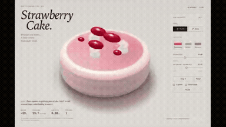</a> 
<strong>Interactive WebGPU Strawberry Cake Soft-Body Physics</strong> 
Use: Interactive soft-body physics demo Inputs: No external assets required by the prompt Tools: WebGPU / WGSL 
<a href="https://x.com/ImaStudio_ai/status/2104514806443303238">Original post ↗</a> · <a href="../../prompts/2104514806443303238.md">Prompt ↗</a>
<!-- pro-tip:start -->
<blockquote><strong>💡 Pro Tip</strong> <code>No Three.js/Babylon.js, Canvas2D, external assets, video/GIF, or CSS-only deformation</code>: Exclude prerecorded video and CSS deformation as substitutes for physics; check that meshes and simulation are implemented.</blockquote>
<!-- pro-tip:end -->
</td>
<td width="33%" valign="top">
<a href="../../prompts/2104504957173153951.md">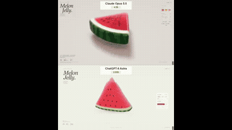</a> 
<strong>Interactive WebGPU Melon Jelly Simulation</strong> 
Use: Claude Opus 5.5 generated a self-contained WebGPU/XPBD soft-body 3D watermelon jelly simulation shown in a side-by-side screen recording. Inputs: User inputs not specified by the author Tools: JavaScript / WebGPU / WGSL 
<a href="https://x.com/esrhengwu/status/2104504957173153951">Original post ↗</a> · <a href="../../prompts/2104504957173153951.md">Prompt ↗</a>
<!-- pro-tip:start -->
<blockquote><strong>💡 Pro Tip</strong> <code>self-contained HTML</code>: Specify one HTML deliverable for easy browser playback; still check whether the implementation loads external dependencies.</blockquote>
<!-- pro-tip:end -->
</td>
</tr>
<tr>
<td width="33%" valign="top">
 
<strong>Beauty of Physics One-Shot Animation via Claude Code and Opus 5.5</strong> 
Use: Author prompts Claude Code using Opus 5.5 to independently generate and render an end-to-end scientific animation video titled 'The Beauty of Physics', spanning from quantum scales to black holes with a continuous timeline and cinematic layout. Inputs: User inputs not specified by the author Tools: Tool setup not specified by the source 
<a href="https://x.com/akokoi1/status/2104200939095904322">Original post ↗</a> · <a href="../../prompts/2104200939095904322.md">Prompt ↗</a>
<!-- pro-tip:start -->
<blockquote><strong>💡 Pro Tip</strong> <code>Generate a video showcasing the beauty of physics, with a cinematic feel, sophisticated aesthetics, and a continuous one-shot flow.</code>: Define the simulated phenomenon, then add motion rules, parameters and interaction beyond its appearance.</blockquote>
<!-- pro-tip:end -->
</td>
<td width="33%" valign="top">
 
<strong>Ex Nihilo: Pure HTML/GLSL Demoscene Intro</strong> 
Use: Procedural Demoscene Production Inputs: User inputs not specified by the author Tools: HTML5 / WebGL / Web Audio 
<a href="https://x.com/JustinPerea/status/2102893186330841502">Original post ↗</a> · <a href="../../prompts/2102893186330841502.md">Prompt ↗</a>
<!-- pro-tip:start -->
<blockquote><strong>💡 Pro Tip</strong> <code>video</code>: Add duration, aspect ratio, assets and delivery format to the short production brief.</blockquote>
<!-- pro-tip:end -->
</td>
<td width="33%" valign="top">
<a href="../../prompts/2111272683375853662.md">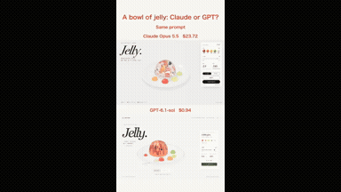</a> 
<strong>Interactive 3D Jelly Bowl in Three.js</strong> 
Use: Interactive 3D Jelly Simulation Inputs: User inputs not specified by the author Tools: Three.js / Web Browser 
<a href="https://x.com/realsunsiyuan/status/2111272683375853662">Original post ↗</a> · <a href="../../prompts/2111272683375853662.md">Prompt ↗</a>
<!-- pro-tip:start -->
<blockquote><strong>💡 Pro Tip</strong> <code>Single HTML file</code>: Specify one HTML deliverable for easy browser playback; still check whether the implementation loads external dependencies.</blockquote>
<!-- pro-tip:end -->
</td>
</tr>
<tr>
<td width="33%" valign="top">
<a href="../../prompts/2111211281814294908.md">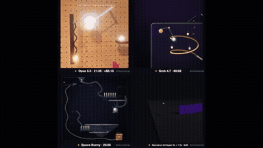</a> 
<strong>Rube Goldberg Machine Benchmark Comparison</strong> 
Use: Rube Goldberg Chain Reaction Simulation Inputs: User inputs not specified by the author Tools: Tool setup not specified by the source 
<a href="https://x.com/mkeremturhan/status/2111211281814294908">Original post ↗</a> · <a href="../../prompts/2111211281814294908.md">Prompt ↗</a>
<!-- pro-tip:start -->
<blockquote><strong>💡 Pro Tip</strong> <code>Build a Rube Goldberg machine.</code>: The public fragment gives a creative direction only; add subject motion, visual constraints and delivery format without assuming the full production process.</blockquote>
<!-- pro-tip:end -->
</td>
<td width="33%" valign="top">
<a href="../../prompts/2111155149003710638.md">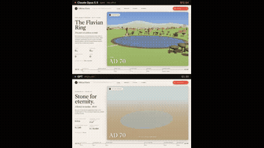</a> 
<strong>Colosseum Construction 3D Three.js Film</strong> 
Use: Colosseum Historical 3D Reconstruction Inputs: User inputs not specified by the author Tools: Three.js 
<a href="https://x.com/genuenci/status/2111155149003710638">Original post ↗</a> · <a href="../../prompts/2111155149003710638.md">Prompt ↗</a>
<!-- pro-tip:start -->
<blockquote><strong>💡 Pro Tip</strong> <code>Three.js</code>: Name the implementation or rendering tool and prepare its environment; a tool name alone is not a complete workflow.</blockquote>
<!-- pro-tip:end -->
</td>
<td width="33%" valign="top">
<a href="../../prompts/2111135774544441654.md">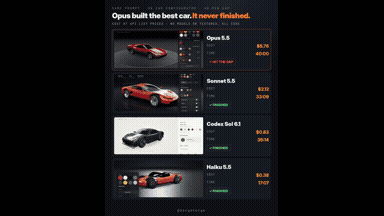</a> 
<strong>3D Car Configurator Benchmark Across Coding Agents</strong> 
Use: Procedural 3D Car Configurator Inputs: User inputs not specified by the author Tools: Tool setup not specified by the source 
<a href="https://x.com/SergeForge/status/2111135774544441654">Original post ↗</a> · <a href="../../prompts/2111135774544441654.md">Prompt ↗</a>
<!-- pro-tip:start -->
<blockquote><strong>💡 Pro Tip</strong> <code>build a 3d car configurator from scratch. no prebuilt 3d models. 40 min cap.</code>: Add dimensions, camera views and materials to the spatial brief to reduce guesswork.</blockquote>
<!-- pro-tip:end -->
</td>
</tr>
<tr>
<td width="33%" valign="top">
<a href="../../prompts/2111099179171037233.md">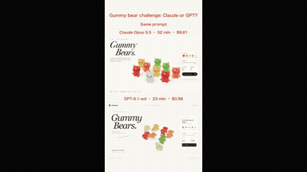</a> 
<strong>Interactive 3D Gummy Bear Physics Simulation</strong> 
Use: Interactive 3D Gummy Bear Physics Inputs: User inputs not specified by the author Tools: Three.js 
<a href="https://x.com/realsunsiyuan/status/2111099179171037233">Original post ↗</a> · <a href="../../prompts/2111099179171037233.md">Prompt ↗</a>
<!-- pro-tip:start -->
<blockquote><strong>💡 Pro Tip</strong> <code>gummy bears you can grab, stretch, squash, throw and pour by the hundreds.</code>: The public fragment gives a creative direction only; add subject motion, visual constraints and delivery format without assuming the full production process.</blockquote>
<!-- pro-tip:end -->
</td>
<td width="33%" valign="top">
<a href="../../prompts/2111085252592415232.md">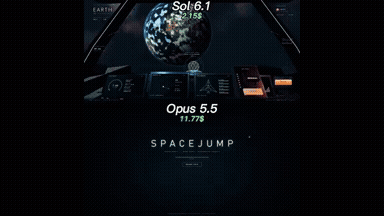</a> 
<strong>Interactive Three.js Spaceship Cockpit Warp Jump Comparison</strong> 
Use: Interactive Spaceship Cockpit Warp Jump Inputs: User inputs not specified by the author Tools: Three.js 
<a href="https://x.com/olezhavich/status/2111085252592415232">Original post ↗</a> · <a href="../../prompts/2111085252592415232.md">Prompt ↗</a>
<!-- pro-tip:start -->
<blockquote><strong>💡 Pro Tip</strong> <code>an interactive first-person spaceship cockpit with an Earth-to-Mars warp jump in Three.js.</code>: Name the implementation or rendering tool and prepare its environment; a tool name alone is not a complete workflow.</blockquote>
<!-- pro-tip:end -->
</td>
<td width="33%" valign="top">
<a href="../../prompts/2110845560995381514.md">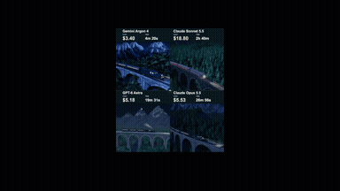</a> 
<strong>3D Night Scene Train Crossing Stone Mountain Bridge Comparison</strong> 
Use: 3D Mountain Bridge Train Scene Inputs: User inputs not specified by the author Tools: Tool setup not specified by the source 
<a href="https://x.com/renanekko/status/2110845560995381514">Original post ↗</a> · <a href="../../prompts/2110845560995381514.md">Prompt ↗</a>
<!-- pro-tip:start -->
<blockquote><strong>💡 Pro Tip</strong> <code>generate a 3D night scene of a train crossing a stone mountain bridge</code>: Add dimensions, camera views and materials to the spatial brief to reduce guesswork.</blockquote>
<!-- pro-tip:end -->
</td>
</tr>
<tr>
<td width="33%" valign="top">
<a href="../../prompts/2110835030964732074.md">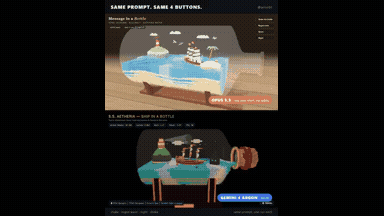</a> 
<strong>Interactive Voxel Ship in a Bottle Diorama</strong> 
Use: Interactive 3D Voxel Physics Diorama Inputs: User inputs not specified by the author Tools: Tool setup not specified by the source 
<a href="https://x.com/arixxbt/status/2110835030964732074">Original post ↗</a> · <a href="../../prompts/2110835030964732074.md">Prompt ↗</a>
<!-- pro-tip:start -->
<blockquote><strong>💡 Pro Tip</strong> <code>a ship sailing through waves inside a bottle, with physics</code>: Define the simulated phenomenon, then add motion rules, parameters and interaction beyond its appearance.</blockquote>
<!-- pro-tip:end -->
</td>
<td width="33%" valign="top">
 
<strong>3D Mediterranean Tsunami Simulation in Three.js</strong> 
Use: Mediterranean Tsunami 3D Simulation Inputs: User inputs not specified by the author Tools: Three.js 
<a href="https://x.com/genuenci/status/2110724865711862155">Original post ↗</a> · <a href="../../prompts/2110724865711862155.md">Prompt ↗</a>
<!-- pro-tip:start -->
<blockquote><strong>💡 Pro Tip</strong> <code>One HTML file</code>: Specify one HTML deliverable for easy browser playback; still check whether the implementation loads external dependencies.</blockquote>
<!-- pro-tip:end -->
</td>
<td width="33%" valign="top">
<a href="../../prompts/2110712475167629442.md">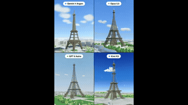</a> 
<strong>3D Eiffel Tower Generation in Three.js</strong> 
Use: 3D Eiffel Tower in Three.js Inputs: User inputs not specified by the author Tools: Three.js 
<a href="https://x.com/AkshayGurav_/status/2110712475167629442">Original post ↗</a> · <a href="../../prompts/2110712475167629442.md">Prompt ↗</a>
<!-- pro-tip:start -->
<blockquote><strong>💡 Pro Tip</strong> <code>build the Eiffel Tower in Paris in Three.js</code>: Name the implementation or rendering tool and prepare its environment; a tool name alone is not a complete workflow.</blockquote>
<!-- pro-tip:end -->
</td>
</tr>
<tr>
<td width="33%" valign="top">
<a href="../../prompts/2110708088680403204.md">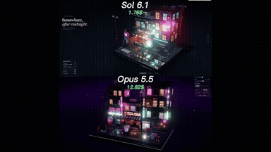</a> 
<strong>Interactive Tokyo Street Alley at Night in the Rain</strong> 
Use: Interactive 3D Tokyo Alley Diorama Inputs: User inputs not specified by the author Tools: Tool setup not specified by the source 
<a href="https://x.com/olezhavich/status/2110708088680403204">Original post ↗</a> · <a href="../../prompts/2110708088680403204.md">Prompt ↗</a>
<!-- pro-tip:start -->
<blockquote><strong>💡 Pro Tip</strong> <code>an interactive Tokyo street alley at night in the rain.</code>: Specify how user input changes state so the result is interactive rather than merely viewable.</blockquote>
<!-- pro-tip:end -->
</td>
<td width="33%" valign="top">
 
<strong>Glim - 3D Animated Short via Blender Python Scripts</strong> 
Use: Character &amp; Environment 3D Animation Short Inputs: User inputs not specified by the author Tools: Blender 5.1 / Python 
<a href="https://x.com/Reena_Lin/status/2110705871755878728">Original post ↗</a> · <a href="../../prompts/2110705871755878728.md">Prompt ↗</a>
<!-- pro-tip:start -->
<blockquote><strong>💡 Pro Tip</strong> <code>No text</code>: Use explicit exclusions to prevent unwanted text, UI or interactions.</blockquote>
<!-- pro-tip:end -->
</td>
<td width="33%" valign="top">
<a href="../../prompts/2110620135245443294.md">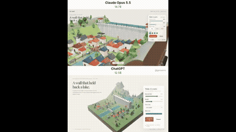</a> 
<strong>Interactive 3D Dam Collapse Simulation</strong> 
Use: Interactive 3D Dam Breach Simulation Inputs: User inputs not specified by the author Tools: Tool setup not specified by the source 
<a href="https://x.com/genuenci/status/2110620135245443294">Original post ↗</a> · <a href="../../prompts/2110620135245443294.md">Prompt ↗</a>
<!-- pro-tip:start -->
<blockquote><strong>💡 Pro Tip</strong> <code>A concrete dam, a mountain lake, a village in the valley below, and a &quot;Break the</code>: The public fragment gives a creative direction only; add subject motion, visual constraints and delivery format without assuming the full production process.</blockquote>
<!-- pro-tip:end -->
</td>
</tr>
<tr>
<td width="33%" valign="top">
<a href="../../prompts/2110613662599942496.md">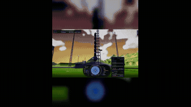</a> 
<strong>Roll Authority Max-Q Vehicle Shake</strong> 
Use: Spaceflight Simulation Dynamic Launch Shake Inputs: User inputs not specified by the author Tools: Tool setup not specified by the source 
<a href="https://x.com/RollAuthGame/status/2110613662599942496">Original post ↗</a> · <a href="../../prompts/2110613662599942496.md">Prompt ↗</a>
<!-- pro-tip:start -->
<blockquote><strong>💡 Pro Tip</strong> <code>i want to FEEL the power of the vehicle.</code>: The public fragment gives a creative direction only; add subject motion, visual constraints and delivery format without assuming the full production process.</blockquote>
<!-- pro-tip:end -->
</td>
<td width="33%" valign="top">
<a href="../../prompts/2110578363069006331.md">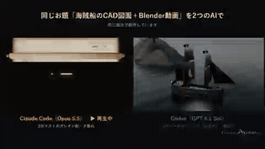</a> 
<strong>Opus 5.5 Blender 3D Pirate Ship Animation and CAD Blueprint</strong> 
Use: Procedural 3D Galleon Modeling and Sunset Animation Inputs: User inputs not specified by the author Tools: Blender 
<a href="https://x.com/Ayu_AI_0912/status/2110578363069006331">Original post ↗</a> · <a href="../../prompts/2110578363069006331.md">Prompt ↗</a>
<!-- pro-tip:start -->
<blockquote><strong>💡 Pro Tip</strong> <code>Blender</code>: Name the implementation or rendering tool and prepare its environment; a tool name alone is not a complete workflow.</blockquote>
<!-- pro-tip:end -->
</td>
<td width="33%" valign="top">
<a href="../../prompts/2110491352311984308.md">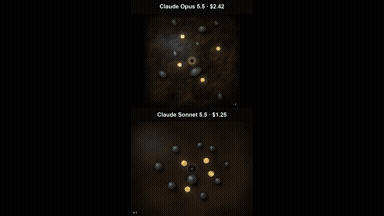</a> 
<strong>Antlight: Glowing Colony Terrarium Simulation</strong> 
Use: Glowing Ant Colony Terrarium Simulation Inputs: User inputs not specified by the author Tools: HTML / Canvas or WebGL 
<a href="https://x.com/jeffbruchado/status/2110491352311984308">Original post ↗</a> · <a href="../../prompts/2110491352311984308.md">Prompt ↗</a>
<!-- pro-tip:start -->
<blockquote><strong>💡 Pro Tip</strong> <code>single self-contained HTML file</code>: Specify one HTML deliverable for easy browser playback; still check whether the implementation loads external dependencies.</blockquote>
<!-- pro-tip:end -->
</td>
</tr>
<tr>
<td width="33%" valign="top">
<a href="../../prompts/2110478089478127834.md">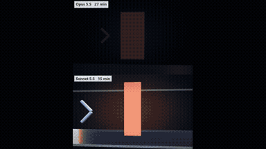</a> 
<strong>Claude Code Mascot 3D Recreation in Three.js</strong> 
Use: Three.js Procedural 3D Mascot Recreation Inputs: User inputs not specified by the author Tools: Three.js / Web Browser / WebGL Engine 
<a href="https://x.com/yurshevv/status/2110478089478127834">Original post ↗</a> · <a href="../../prompts/2110478089478127834.md">Prompt ↗</a>
<!-- pro-tip:start -->
<blockquote><strong>💡 Pro Tip</strong> <code>20 frames of the Claude Code mascot, rebuild it in three.js</code>: Name the implementation or rendering tool and prepare its environment; a tool name alone is not a complete workflow.</blockquote>
<!-- pro-tip:end -->
</td>
<td width="33%" valign="top">
<a href="../../prompts/2110421556031569949.md">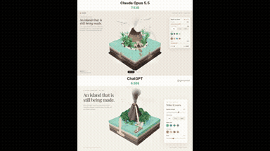</a> 
<strong>Interactive 3D Volcano Island Web Demo</strong> 
Use: Interactive 3D Volcano Island Web Demo Inputs: User inputs not specified by the author Tools: Web Browser / WebGL Canvas 
<a href="https://x.com/genuenci/status/2110421556031569949">Original post ↗</a> · <a href="../../prompts/2110421556031569949.md">Prompt ↗</a>
<!-- pro-tip:start -->
<blockquote><strong>💡 Pro Tip</strong> <code>volcano</code>: Turn the environment into an actionable scene brief with movement direction, density and lighting.</blockquote>
<!-- pro-tip:end -->
</td>
<td width="33%" valign="top">
 
<strong>3D Whale Breaching Scene Comparison</strong> 
Use: 3D Whale Breaching Simulation Inputs: User inputs not specified by the author Tools: Tool setup not specified by the source 
<a href="https://x.com/PrakashAnant3/status/2110413293491831212">Original post ↗</a> · <a href="../../prompts/2110413293491831212.md">Prompt ↗</a>
<!-- pro-tip:start -->
<blockquote><strong>💡 Pro Tip</strong> <code>build a 3D whale breaching scene</code>: Add dimensions, camera views and materials to the spatial brief to reduce guesswork.</blockquote>
<!-- pro-tip:end -->
</td>
</tr>
<tr>
<td width="33%" valign="top">
 
<strong>3D Interactive Winter Cabin Web Scene</strong> 
Use: Tiny 3D Winter Cabin Interactive Web Scene Inputs: User inputs not specified by the author Tools: Tool setup not specified by the source 
<a href="https://x.com/genuenci/status/2110354160986079462">Original post ↗</a> · <a href="../../prompts/2110354160986079462.md">Prompt ↗</a>
<!-- pro-tip:start -->
<blockquote><strong>💡 Pro Tip</strong> <code>Log cabin, snowy pines, a frozen pond, smoking chimney, falling snow, and a panel to change time of day, ice color and snowfall.</code>: Turn the environment into an actionable scene brief with movement direction, density and lighting.</blockquote>
<!-- pro-tip:end -->
</td>
<td width="33%" valign="top">
 
<strong>Interactive 3D LEGO Instructions Viewer (BrickForge)</strong> 
Use: Interactive 3D LEGO Assembly Guide Inputs: User inputs not specified by the author Tools: Tool setup not specified by the source 
<a href="https://x.com/HeyMrOdo/status/2110317136086470729">Original post ↗</a> · <a href="../../prompts/2110317136086470729.md">Prompt ↗</a>
<!-- pro-tip:start -->
<blockquote><strong>💡 Pro Tip</strong> <code>LEGO instructions, but in 3D.</code>: Add dimensions, camera views and materials to the spatial brief to reduce guesswork.</blockquote>
<!-- pro-tip:end -->
</td>
<td width="33%" valign="top">
 
<strong>Aliens Stop for Burgers Three.js Short Animation</strong> 
Use: Aliens Love Earth Burgers 3D Animation Inputs: User inputs not specified by the author Tools: Claude CLI / Three.js 
<a href="https://x.com/shownotover/status/2110274182046953661">Original post ↗</a> · <a href="../../prompts/2110274182046953661.md">Prompt ↗</a>
<!-- pro-tip:start -->
<blockquote><strong>💡 Pro Tip</strong> <code>The story and the prompt: Aliens stop for burgers… but they LOVE the food on Earth too much 😂 A 15-second Three.js short. Both HIGH.</code>: Name the implementation or rendering tool and prepare its environment; a tool name alone is not a complete workflow.</blockquote>
<!-- pro-tip:end -->
</td>
</tr>
<tr>
<td width="33%" valign="top">
 
<strong>Claude Opus 5.5 vs Gemini Argon: Procedural 3D Plush Cat in Thre…</strong> 
Use: Procedural 3D Plush Cat in Three.js Inputs: Photo of author's cat used as visual reference for procedural reconstruction Tools: Three.js 
<a href="https://x.com/geek_zard/status/2110216255474897247">Original post ↗</a> · <a href="../../prompts/2110216255474897247.md">Prompt ↗</a>
<!-- pro-tip:start -->
<blockquote><strong>💡 Pro Tip</strong> <code>single HTML file</code>: Specify one HTML deliverable for easy browser playback; still check whether the implementation loads external dependencies.</blockquote>
<!-- pro-tip:end -->
</td>
<td width="33%" valign="top">
 
<strong>3D Whale Breaching Scene Model Comparison</strong> 
Use: 3D Whale Breaching Animation Inputs: User inputs not specified by the author Tools: Tool setup not specified by the source 
<a href="https://x.com/Bhavani_00007/status/2110078803297055212">Original post ↗</a> · <a href="../../prompts/2110078803297055212.md">Prompt ↗</a>
<!-- pro-tip:start -->
<blockquote><strong>💡 Pro Tip</strong> <code>build a 3D whale breaching scene</code>: Add dimensions, camera views and materials to the spatial brief to reduce guesswork.</blockquote>
<!-- pro-tip:end -->
</td>
<td width="33%" valign="top">
 
<strong>3D Lean Aircraft Manufacturing Simulation with Three.js</strong> 
Use: Interactive 3D Aircraft Factory Simulation Inputs: Airsup lean production books and aircraft manufacturing references Tools: Three.js 
<a href="https://x.com/konstantinsaifo/status/2109989449673347271">Original post ↗</a> · <a href="../../prompts/2109989449673347271.md">Prompt ↗</a>
<!-- pro-tip:start -->
<blockquote><strong>💡 Pro Tip</strong> <code>simulation</code>: Define the simulated phenomenon, then add motion rules, parameters and interaction beyond its appearance.</blockquote>
<!-- pro-tip:end -->
</td>
</tr>
<tr>
<td width="33%" valign="top">
 
<strong>Three.js 治愈雨夜日式便利店 3D 微缩交互场景</strong> 
Use: Three.js 雨夜日式便利店 3D 微缩场景 Inputs: User inputs not specified by the author Tools: Three.js 
<a href="https://x.com/xiax0603/status/2109655631284363289">Original post ↗</a> · <a href="../../prompts/2109655631284363289.md">Prompt ↗</a>
<!-- pro-tip:start -->
<blockquote><strong>💡 Pro Tip</strong> <code>drag</code>: Specify how user input changes state so the result is interactive rather than merely viewable.</blockquote>
<!-- pro-tip:end -->
</td>
<td width="33%" valign="top">
 
<strong>Interactive 3D Seal Aquarium Diorama</strong> 
Use: Interactive 3D Seal Aquarium Inputs: User inputs not specified by the author Tools: Tool setup not specified by the source 
<a href="https://x.com/neet_ai_/status/2109606505666560338">Original post ↗</a> · <a href="../../prompts/2109606505666560338.md">Prompt ↗</a>
<!-- pro-tip:start -->
<blockquote><strong>💡 Pro Tip</strong> <code>/diorama</code>: This is a workflow command whose behavior depends on its supporting skill and project context; obtain that workflow definition before reuse.</blockquote>
<!-- pro-tip:end -->
</td>
<td width="33%" valign="top">
 
<strong>Banana Tree and Shaking Monkey 3D Code Animation</strong> 
Use: 3D Procedural Character and Tree Animation Inputs: User inputs not specified by the author Tools: Tool setup not specified by the source 
<a href="https://x.com/Andr1ycp/status/2109313213678367157">Original post ↗</a> · <a href="../../prompts/2109313213678367157.md">Prompt ↗</a>
<!-- pro-tip:start -->
<blockquote><strong>💡 Pro Tip</strong> <code>a banana tree and a monkey shaking it</code>: Break the requested action into key poses, contact points and speeds; check continuity.</blockquote>
<!-- pro-tip:end -->
</td>
</tr>
<tr>
<td width="33%" valign="top">
 
<strong>Claude's Little Avatar and Dandelion Fluff Animation</strong> 
Use: Character Animation and Gentle 3D Scene Inputs: User inputs not specified by the author Tools: Tool setup not specified by the source 
<a href="https://x.com/Charlotteqozf/status/2109247904351445151">Original post ↗</a> · <a href="../../prompts/2109247904351445151.md">Prompt ↗</a>
<!-- pro-tip:start -->
<blockquote><strong>💡 Pro Tip</strong> <code>Make a video where you appear</code>: Add duration, aspect ratio, assets and delivery format to the short production brief.</blockquote>
<!-- pro-tip:end -->
</td>
<td width="33%" valign="top">
 
<strong>Quadruped Robot Perception &amp; Locomotion Simulation in Three.js</strong> 
Use: Robot Perception and Locomotion Simulation Inputs: User inputs not specified by the author Tools: build123d / MuJoCo / three.js 
<a href="https://x.com/konstantinsaifo/status/2109243587724755158">Original post ↗</a> · <a href="../../prompts/2109243587724755158.md">Prompt ↗</a>
<!-- pro-tip:start -->
<blockquote><strong>💡 Pro Tip</strong> <code>I asked Claude Opus 5.5 to give my robot dog a lidar, two depth cameras and a brain that walks it in a physics sim.</code>: Define the simulated phenomenon, then add motion rules, parameters and interaction beyond its appearance.</blockquote>
<!-- pro-tip:end -->
</td>
<td width="33%" valign="top">
 
<strong>Breaching Whale at Sunrise in Three.js</strong> 
Use: Whale Breaching Sunrise 3D Scene Inputs: User inputs not specified by the author Tools: Three.js 
<a href="https://x.com/Bhavani_00007/status/2108986964615840035">Original post ↗</a> · <a href="../../prompts/2108986964615840035.md">Prompt ↗</a>
<!-- pro-tip:start -->
<blockquote><strong>💡 Pro Tip</strong> <code>build a whale breaching at sunrise in Three.js</code>: Name the implementation or rendering tool and prepare its environment; a tool name alone is not a complete workflow.</blockquote>
<!-- pro-tip:end -->
</td>
</tr>
<tr>
<td width="33%" valign="top">
 
<strong>Interactive 3D Domino Playground</strong> 
Use: Interactive 3D Domino Simulation Inputs: User inputs not specified by the author Tools: Claude Artifacts / Custom physics code 
<a href="https://x.com/madhugogineni97/status/2108928100624896157">Original post ↗</a> · <a href="../../prompts/2108928100624896157.md">Prompt ↗</a>
<!-- pro-tip:start -->
<blockquote><strong>💡 Pro Tip</strong> <code>make a domino playground</code>: The public fragment gives a creative direction only; add subject motion, visual constraints and delivery format without assuming the full production process.</blockquote>
<!-- pro-tip:end -->
</td>
<td width="33%" valign="top">
 
<strong>Interactive 3D DIY Bookshelf in HTML</strong> 
Use: Interactive 3D DIY Bookshelf Visualizer Inputs: Room or DIY shelf specifications and request for blueprints and concept visualization Tools: HTML / WebGL Viewer 
<a href="https://x.com/Ponpara5/status/2108907357166313662">Original post ↗</a> · <a href="../../prompts/2108907357166313662.md">Prompt ↗</a>
<!-- pro-tip:start -->
<blockquote><strong>💡 Pro Tip</strong> <code>Also give me the blueprints and an image illustration while you&#x27;re at it</code>: Supply the reference image or file and state which proportions, colors and structures must stay intact.</blockquote>
<!-- pro-tip:end -->
</td>
<td width="33%" valign="top">
 
<strong>Three.js 3D Logo Intro Studio Generator</strong> 
Use: 3D Logo Motion Intro Inputs: User SVG logo code to be converted into 3D geometry Tools: Google Chrome / three.js 
<a href="https://x.com/juancarlos17626/status/2108663864581558301">Original post ↗</a> · <a href="../../prompts/2108663864581558301.md">Prompt ↗</a>
<!-- pro-tip:start -->
<blockquote><strong>💡 Pro Tip</strong> <code>SINGLE HTML file</code>: Specify one HTML deliverable for easy browser playback; still check whether the implementation loads external dependencies.</blockquote>
<!-- pro-tip:end -->
</td>
</tr>
<tr>
<td width="33%" valign="top">
 
<strong>Interactive Jelly Koi Pond Simulation</strong> 
Use: Interactive Jelly Koi Pond Inputs: User inputs not specified by the author Tools: Tool setup not specified by the source 
<a href="https://x.com/promptlogic_lab/status/2108564740519674082">Original post ↗</a> · <a href="../../prompts/2108564740519674082.md">Prompt ↗</a>
<!-- pro-tip:start -->
<blockquote><strong>💡 Pro Tip</strong> <code>make a jelly koi pond</code>: Turn the environment into an actionable scene brief with movement direction, density and lighting.</blockquote>
<!-- pro-tip:end -->
</td>
<td width="33%" valign="top">
 
<strong>Airplane Landing Animation Comparison</strong> 
Use: Airplane Landing 3D Animation Inputs: User inputs not specified by the author Tools: Tool setup not specified by the source 
<a href="https://x.com/sebmoska/status/2108552389871444113">Original post ↗</a> · <a href="../../prompts/2108552389871444113.md">Prompt ↗</a>
<!-- pro-tip:start -->
<blockquote><strong>💡 Pro Tip</strong> <code>animate an airplane landing.</code>: Break the requested action into key poses, contact points and speeds; check continuity.</blockquote>
<!-- pro-tip:end -->
</td>
<td width="33%" valign="top">
 
<strong>Three.js Morphing Cube and Galaxy Animation</strong> 
Use: Procedural 3D Visualizer Inputs: User inputs not specified by the author Tools: Three.js 
<a href="https://x.com/narukijima/status/2108547315971793119">Original post ↗</a> · <a href="../../prompts/2108547315971793119.md">Prompt ↗</a>
<!-- pro-tip:start -->
<blockquote><strong>💡 Pro Tip</strong> <code>Make something</code>: The public fragment gives a creative direction only; add subject motion, visual constraints and delivery format without assuming the full production process.</blockquote>
<!-- pro-tip:end -->
</td>
</tr>
<tr>
<td width="33%" valign="top">
 
<strong>GPT-6 Astra vs Claude Opus 5.5 Video Lighting Comparison</strong> 
Use: Cinematic Scene Lighting and Video Generation Comparison Inputs: User inputs not specified by the author Tools: Tool setup not specified by the source 
<a href="https://x.com/kinderlayer/status/2108537908583919966">Original post ↗</a> · <a href="../../prompts/2108537908583919966.md">Prompt ↗</a>
<!-- pro-tip:start -->
<blockquote><strong>💡 Pro Tip</strong> <code>A snake across an old rug. A swan through the forest. A dolphin in the deep.</code>: The public fragment gives a creative direction only; add subject motion, visual constraints and delivery format without assuming the full production process.</blockquote>
<!-- pro-tip:end -->
</td>
<td width="33%" valign="top">
 
<strong>Interactive 3D Plush Goat Artifact</strong> 
Use: Interactive 3D Plush Toy Simulation Inputs: User inputs not specified by the author Tools: Claude Artifacts 
<a href="https://x.com/N1njaCodex/status/2108531279473910161">Original post ↗</a> · <a href="../../prompts/2108531279473910161.md">Prompt ↗</a>
<!-- pro-tip:start -->
<blockquote><strong>💡 Pro Tip</strong> <code>make a plush goat</code>: The public fragment gives a creative direction only; add subject motion, visual constraints and delivery format without assuming the full production process.</blockquote>
<!-- pro-tip:end -->
</td>
<td width="33%" valign="top">
 
<strong>Interactive Jelly Koi Pond Simulation with Physics</strong> 
Use: Interactive Jelly Koi Pond Simulation Inputs: User inputs not specified by the author Tools: Tool setup not specified by the source 
<a href="https://x.com/zyroxxx111/status/2108514670411907296">Original post ↗</a> · <a href="../../prompts/2108514670411907296.md">Prompt ↗</a>
<!-- pro-tip:start -->
<blockquote><strong>💡 Pro Tip</strong> <code>make a jelly koi pond</code>: Turn the environment into an actionable scene brief with movement direction, density and lighting.</blockquote>
<!-- pro-tip:end -->
</td>
</tr>
<tr>
<td width="33%" valign="top">
 
<strong>Procedural 3D Elephant in Three.js</strong> 
Use: Procedural 3D Scene Generation Inputs: User inputs not specified by the author Tools: HTML / Browser WebGL / Three.js 
<a href="https://x.com/Thusatharan/status/2108511286795640926">Original post ↗</a> · <a href="../../prompts/2108511286795640926.md">Prompt ↗</a>
<!-- pro-tip:start -->
<blockquote><strong>💡 Pro Tip</strong> <code>one HTML file</code>: Specify one HTML deliverable for easy browser playback; still check whether the implementation loads external dependencies.</blockquote>
<!-- pro-tip:end -->
</td>
<td width="33%" valign="top">
 
<strong>Hraunheim: Interactive 3D Lava River and Volcano in Three.js</strong> 
Use: Interactive 3D Lava River and Gnome Habitat in Three.js Inputs: User inputs not specified by the author Tools: Three.js 
<a href="https://x.com/ottollm/status/2108311732376453546">Original post ↗</a> · <a href="../../prompts/2108311732376453546.md">Prompt ↗</a>
<!-- pro-tip:start -->
<blockquote><strong>💡 Pro Tip</strong> <code>i asked for a river of lava coming down from an erupting volcano. and right next to it a little dome where gnomes live. by the fire. on purpose</code>: Turn the environment into an actionable scene brief with movement direction, density and lighting.</blockquote>
<!-- pro-tip:end -->
</td>
<td width="33%" valign="top">
 
<strong>Interactive 3D Liquid-Cooled AI Hall Concept in Three.js</strong> 
Use: Data Center Infrastructure 3D Walkthrough Inputs: User inputs not specified by the author Tools: Three.js 
<a href="https://x.com/Solvaix/status/2108301527483838465">Original post ↗</a> · <a href="../../prompts/2108301527483838465.md">Prompt ↗</a>
<!-- pro-tip:start -->
<blockquote><strong>💡 Pro Tip</strong> <code>&quot;make the row shorter&quot;, &quot;add a cooling loop&quot;</code>: Define motion phases, speed and the end state so the output changes over time rather than remaining a still scene.</blockquote>
<!-- pro-tip:end -->
</td>
</tr>
<tr>
<td width="33%" valign="top">
 
<strong>Interactive WebGL Lava Lamp in Single HTML</strong> 
Use: WebGL 3D Lava Lamp Simulation Inputs: User inputs not specified by the author Tools: Google Chrome / WebGL / HTML5 Canvas 
<a href="https://x.com/juancarlos17626/status/2108301452384870600">Original post ↗</a> · <a href="../../prompts/2108301452384870600.md">Prompt ↗</a>
<!-- pro-tip:start -->
<blockquote><strong>💡 Pro Tip</strong> <code>SINGLE HTML file</code>: Specify one HTML deliverable for easy browser playback; still check whether the implementation loads external dependencies.</blockquote>
<!-- pro-tip:end -->
</td>
<td width="33%" valign="top">
 
<strong>F1 Pit Stop Procedural Three.js Animation Orchestration</strong> 
Use: Procedural 3D F1 Pit Stop Animation Inputs: User inputs not specified by the author Tools: Claude Haiku 5.5 / Three.js 
<a href="https://x.com/rubenssoto_ai/status/2108289170871582851">Original post ↗</a> · <a href="../../prompts/2108289170871582851.md">Prompt ↗</a>
<!-- pro-tip:start -->
<blockquote><strong>💡 Pro Tip</strong> <code>a 30s cinematic F1 pit stop in Three.js. Detailed car, 8-person crew changing all 4 tyres, synthesized audio, fully procedural.</code>: Name the implementation or rendering tool and prepare its environment; a tool name alone is not a complete workflow.</blockquote>
<!-- pro-tip:end -->
</td>
<td width="33%" valign="top">
 
<strong>Night Monster</strong> 
Use: Cinematic horror creature reveal scene Inputs: User inputs not specified by the author Tools: Claude Opus 5.5 / Higgsfield / Seedance 2.5 
<a href="https://x.com/MadMax_Series/status/2108218235468325374">Original post ↗</a> · <a href="../../prompts/2108218235468325374.md">Prompt ↗</a>
<!-- pro-tip:start -->
<blockquote><strong>💡 Pro Tip</strong> <code>no text</code>: Use explicit exclusions to prevent unwanted text, UI or interactions.</blockquote>
<!-- pro-tip:end -->
</td>
</tr>
<tr>
<td width="33%" valign="top">
 
<strong>Bullistic Ball Drive 3D Running Animation</strong> 
Use: Procedural 3D Character Animation Inputs: User inputs not specified by the author Tools: Tool setup not specified by the source 
<a href="https://x.com/SpikeCalls/status/2107876637534568853">Original post ↗</a> · <a href="../../prompts/2107876637534568853.md">Prompt ↗</a>
<!-- pro-tip:start -->
<blockquote><strong>💡 Pro Tip</strong> <code>make a bull that runs</code>: Break the requested action into key poses, contact points and speeds; check continuity.</blockquote>
<!-- pro-tip:end -->
</td>
<td width="33%" valign="top">
 
<strong>Running Crawler Spider Animation with Opus 5.5</strong> 
Use: 3D Character Animation Inputs: User inputs not specified by the author Tools: Tool setup not specified by the source 
<a href="https://x.com/immortalhowwl/status/2107812780690596105">Original post ↗</a> · <a href="../../prompts/2107812780690596105.md">Prompt ↗</a>
<!-- pro-tip:start -->
<blockquote><strong>💡 Pro Tip</strong> <code>running crawler spider</code>: Break the requested action into key poses, contact points and speeds; check continuity.</blockquote>
<!-- pro-tip:end -->
</td>
<td width="33%" valign="top">
 
<strong>Interactive 3D Live Visitor Analytics Globe</strong> 
Use: Live Visitor Map Visualization Inputs: Cloudflare real-time socket connections and country codes Tools: Tool setup not specified by the source 
<a href="https://x.com/RyanSael/status/2107683152865173619">Original post ↗</a> · <a href="../../prompts/2107683152865173619.md">Prompt ↗</a>
<!-- pro-tip:start -->
<blockquote><strong>💡 Pro Tip</strong> <code>my live visitor count</code>: Use live visitor counts as visual input and supply the data endpoint and refresh rate.</blockquote>
<!-- pro-tip:end -->
</td>
</tr>
<tr>
<td width="33%" valign="top">
 
<strong>Running Cow on Udder</strong> 
Use: 3D Cartoon Character Animation Inputs: User inputs not specified by the author Tools: Tool setup not specified by the source 
<a href="https://x.com/AIMind_Ai/status/2107435499686154557">Original post ↗</a> · <a href="../../prompts/2107435499686154557.md">Prompt ↗</a>
<!-- pro-tip:start -->
<blockquote><strong>💡 Pro Tip</strong> <code>make a cow that runs</code>: Break the requested action into key poses, contact points and speeds; check continuity.</blockquote>
<!-- pro-tip:end -->
</td>
<td width="33%" valign="top">
 
<strong>Maglev Train Journey Through Impossible Worlds</strong> 
Use: Continuous Multi-Environment Sci-Fi Train Journey Inputs: User inputs not specified by the author Tools: Seedance 2.5 / Vidfield 
<a href="https://x.com/HeyAbhishek/status/2106710882567037394">Original post ↗</a> · <a href="../../prompts/2106710882567037394.md">Prompt ↗</a>
<!-- pro-tip:start -->
<blockquote><strong>💡 Pro Tip</strong> <code>NO TEXT</code>: Use explicit exclusions to prevent unwanted text, UI or interactions.</blockquote>
<!-- pro-tip:end -->
</td>
<td width="33%" valign="top">
 
<strong>Inside the Mind of Claude AI Three.js ASCII Animation</strong> 
Use: AI Consciousness ASCII Journey Inputs: User inputs not specified by the author Tools: CapCut / Puppeteer with ffmpeg or CCapture.js / Three.js 
<a href="https://x.com/trikcode/status/2106599643014414696">Original post ↗</a> · <a href="../../prompts/2106599643014414696.md">Prompt ↗</a>
<!-- pro-tip:start -->
<blockquote><strong>💡 Pro Tip</strong> <code>single self-contained HTML file</code>: Specify one HTML deliverable for easy browser playback; still check whether the implementation loads external dependencies.</blockquote>
<!-- pro-tip:end -->
</td>
</tr>
<tr>
<td width="33%" valign="top">
 
<strong>Stained-Glass Maple Leaf 3D Animation Comparison: GPT 6.1 SOL vs…</strong> 
Use: The author compares 3D generation capabilities between GPT 6.1 SOL and Claude Opus 5.5, requesting thin borders, translucent tones, detailed veins, and beveled edges on a rotating stained-glass leaf. Inputs: User inputs not specified by the author Tools: Tool setup not specified by the source 
<a href="https://x.com/abhinavflac/status/2105100907952353560">Original post ↗</a> · <a href="../../prompts/2105100907952353560.md">Prompt ↗</a>
<!-- pro-tip:start -->
<blockquote><strong>💡 Pro Tip</strong> <code>thin borders, translucent tones, detailed veins and beveled edges</code>: Break material appearance into borders, transmission, texture and bevels rather than asking only for realism.</blockquote>
<!-- pro-tip:end -->
</td>
<td width="33%" valign="top">
 
<strong>Interactive 20,000 Water Particle Fluid Simulation Comparison</strong> 
Use: Interactive 2D particle fluid dynamics simulation Inputs: User inputs not specified by the author Tools: Tool setup not specified by the source 
<a href="https://x.com/viewsfrom02108/status/2105086568155304269">Original post ↗</a> · <a href="../../prompts/2105086568155304269.md">Prompt ↗</a>
<!-- pro-tip:start -->
<blockquote><strong>💡 Pro Tip</strong> <code>20,000 water particles, 60 fps</code>: Turn the environment into an actionable scene brief with movement direction, density and lighting.</blockquote>
<!-- pro-tip:end -->
</td>
<td width="33%" valign="top">
 
<strong>NASA Mars Canyon Flight Simulation</strong> 
Use: Mars Canyon Procedural Flight Inputs: User inputs not specified by the author Tools: Claude Code / ffmpeg / Gemini 3.8 Flash TTS / Playwright / Three.js / whisper 
<a href="https://x.com/Mochi_AGI/status/2105049523139850561">Original post ↗</a> · <a href="../../prompts/2105049523139850561.md">Prompt ↗</a>
<!-- pro-tip:start -->
<blockquote><strong>💡 Pro Tip</strong> <code>2m above ground and 550 km/h</code>: Define altitude and speed numerically, then check scene units and camera motion against those values.</blockquote>
<!-- pro-tip:end -->
</td>
</tr>
<tr>
<td width="33%" valign="top">
 
<strong>Interactive Water Balloon Ballistics Simulation with Ray Traced…</strong> 
Use: Interactive 3D ballistics and fluid ray tracing simulation Inputs: User inputs not specified by the author Tools: Tool setup not specified by the source 
<a href="https://x.com/decodedbysania/status/2104859976112206265">Original post ↗</a> · <a href="../../prompts/2104859976112206265.md">Prompt ↗</a>
<!-- pro-tip:start -->
<blockquote><strong>💡 Pro Tip</strong> <code>shoot a bullet in a water balloon</code>: Turn the environment into an actionable scene brief with movement direction, density and lighting.</blockquote>
<!-- pro-tip:end -->
</td>
<td width="33%" valign="top">
 
<strong>Wave Model Psyche Simulation in Three.js</strong> 
Use: Psychological Wave Model Interactive 3D Visualization Inputs: Preprint paper: 'A wave model of interaction between the psyche and environment' (F. Rasheed) Tools: Three.js 
<a href="https://x.com/fabinrasheed/status/2104803951296352610">Original post ↗</a> · <a href="../../prompts/2104803951296352610.md">Prompt ↗</a>
<!-- pro-tip:start -->
<blockquote><strong>💡 Pro Tip</strong> <code>create a mathematically accurate visualisation of the paper</code>: State the teaching or visualization purpose, then add audience, key conclusions and examples; verify facts and data.</blockquote>
<!-- pro-tip:end -->
</td>
<td width="33%" valign="top">
 
<strong>Tokyo Station 3D Architectural Breakdown</strong> 
Use: 3D visualization dissecting Tokyo Station's multi-layered layout generated via Claude Code / Opus 5.5 scripting Blender. Inputs: User inputs not specified by the author Tools: Blender 
<a href="https://x.com/yktgch/status/2104525642121519401">Original post ↗</a> · <a href="../../prompts/2104525642121519401.md">Prompt ↗</a>
<!-- pro-tip:start -->
<blockquote><strong>💡 Pro Tip</strong> <code>I want to try Opus 5.5, so write a prompt for Blender to create a &#x27;Tokyo Station anatomy video&#x27; (starting from Marunouchi building to Yaesu side).</code>: Name the implementation or rendering tool and prepare its environment; a tool name alone is not a complete workflow.</blockquote>
<!-- pro-tip:end -->
</td>
</tr>
<tr>
<td width="33%" valign="top">
 
<strong>Interactive F135 Jet Engine Simulation</strong> 
Use: Author used Claude Opus 5.5 to create an interactive 3D WebGL F135 fighter jet engine model demonstrating internal airflow, combustion, and afterburner plume. Inputs: User inputs not specified by the author Tools: Tool setup not specified by the source 
<a href="https://x.com/konstantinsaifo/status/2104516868182598079">Original post ↗</a> · <a href="../../prompts/2104516868182598079.md">Prompt ↗</a>
<!-- pro-tip:start -->
<blockquote><strong>💡 Pro Tip</strong> <code>explain how a fighter jet engine works by building an interactive F135 you can take apart in your browser.</code>: Specify how user input changes state so the result is interactive rather than merely viewable.</blockquote>
<!-- pro-tip:end -->
</td>
<td width="33%" valign="top">
 
<strong>Microring Resonator Thermal Drift and Controller Simulation</strong> 
Use: Saul Flores Jr. demonstrates an interactive 3D simulation of sunlight heating a microring resonator and controller compensation, created by prompting Claude Opus 5.5. Inputs: User inputs not specified by the author Tools: Tool setup not specified by the source 
<a href="https://x.com/SaulFloresJr/status/2104498456626651380">Original post ↗</a> · <a href="../../prompts/2104498456626651380.md">Prompt ↗</a>
<!-- pro-tip:start -->
<blockquote><strong>💡 Pro Tip</strong> <code>simulate what happens when sunlight hits a microring resonator</code>: Define the simulated phenomenon, then add motion rules, parameters and interaction beyond its appearance.</blockquote>
<!-- pro-tip:end -->
</td>
<td width="33%" valign="top">
 
<strong>Claude Opus 5.5 Unity Rain and Lightning Effect Experiment</strong> 
Use: Unity weather-effects experiment Inputs: Base Unity scene with simple 3D primitives and terrain before weather effects were added. Tools: Tool setup not specified by the source 
<a href="https://x.com/threediveai/status/2104458970865996117">Original post ↗</a> · <a href="../../prompts/2104458970865996117.md">Prompt ↗</a>
<!-- pro-tip:start -->
<blockquote><strong>💡 Pro Tip</strong> <code>rain expression</code>: Turn the environment into an actionable scene brief with movement direction, density and lighting.</blockquote>
<!-- pro-tip:end -->
</td>
</tr>
<tr>
<td width="33%" valign="top">
 
<strong>Toyota Prius 2027 3D Disassembly and Animation in Blender</strong> 
Use: 3D modeling and exploded-view animation of a Toyota Prius 2027 in Blender, showing disassembly into 261 pieces, reassembly, and rainbow to mustard color shifting, led by Claude Opus 5.5 with assistance from GPT-Astra and Gemini. Inputs: User inputs not specified by the author Tools: Tool setup not specified by the source 
<a href="https://x.com/abxda/status/2104410894167916709">Original post ↗</a> · <a href="../../prompts/2104410894167916709.md">Prompt ↗</a>
<!-- pro-tip:start -->
<blockquote><strong>💡 Pro Tip</strong> <code>3D</code>: Add dimensions, camera views and materials to the spatial brief to reduce guesswork.</blockquote>
<!-- pro-tip:end -->
</td>
<td width="33%" valign="top">
 
<strong>Porco Rosso Sunset Dogfight Web3D</strong> 
Use: A Web3D prompt used with Opus 5.5 and Three.js to recreate the classic dogfight scene from Hayao Miyazaki's 'Porco Rosso' over a sunset sea. Inputs: User inputs not specified by the author Tools: Tool setup not specified by the source 
<a href="https://x.com/NFT_Chen/status/2103882415299350878">Original post ↗</a> · <a href="../../prompts/2103882415299350878.md">Prompt ↗</a>
<!-- pro-tip:start -->
<blockquote><strong>💡 Pro Tip</strong> <code>sea</code>: Turn the environment into an actionable scene brief with movement direction, density and lighting.</blockquote>
<!-- pro-tip:end -->
</td>
<td width="33%" valign="top">
 
<strong>3D Forest Conservation Website</strong> 
Use: A 3D website for a forest conservation agency generated in a single HTML file using Opus 5.5 based on a Pinterest reference. Inputs: User inputs not specified by the author Tools: Tool setup not specified by the source 
<a href="https://x.com/Souradip3000/status/2103876499262800291">Original post ↗</a> · <a href="../../prompts/2103876499262800291.md">Prompt ↗</a>
<!-- pro-tip:start -->
<blockquote><strong>💡 Pro Tip</strong> <code>create a website for forest conservation agency with pinterest post as reference for 3D animation</code>: Supply the reference image or file and state which proportions, colors and structures must stay intact.</blockquote>
<!-- pro-tip:end -->
</td>
</tr>
<tr>
<td width="33%" valign="top">
 
<strong>AI Data Centre 3D Motion Graphic</strong> 
Use: A prompt given to Claude Opus 5.5 to generate a 3D browser animation inside a single HTML file showing what happens inside an AI data center down to the Blackwell silicon. Inputs: User inputs not specified by the author Tools: Tool setup not specified by the source 
<a href="https://x.com/mdaman010/status/2103845689713111079">Original post ↗</a> · <a href="../../prompts/2103845689713111079.md">Prompt ↗</a>
<!-- pro-tip:start -->
<blockquote><strong>💡 Pro Tip</strong> <code>Show me what goes on inside an AI data centre.</code>: Identify the teaching or research subject, then supply sources, audience and key conclusions before scripting.</blockquote>
<!-- pro-tip:end -->
</td>
<td width="33%" valign="top">
 
<strong>AI Data Centre 3D Film</strong> 
Use: A simple prompt given to Claude Opus to generate an animated 3D walkthrough showing what happens inside an AI data center from the grid down to silicon. Inputs: User inputs not specified by the author Tools: Tool setup not specified by the source 
<a href="https://x.com/Sayan_shanky/status/2103736579449868515">Original post ↗</a> · <a href="../../prompts/2103736579449868515.md">Prompt ↗</a>
<!-- pro-tip:start -->
<blockquote><strong>💡 Pro Tip</strong> <code>show me what goes on inside an AI data centre.</code>: Identify the teaching or research subject, then supply sources, audience and key conclusions before scripting.</blockquote>
<!-- pro-tip:end -->
</td>
<td width="33%" valign="top">
 
<strong>Creative Front-End and Video Generation</strong> 
Use: A creative prompt asking the AI model to freely select a theme tailored to the user's interests, generating both a 30-second video and an interactive HTML page to showcase its front-end capabilities. Inputs: User inputs not specified by the author Tools: Tool setup not specified by the source 
<a href="https://x.com/DemitiyaGeekzen/status/2103517910274818523">Original post ↗</a> · <a href="../../prompts/2103517910274818523.md">Prompt ↗</a>
<!-- pro-tip:start -->
<blockquote><strong>💡 Pro Tip</strong> <code>30-second video</code>: Set a duration budget, then allocate shots and motion to fit it.</blockquote>
<!-- pro-tip:end -->
</td>
</tr>
<tr>
<td width="33%" valign="top">
 
<strong>GLSL Fishbowl in Three.js</strong> 
Use: A prompt used to evaluate Claude Opus 5.5 on generating GLSL shaders in Three.js, focusing on refraction, reflection, and water caustics. Inputs: User inputs not specified by the author Tools: Tool setup not specified by the source 
<a href="https://x.com/NicolaManzini/status/2103499771206156628">Original post ↗</a> · <a href="../../prompts/2103499771206156628.md">Prompt ↗</a>
<!-- pro-tip:start -->
<blockquote><strong>💡 Pro Tip</strong> <code>reflection, refraction and water caustics</code>: Break realism into reflection, refraction and caustics rather than requesting only transparent material.</blockquote>
<!-- pro-tip:end -->
</td>
<td width="33%" valign="top">
 
<strong>3D Pagoda Navigation</strong> 
Use: A creative coding prompt used with Claude Opus 5.5 to generate an interactive 3D pagoda navigation world in a single shot. Inputs: User inputs not specified by the author Tools: Tool setup not specified by the source 
<a href="https://x.com/BuildFastWithAI/status/2103483174957597035">Original post ↗</a> · <a href="../../prompts/2103483174957597035.md">Prompt ↗</a>
<!-- pro-tip:start -->
<blockquote><strong>💡 Pro Tip</strong> <code>Implement code to be able to navigate in a pagoda in 3D.</code>: Add dimensions, camera views and materials to the spatial brief to reduce guesswork.</blockquote>
<!-- pro-tip:end -->
</td>
<td width="33%" valign="top">
 
<strong>3D Animation of Gradient Descent</strong> 
Use: A prompt requesting Claude Opus to generate a 3D animation illustrating gradient descent with a ball moving from crest to trough, along with explanations and a specific color scheme. Inputs: User inputs not specified by the author Tools: Tool setup not specified by the source 
<a href="https://x.com/anirockshady/status/2103195903012032809">Original post ↗</a> · <a href="../../prompts/2103195903012032809.md">Prompt ↗</a>
<!-- pro-tip:start -->
<blockquote><strong>💡 Pro Tip</strong> <code>3D</code>: Add dimensions, camera views and materials to the spatial brief to reduce guesswork.</blockquote>
<!-- pro-tip:end -->
</td>
</tr>
<tr>
<td width="33%" valign="top">
 
<strong>Cinematic Browser-Based 3D World</strong> 
Use: Explorable cinematic 3D world Inputs: User inputs not specified by the author Tools: Tool setup not specified by the source 
<a href="https://x.com/LexnLin/status/2103194052850241739">Original post ↗</a> · <a href="../../prompts/2103194052850241739.md">Prompt ↗</a>
<!-- pro-tip:start -->
<blockquote><strong>💡 Pro Tip</strong> <code>This is not a game and not combat-focused</code>: Exclude combat and quests to focus the scene on exploration, architecture, atmosphere and discovery.</blockquote>
<!-- pro-tip:end -->
</td>
<td width="33%" valign="top">
 
<strong>Viral Video Physics Simulation</strong> 
Use: A prompt given to Claude Opus asking it to create a video designed to go viral, leading to a coded physics simulation and synthesizer synchronized with Für Elise. Inputs: User inputs not specified by the author Tools: Tool setup not specified by the source 
<a href="https://x.com/kantamk/status/2103148907228176511">Original post ↗</a> · <a href="../../prompts/2103148907228176511.md">Prompt ↗</a>
<!-- pro-tip:start -->
<blockquote><strong>💡 Pro Tip</strong> <code>make a video that could go viral.</code>: Add duration, aspect ratio, assets and delivery format to the short production brief.</blockquote>
<!-- pro-tip:end -->
</td>
<td width="33%" valign="top">
 
<strong>Pelican Riding a Bicycle Animation</strong> 
Use: Detailed character animation Inputs: User inputs not specified by the author Tools: Tool setup not specified by the source 
<a href="https://x.com/AxtonLiu/status/2103119648271290566">Original post ↗</a> · <a href="../../prompts/2103119648271290566.md">Prompt ↗</a>
<!-- pro-tip:start -->
<blockquote><strong>💡 Pro Tip</strong> <code>pelican riding a bicycle</code>: Use the same subject and action for comparison; add pedal and wheel coordination when reusing the short brief.</blockquote>
<!-- pro-tip:end -->
</td>
</tr>
<tr>
<td width="33%" valign="top">
 
<strong>Interactive 3D Taj Mahal in Three.js</strong> 
Use: Prompt used with Opus 5.5 to generate an interactive, detailed 3D model of the Taj Mahal with an exploded architectural view in a single HTML file using Three.js. Inputs: User inputs not specified by the author Tools: Three.js 
<a href="https://x.com/CurieuxExplorer/status/2103038625483272483">Original post ↗</a> · <a href="../../prompts/2103038625483272483.md">Prompt ↗</a>
<!-- pro-tip:start -->
<blockquote><strong>💡 Pro Tip</strong> <code>single HTML file</code>: Specify one HTML deliverable for easy browser playback; still check whether the implementation loads external dependencies.</blockquote>
<!-- pro-tip:end -->
</td>
<td width="33%" valign="top">
 
<strong>3D Water Simulation Benchmark</strong> 
Use: Claude Opus 5.5 runs a benchmark task to generate a 3D procedural water simulation with terrain, rain, streams, and lakes using TypeScript and Three.js. Inputs: User inputs not specified by the author Tools: Three.js 
<a href="https://x.com/StephanFerraro/status/2103020274107224281">Original post ↗</a> · <a href="../../prompts/2103020274107224281.md">Prompt ↗</a>
<!-- pro-tip:start -->
<blockquote><strong>💡 Pro Tip</strong> <code>Three.js</code>: Name the implementation or rendering tool and prepare its environment; a tool name alone is not a complete workflow.</blockquote>
<!-- pro-tip:end -->
</td>
<td width="33%" valign="top">
 
<strong>Interactive Explosion Simulation</strong> 
Use: A creative coding prompt instructing the AI to generate an advanced interactive explosion effect and unique environment with dynamic force propagation and visual aftermath. Inputs: User inputs not specified by the author Tools: Tool setup not specified by the source 
<a href="https://x.com/FornYapayZeka/status/2102971287224135914">Original post ↗</a> · <a href="../../prompts/2102971287224135914.md">Prompt ↗</a>
<!-- pro-tip:start -->
<blockquote><strong>💡 Pro Tip</strong> <code>product</code>: Provide product assets, one key selling point and a closing action for a focused commercial presentation.</blockquote>
<!-- pro-tip:end -->
</td>
</tr>
<tr>
<td width="33%" valign="top">
 
<strong>Stylistic 3D Particle Santa Monica Beach</strong> 
Use: A prompt used with Claude Opus 5.5 to generate an interactive 3D WebGL particle illustration of Santa Monica beach that adapts to the time of day. Inputs: User inputs not specified by the author Tools: Tool setup not specified by the source 
<a href="https://x.com/ishuagra02/status/2102920408743678129">Original post ↗</a> · <a href="../../prompts/2102920408743678129.md">Prompt ↗</a>
<!-- pro-tip:start -->
<blockquote><strong>💡 Pro Tip</strong> <code>particle</code>: Define the simulated phenomenon, then add motion rules, parameters and interaction beyond its appearance.</blockquote>
<!-- pro-tip:end -->
</td>
<td width="33%" valign="top">
 
<strong>Interactive Fireworks and Particle Simulation</strong> 
Use: A creative coding prompt instructing the AI to design and build an impressive, cinematic fireworks or light particle show with depth, dynamic lighting, and interactive replay capabilities. Inputs: User inputs not specified by the author Tools: Tool setup not specified by the source 
<a href="https://x.com/FornYapayZeka/status/2102888241443795431">Original post ↗</a> · <a href="../../prompts/2102888241443795431.md">Prompt ↗</a>
<!-- pro-tip:start -->
<blockquote><strong>💡 Pro Tip</strong> <code>product</code>: Provide product assets, one key selling point and a closing action for a focused commercial presentation.</blockquote>
<!-- pro-tip:end -->
</td>
<td width="33%" valign="top">
 
<strong>Browser Minecraft Recreation</strong> 
Use: A detailed prompt for Claude Opus 5.5 and PINOC MCP to generate a playable, browser-based Minecraft recreation with Three.js shaders and animated voxel NPCs. Inputs: User inputs not specified by the author Tools: Three.js 
<a href="https://x.com/Viggle_PINOC/status/2102861939072434495">Original post ↗</a> · <a href="../../prompts/2102861939072434495.md">Prompt ↗</a>
<!-- pro-tip:start -->
<blockquote><strong>💡 Pro Tip</strong> <code>three.js</code>: Name the implementation or rendering tool and prepare its environment; a tool name alone is not a complete workflow.</blockquote>
<!-- pro-tip:end -->
</td>
</tr>
<tr>
<td width="33%" valign="top">
 
<strong>Interactive 3D STEP File CAD Viewer</strong> 
Use: STEP CAD Interactive 3D Viewer Inputs: STEP AP203 CAD file with 65 bodies and 2,595 B-rep faces (201 x 161 x 488 mm) Tools: Tool setup not specified by the source 
<a href="https://x.com/profpicsou/status/2102715938671878156">Original post ↗</a> · <a href="../../prompts/2102715938671878156.md">Prompt ↗</a>
<!-- pro-tip:start -->
<blockquote><strong>💡 Pro Tip</strong> <code>give me the 3D visual</code>: Add dimensions, camera views and materials to the spatial brief to reduce guesswork.</blockquote>
<!-- pro-tip:end -->
</td>
<td width="33%" valign="top">
 
<strong>1906 San Francisco Market Street Blender Reconstruction</strong> 
Use: Historical 3D reconstruction Inputs: User inputs not specified by the author Tools: Blender 
<a href="https://x.com/alexalbert__/status/2102466523164274839">Original post ↗</a> · <a href="../../prompts/2102466523164274839.md">Prompt ↗</a>
<!-- pro-tip:start -->
<blockquote><strong>💡 Pro Tip</strong> <code>Before modeling anything, build a source file</code>: Build a historical source file before modeling so architectural details can be checked against evidence.</blockquote>
<!-- pro-tip:end -->
</td><td></td>
</tr>
</table>

[Back to gallery](../../README.md)
