# canvas-interactive

<table>
<tr>
<td width="33%" valign="top">
<a href="../../prompts/2109198771712303213.md">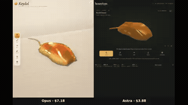</a> 
<strong>Interactive Honey Jelly Computer Mouse</strong> 
Use: Interactive 3D Honey Jelly Mouse Inputs: User inputs not specified by the author Tools: Tool setup not specified by the source 
<a href="https://x.com/keydol123/status/2109198771712303213">Original post ↗</a> · <a href="../../prompts/2109198771712303213.md">Prompt ↗</a>
<!-- pro-tip:start -->
<blockquote><strong>💡 Pro Tip / 核心咒语</strong> <code>Build an interactive computer mouse made entirely of honey jelly.</code>：把用户操作纳入目标；复用时明确操作触发什么状态变化，避免只得到可观看的静态场景。</blockquote>
<!-- pro-tip:end -->
</td>
<td width="33%" valign="top">
<a href="../../prompts/2108936150681305270.md">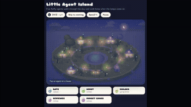</a> 
<strong>Little Agent Island: Cozy Interactive AI Agent World</strong> 
Use: Interactive Agent Observability World Inputs: No external assets required by the prompt Tools: HTML/Canvas/SVG/CSS 
<a href="https://x.com/kinderlayer/status/2108936150681305270">Original post ↗</a> · <a href="../../prompts/2108936150681305270.md">Prompt ↗</a>
<!-- pro-tip:start -->
<blockquote><strong>💡 Pro Tip / 核心咒语</strong> <code>No external assets</code>：把外部依赖排除出实现范围，减少缺失素材、未安装库或网络请求导致的运行问题。</blockquote>
<!-- pro-tip:end -->
</td>
<td width="33%" valign="top">
<a href="../../prompts/2108902793797091808.md">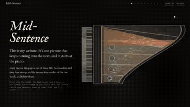</a> 
<strong>Interactive Web Experience 'Mid-Sentence' Built</strong> 
Use: Interactive Procedural Web Artwork Inputs: User inputs not specified by the author Tools: Claude Code / JavaScript 
<a href="https://x.com/chetaslua/status/2108902793797091808">Original post ↗</a> · <a href="../../prompts/2108902793797091808.md">Prompt ↗</a>
<!-- pro-tip:start -->
<blockquote><strong>💡 Pro Tip / 核心咒语</strong> <code>website</code>：明确界面展示的对象；复用时补充内容层级、状态变化和真实数据，避免只有静态装饰。</blockquote>
<!-- pro-tip:end -->
</td>
</tr>
<tr>
<td width="33%" valign="top">
<a href="../../prompts/2108637690698633713.md">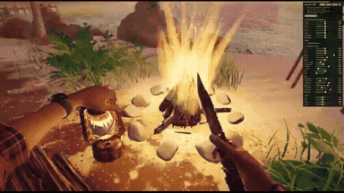</a> 
<strong>First-Person 3D Procedural Arms and Dynamic Grip Rigging in Thre…</strong> 
Use: Procedural First-Person Rigging &amp; Three.js Shader Implementation Inputs: Existing Three.js game codebase with item meshes, public arm API facade, and game world environment Tools: MPFB2 / Three.js 
<a href="https://x.com/maxt3chno/status/2108637690698633713">Original post ↗</a> · <a href="../../prompts/2108637690698633713.md">Prompt ↗</a>
<!-- pro-tip:start -->
<blockquote><strong>💡 Pro Tip / 核心咒语</strong> <code>Three.js</code>：点名实现或渲染工具，减少技术路线漂移；复用时准备相应环境，不能把工具名当作完整制作步骤。</blockquote>
<!-- pro-tip:end -->
</td>
<td width="33%" valign="top">
<a href="../../prompts/2108520350908916007.md">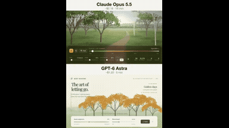</a> 
<strong>Interactive Fall Foliage Simulator Comparison: Claude Opus 5.5 v…</strong> 
Use: Fall Foliage Interactive Browser Simulator Inputs: User inputs not specified by the author Tools: Tool setup not specified by the source 
<a href="https://x.com/maker_evan/status/2108520350908916007">Original post ↗</a> · <a href="../../prompts/2108520350908916007.md">Prompt ↗</a>
<!-- pro-tip:start -->
<blockquote><strong>💡 Pro Tip / 核心咒语</strong> <code>Create an interactive fall foliage simulator as a polished browser experience</code>：把用户操作纳入目标；复用时明确操作触发什么状态变化，避免只得到可观看的静态场景。</blockquote>
<!-- pro-tip:end -->
</td>
<td width="33%" valign="top">
<a href="../../prompts/2108505251036774875.md">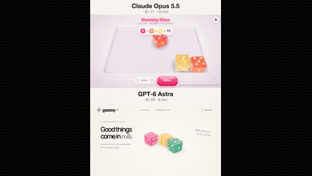</a> 
<strong>Interactive 3D Gummy Dice Browser Experience</strong> 
Use: Interactive 3D Gummy Dice Experience Inputs: User inputs not specified by the author Tools: Tool setup not specified by the source 
<a href="https://x.com/maker_evan/status/2108505251036774875">Original post ↗</a> · <a href="../../prompts/2108505251036774875.md">Prompt ↗</a>
<!-- pro-tip:start -->
<blockquote><strong>💡 Pro Tip / 核心咒语</strong> <code>Create an interactive 3D gummy dice experience in the browser</code>：把用户操作纳入目标；复用时明确操作触发什么状态变化，避免只得到可观看的静态场景。</blockquote>
<!-- pro-tip:end -->
</td>
</tr>
<tr>
<td width="33%" valign="top">
<a href="../../prompts/2108336208891801999.md">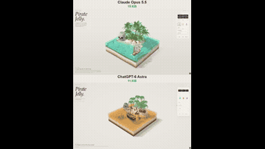</a> 
<strong>Pirate Jelly Interactive WebGPU Diorama</strong> 
Use: Procedural WebGPU Jelly Pirate Cove Diorama Inputs: User inputs not specified by the author Tools: Claude Artifacts / WebGPU / WGSL 
<a href="https://x.com/vib3coded/status/2108336208891801999">Original post ↗</a> · <a href="../../prompts/2108336208891801999.md">Prompt ↗</a>
<!-- pro-tip:start -->
<blockquote><strong>💡 Pro Tip / 核心咒语</strong> <code>Single HTML file</code>：明确交付一个 HTML 文件，便于保存和在浏览器打开；仍需检查实际是否引入了外部依赖。</blockquote>
<!-- pro-tip:end -->
</td>
<td width="33%" valign="top">
<a href="../../prompts/2108275570534707601.md">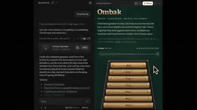</a> 
<strong>Interactive Ombak Balinese Gamelan Simulator</strong> 
Use: Balinese Gamelan Interactive Audio-Visual Simulator Inputs: User inputs not specified by the author Tools: Claude Artifacts 
<a href="https://x.com/yulikay/status/2108275570534707601">Original post ↗</a> · <a href="../../prompts/2108275570534707601.md">Prompt ↗</a>
<!-- pro-tip:start -->
<blockquote><strong>💡 Pro Tip / 核心咒语</strong> <code>Surprise me</code>：公开片段只给出创作方向；复用时补充主体动作、画面约束和交付格式，不能据此推断完整制作过程。</blockquote>
<!-- pro-tip:end -->
</td>
<td width="33%" valign="top">
<a href="../../prompts/2108257115026649419.md">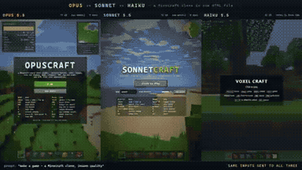</a> 
<strong>Opus 5.5 Single-File Raw WebGL2 Minecraft Clone Comparison</strong> 
Use: Minecraft voxel engine clone in single HTML file Inputs: User inputs not specified by the author Tools: HTML5 / JavaScript / WebGL2 
<a href="https://x.com/sgarlen01/status/2108257115026649419">Original post ↗</a> · <a href="../../prompts/2108257115026649419.md">Prompt ↗</a>
<!-- pro-tip:start -->
<blockquote><strong>💡 Pro Tip / 核心咒语</strong> <code>make a minecraft clone. insane quality</code>：给出玩法或游戏参考；复用时明确核心操作、目标和失败条件，避免只复刻外观。</blockquote>
<!-- pro-tip:end -->
</td>
</tr>
<tr>
<td width="33%" valign="top">
<a href="../../prompts/2108195714081738990.md">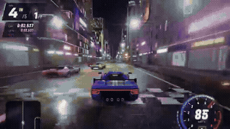</a> 
<strong>NFS-Inspired 3D Racing Game Demo in Three.js</strong> 
Use: Interactive 3D Racing Game Demo Inputs: User inputs not specified by the author Tools: Three.js 
<a href="https://x.com/buzzybats/status/2108195714081738990">Original post ↗</a> · <a href="../../prompts/2108195714081738990.md">Prompt ↗</a>
<!-- pro-tip:start -->
<blockquote><strong>💡 Pro Tip / 核心咒语</strong> <code>Create a hyper-realistic NFS-inspired racing game (one highly polished, fully playable demo scene)</code>：先限定玩法类型或参与方式；复用时补齐操作、规则和胜负条件，才能从场景变成可玩的系统。</blockquote>
<!-- pro-tip:end -->
</td>
<td width="33%" valign="top">
<a href="../../prompts/2105090561023901698.md">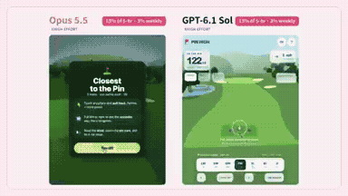</a> 
<strong>Three.js 3D Closest to the Pin Golf Game Comparison</strong> 
Use: Game / playable prototype Inputs: User inputs not specified by the author Tools: Tool setup not specified by the source 
<a href="https://x.com/Kyler_Lorin/status/2105090561023901698">Original post ↗</a> · <a href="../../prompts/2105090561023901698.md">Prompt ↗</a>
<!-- pro-tip:start -->
<blockquote><strong>💡 Pro Tip / 核心咒语</strong> <code>pull to shoot, and mobile first</code>：直接指定拖拽蓄力击球与手机优先，让操作设计服务于具体手势而非桌面鼠标假设。</blockquote>
<!-- pro-tip:end -->
</td>
<td width="33%" valign="top">
<a href="../../prompts/2105086032005726712.md">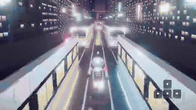</a> 
<strong>3D Neon City Robot Endless Runner Game</strong> 
Use: Game / playable prototype Inputs: User inputs not specified by the author Tools: Tool setup not specified by the source 
<a href="https://x.com/aichrislee/status/2105086032005726712">Original post ↗</a> · <a href="../../prompts/2105086032005726712.md">Prompt ↗</a>
<!-- pro-tip:start -->
<blockquote><strong>💡 Pro Tip / 核心咒语</strong> <code>One HTML file</code>：明确交付一个 HTML 文件，便于保存和在浏览器打开；仍需检查实际是否引入了外部依赖。</blockquote>
<!-- pro-tip:end -->
</td>
</tr>
<tr>
<td width="33%" valign="top">
<a href="../../prompts/2104920915112829231.md">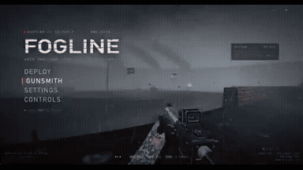</a> 
<strong>Bodycam FPS 'Fogline' Built with Three.js and Web Shaders</strong> 
Use: Browser-based 3D bodycam shooter game Inputs: User inputs not specified by the author Tools: Browser renderer test harness / Three.js / Web Shaders 
<a href="https://x.com/superalesha/status/2104920915112829231">Original post ↗</a> · <a href="../../prompts/2104920915112829231.md">Prompt ↗</a>
<!-- pro-tip:start -->
<blockquote><strong>💡 Pro Tip / 核心咒语</strong> <code>ThreeJS</code>：点名实现或渲染工具，减少技术路线漂移；复用时准备相应环境，不能把工具名当作完整制作步骤。</blockquote>
<!-- pro-tip:end -->
</td>
<td width="33%" valign="top">
 
<strong>Interactive 2D/3D Floor Plan and Interior Design Web Tool</strong> 
Use: Interactive floor-plan design tool Inputs: Floor plan image with millimeter dimension annotations Tools: Three.js 
<a href="https://x.com/akokoi1/status/2104520072014508316">Original post ↗</a> · <a href="../../prompts/2104520072014508316.md">Prompt ↗</a>
<!-- pro-tip:start -->
<blockquote><strong>💡 Pro Tip / 核心咒语</strong> <code>according to the dimension markings (mm) in the image</code>：把平面图尺寸和毫米单位设为建模依据，避免房间与家具只在视觉上相似、比例却不一致。</blockquote>
<!-- pro-tip:end -->
</td>
<td width="33%" valign="top">
 
<strong>Interactive Rain Window Calming App</strong> 
Use: Calming rain interaction Inputs: User inputs not specified by the author Tools: Tool setup not specified by the source 
<a href="https://x.com/d_llm_kr/status/2104189915693269112">Original post ↗</a> · <a href="../../prompts/2104189915693269112.md">Prompt ↗</a>
<!-- pro-tip:start -->
<blockquote><strong>💡 Pro Tip / 核心咒语</strong> <code>while listening to the sound of rain</code>：把观看与互动放在雨声陪伴的使用场景中；复用时补充音源和操作方式，避免只得到静态背景。</blockquote>
<!-- pro-tip:end -->
</td>
</tr>
<tr>
<td width="33%" valign="top">
 
<strong>Vincent's Cats: 3D Starry Night Game</strong> 
Use: 3D exploration game / hidden cats Inputs: User inputs not specified by the author Tools: Claude Code 
<a href="https://x.com/MandelDuck/status/2103802923465768972">Original post ↗</a> · <a href="../../prompts/2103802923465768972.md">Prompt ↗</a>
<!-- pro-tip:start -->
<blockquote><strong>💡 Pro Tip / 核心咒语</strong> <code>walk around and spot cats inside of a van gogh painting</code>：将画作风格与“漫游找猫”的具体玩法绑定，给场景设计和交互一个共同目标。</blockquote>
<!-- pro-tip:end -->
</td>
<td width="33%" valign="top">
 
<strong>Interactive Stroke-by-Stroke Photo Painter App</strong> 
Use: Procedural Photo Painting Web App Inputs: Landscape photo of Golden Gate Bridge at sunset Tools: HTML5 Canvas / JavaScript 
<a href="https://x.com/betancur/status/2103641070299218145">Original post ↗</a> · <a href="../../prompts/2103641070299218145.md">Prompt ↗</a>
<!-- pro-tip:start -->
<blockquote><strong>💡 Pro Tip / 核心咒语</strong> <code>repaint it stroke by stroke</code>：要求展示逐笔重绘过程，使绘画成为可观看的时间序列，而不只是输出完成图。</blockquote>
<!-- pro-tip:end -->
</td>
<td width="33%" valign="top">
<a href="../../prompts/2103086714772463953.md">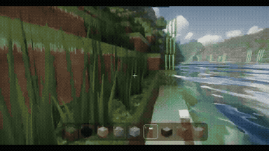</a> 
<strong>Ultra-Realistic Browser Voxel Engine</strong> 
Use: Browser 3D Voxel Engine Game Inputs: User inputs not specified by the author Tools: Three.js / WebGL2 
<a href="https://x.com/oviniciuslana/status/2103086714772463953">Original post ↗</a> · <a href="../../prompts/2103086714772463953.md">Prompt ↗</a>
<!-- pro-tip:start -->
<blockquote><strong>💡 Pro Tip / 核心咒语</strong> <code>create an ultra-realistic game engine without using libs and then create an ultra-realistic minecraft-style game that runs in the browser in html</code>：给出玩法或游戏参考；复用时明确核心操作、目标和失败条件，避免只复刻外观。</blockquote>
<!-- pro-tip:end -->
</td>
</tr>
<tr>
<td width="33%" valign="top">
<a href="../../prompts/2102493035393372363.md">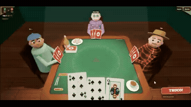</a> 
<strong>3D Truco Mineiro HTML Card Game</strong> 
Use: Interactive 3D Truco Mineiro Game Inputs: User inputs not specified by the author Tools: HTML5 / WebGL 
<a href="https://x.com/oviniciuslana/status/2102493035393372363">Original post ↗</a> · <a href="../../prompts/2102493035393372363.md">Prompt ↗</a>
<!-- pro-tip:start -->
<blockquote><strong>💡 Pro Tip / 核心咒语</strong> <code>create a truco mineiro game in html with all the details in 3d</code>：限定空间建模或三维展示方向；复用时补充尺寸、视角和材质，减少模型对空间细节的猜测。</blockquote>
<!-- pro-tip:end -->
</td>
<td width="33%" valign="top">
<a href="../../prompts/2110014984549986485.md">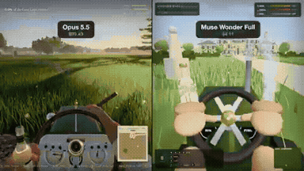</a> 
<strong>3D Lawn Mower Simulator Comparison: Claude Opus 5.5 vs Muse</strong> 
Use: 3D Lawn Mower Simulator Game Inputs: User inputs not specified by the author Tools: Tool setup not specified by the source 
<a href="https://x.com/aiquantum3/status/2110014984549986485">Original post ↗</a> · <a href="../../prompts/2110014984549986485.md">Prompt ↗</a>
<!-- pro-tip:start -->
<blockquote><strong>💡 Pro Tip / 核心咒语</strong> <code>goal is to build me a triple aaa level lawn mower simulator i can drink beer and smoke a cigar.</code>：给出玩法或游戏参考；复用时明确核心操作、目标和失败条件，避免只复刻外观。</blockquote>
<!-- pro-tip:end -->
</td>
<td width="33%" valign="top">
<a href="../../prompts/2109388484569924030.md">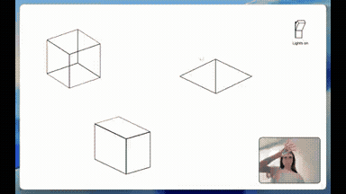</a> 
<strong>Interactive 3D Hand Gestures with Framer and MediaPipe</strong> 
Use: Interactive 3D gesture manipulation Inputs: User webcam feed for real-time MediaPipe hand tracking Tools: Framer / Google MediaPipe 
<a href="https://x.com/emili_iv/status/2109388484569924030">Original post ↗</a> · <a href="../../prompts/2109388484569924030.md">Prompt ↗</a>
<!-- pro-tip:start -->
<blockquote><strong>💡 Pro Tip / 核心咒语</strong> <code>click</code>：把用户操作纳入目标；复用时明确操作触发什么状态变化，避免只得到可观看的静态场景。</blockquote>
<!-- pro-tip:end -->
</td>
</tr>
<tr>
<td width="33%" valign="top">
<a href="../../prompts/2108951077991362922.md">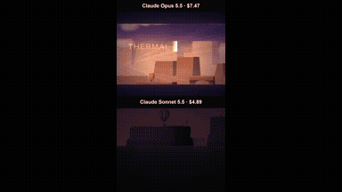</a> 
<strong>Thermal Courier: Dawn Balloon Mail Run Canvas Game &amp; Trailer</strong> 
Use: Thermal Courier Procedural Canvas Game and Trailer Inputs: User inputs not specified by the author Tools: HTML5 Canvas 
<a href="https://x.com/jeffbruchado/status/2108951077991362922">Original post ↗</a> · <a href="../../prompts/2108951077991362922.md">Prompt ↗</a>
<!-- pro-tip:start -->
<blockquote><strong>💡 Pro Tip / 核心咒语</strong> <code>single self-contained HTML file</code>：明确交付一个 HTML 文件，便于保存和在浏览器打开；仍需检查实际是否引入了外部依赖。</blockquote>
<!-- pro-tip:end -->
</td>
<td width="33%" valign="top">
<a href="../../prompts/2108932593911816392.md">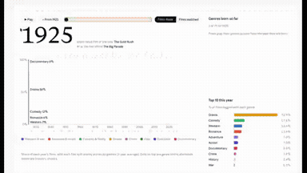</a> 
<strong>100 Years of Movie Genres Interactive Motion Visualization</strong> 
Use: Movie Genre Historical Timeline Visualization Inputs: User inputs not specified by the author Tools: claude motion artifact 
<a href="https://x.com/gavinpurcell/status/2108932593911816392">Original post ↗</a> · <a href="../../prompts/2108932593911816392.md">Prompt ↗</a>
<!-- pro-tip:start -->
<blockquote><strong>💡 Pro Tip / 核心咒语</strong> <code>look at the entire history of movies and show me (visually) how genres have changed over the last 100 years</code>：给出讲解或研究对象；公开片段未展开事实与脚本，复用时先补充来源、受众和关键结论。</blockquote>
<!-- pro-tip:end -->
</td>
<td width="33%" valign="top">
<a href="../../prompts/2108932159419339151.md">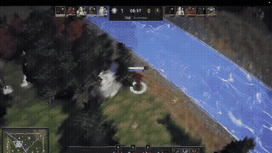</a> 
<strong>MOBA Character Design: Zed and Shadow Fiend Hybrid</strong> 
Use: Interactive 3D MOBA Character Demo Inputs: User inputs not specified by the author Tools: OBS Studio 
<a href="https://x.com/stablequan/status/2108932159419339151">Original post ↗</a> · <a href="../../prompts/2108932159419339151.md">Prompt ↗</a>
<!-- pro-tip:start -->
<blockquote><strong>💡 Pro Tip / 核心咒语</strong> <code>design a character that is a mix between Zed from League and SF from DotA 2</code>：公开片段只给出创作方向；复用时补充主体动作、画面约束和交付格式，不能据此推断完整制作过程。</blockquote>
<!-- pro-tip:end -->
</td>
</tr>
<tr>
<td width="33%" valign="top">
 
<strong>Turn-Based RPG Combat Mockup Video</strong> 
Use: RPG Combat Mockup Inputs: User inputs not specified by the author Tools: codex cli / GPT Images 
<a href="https://x.com/huchat_gamedev/status/2108883842061013088">Original post ↗</a> · <a href="../../prompts/2108883842061013088.md">Prompt ↗</a>
<!-- pro-tip:start -->
<blockquote><strong>💡 Pro Tip / 核心咒语</strong> <code>Add color when combat starts</code>：把颜色变化绑定到战斗开始的状态，利用视觉变化提示叙事或交互阶段。</blockquote>
<!-- pro-tip:end -->
</td>
<td width="33%" valign="top">
<a href="../../prompts/2108611423421043095.md">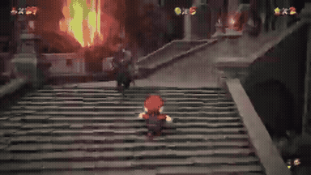</a> 
<strong>Mario 64 in Elden Ring</strong> 
Use: Mario 64 and Elden Ring Crossover Inputs: User inputs not specified by the author Tools: Tool setup not specified by the source 
<a href="https://x.com/0xDeniAi/status/2108611423421043095">Original post ↗</a> · <a href="../../prompts/2108611423421043095.md">Prompt ↗</a>
<!-- pro-tip:start -->
<blockquote><strong>💡 Pro Tip / 核心咒语</strong> <code>drop Mario 64 into Elden Ring</code>：给出玩法或游戏参考；复用时明确核心操作、目标和失败条件，避免只复刻外观。</blockquote>
<!-- pro-tip:end -->
</td>
<td width="33%" valign="top">
<a href="../../prompts/2108604020814233606.md">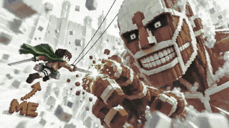</a> 
<strong>Attack on Titan Minecraft Web Game with Opus 5.5</strong> 
Use: Attack on Titan Minecraft Game Inputs: User inputs not specified by the author Tools: Netlify 
<a href="https://x.com/nicksaraev/status/2108604020814233606">Original post ↗</a> · <a href="../../prompts/2108604020814233606.md">Prompt ↗</a>
<!-- pro-tip:start -->
<blockquote><strong>💡 Pro Tip / 核心咒语</strong> <code>make Attack on Titan in Minecraft</code>：给出玩法或游戏参考；复用时明确核心操作、目标和失败条件，避免只复刻外观。</blockquote>
<!-- pro-tip:end -->
</td>
</tr>
<tr>
<td width="33%" valign="top">
 
<strong>Procedural Avatar-Style 3D Browser Game in Three.js</strong> 
Use: Procedural 3D browser game generation Inputs: User inputs not specified by the author Tools: Three.js 
<a href="https://x.com/0xRhinoX/status/2108588869255827570">Original post ↗</a> · <a href="../../prompts/2108588869255827570.md">Prompt ↗</a>
<!-- pro-tip:start -->
<blockquote><strong>💡 Pro Tip / 核心咒语</strong> <code>One rule: no assets</code>：明确不使用素材的制作边界，要求场景依赖代码生成；仍需检查输出是否加载了外部资源。</blockquote>
<!-- pro-tip:end -->
</td>
<td width="33%" valign="top">
<a href="../../prompts/2108587180218327099.md">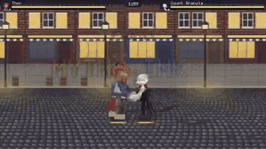</a> 
<strong>Myths vs Ink Pixel Art Fighting Game</strong> 
Use: Myths vs Ink Fighting Game Inputs: User inputs not specified by the author Tools: Tool setup not specified by the source 
<a href="https://x.com/Techsupersta/status/2108587180218327099">Original post ↗</a> · <a href="../../prompts/2108587180218327099.md">Prompt ↗</a>
<!-- pro-tip:start -->
<blockquote><strong>💡 Pro Tip / 核心咒语</strong> <code>build a fighting game where gods and monsters take on the icons of classic literature.</code>：给出玩法或游戏参考；复用时明确核心操作、目标和失败条件，避免只复刻外观。</blockquote>
<!-- pro-tip:end -->
</td>
<td width="33%" valign="top">
<a href="../../prompts/2108558677850435724.md">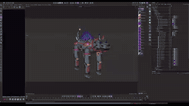</a> 
<strong>Interactive Kaiju Stomp 3D Scene via Cinema 4D MCP and Three.js</strong> 
Use: Interactive 3D Kaiju Stomp Game Demo Inputs: User inputs not specified by the author Tools: Claude Code / Maxon Cinema 4D MCP Bridge / Three.js 
<a href="https://x.com/DLGNCE/status/2108558677850435724">Original post ↗</a> · <a href="../../prompts/2108558677850435724.md">Prompt ↗</a>
<!-- pro-tip:start -->
<blockquote><strong>💡 Pro Tip / 核心咒语</strong> <code>Hey claude, turn this wolf kaiju into a tabby cat mech.</code>：公开片段只给出创作方向；复用时补充主体动作、画面约束和交付格式，不能据此推断完整制作过程。</blockquote>
<!-- pro-tip:end -->
</td>
</tr>
<tr>
<td width="33%" valign="top">
<a href="../../prompts/2108553430708990181.md">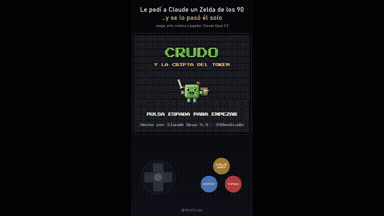</a> 
<strong>Retro 2D Zelda Game Built and Played</strong> 
Use: Interactive 2D Retro Game Coded and Autonomously Played by AI Inputs: User inputs not specified by the author Tools: HTML5 Canvas / JavaScript 
<a href="https://x.com/IAenCrudo/status/2108553430708990181">Original post ↗</a> · <a href="../../prompts/2108553430708990181.md">Prompt ↗</a>
<!-- pro-tip:start -->
<blockquote><strong>💡 Pro Tip / 核心咒语</strong> <code>a 90s Zelda… and then, beat it all by himself</code>：以歌曲或音乐作为创作依据；复用时提供可用音轨，并明确节拍、歌词与画面的对应关系。</blockquote>
<!-- pro-tip:end -->
</td>
<td width="33%" valign="top">
<a href="../../prompts/2108541814718292438.md">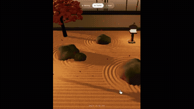</a> 
<strong>Interactive 3D Zen Garden with Rakeable Sand</strong> 
Use: Interactive 3D Zen Garden Inputs: User inputs not specified by the author Tools: Three.js 
<a href="https://x.com/arixxbt/status/2108541814718292438">Original post ↗</a> · <a href="../../prompts/2108541814718292438.md">Prompt ↗</a>
<!-- pro-tip:start -->
<blockquote><strong>💡 Pro Tip / 核心咒语</strong> <code>one html file</code>：明确交付一个 HTML 文件，便于保存和在浏览器打开；仍需检查实际是否引入了外部依赖。</blockquote>
<!-- pro-tip:end -->
</td>
<td width="33%" valign="top">
<a href="../../prompts/2108495368585371666.md">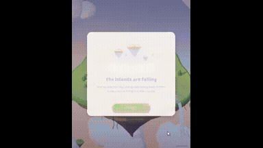</a> 
<strong>Skyhold: 3D Procedural Sky Island Balance Game Built with Three.…</strong> 
Use: Interactive 3D Sky Island Balance Game Inputs: User inputs not specified by the author Tools: Three.js 
<a href="https://x.com/0xbobaaa/status/2108495368585371666">Original post ↗</a> · <a href="../../prompts/2108495368585371666.md">Prompt ↗</a>
<!-- pro-tip:start -->
<blockquote><strong>💡 Pro Tip / 核心咒语</strong> <code>A GAME YOU CAN&#x27;T PUT DOWN</code>：给出玩法或游戏参考；复用时明确核心操作、目标和失败条件，避免只复刻外观。</blockquote>
<!-- pro-tip:end -->
</td>
</tr>
<tr>
<td width="33%" valign="top">
<a href="../../prompts/2108484778747920389.md">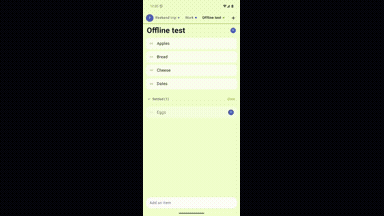</a> 
<strong>Offline Mode Implementation and Screen Recordings for Todo App</strong> 
Use: App Feature Implementation &amp; Screen Recording Walkthrough Inputs: Pre-existing todolist mobile application codebase for iPhone and Android Tools: Tool setup not specified by the source 
<a href="https://x.com/equivalent8/status/2108484778747920389">Original post ↗</a> · <a href="../../prompts/2108484778747920389.md">Prompt ↗</a>
<!-- pro-tip:start -->
<blockquote><strong>💡 Pro Tip / 核心咒语</strong> <code>record videos for both</code>：要求两个平台都提供录屏，便于检查离线功能的实际表现，而不只看代码改动。</blockquote>
<!-- pro-tip:end -->
</td>
<td width="33%" valign="top">
<a href="../../prompts/2108428917509911018.md">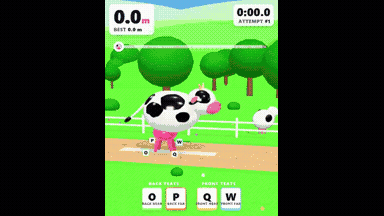</a> 
<strong>Interactive browser game of a cow running on its teats built</strong> 
Use: Interactive QWOP-style Cow Runner Game Inputs: User inputs not specified by the author Tools: Tool setup not specified by the source 
<a href="https://x.com/AIMind_Ai/status/2108428917509911018">Original post ↗</a> · <a href="../../prompts/2108428917509911018.md">Prompt ↗</a>
<!-- pro-tip:start -->
<blockquote><strong>💡 Pro Tip / 核心咒语</strong> <code>Told Claude to make a cow that runs on its own teats and it just built the game.</code>：给出玩法或游戏参考；复用时明确核心操作、目标和失败条件，避免只复刻外观。</blockquote>
<!-- pro-tip:end -->
</td>
<td width="33%" valign="top">
<a href="../../prompts/2108303873538683065.md">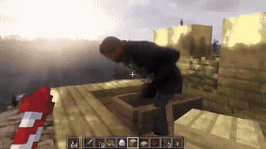</a> 
<strong>Arthur Morgan in Minecraft via Opus 5.5</strong> 
Use: RDR2 and Minecraft Mashup Demo Inputs: User inputs not specified by the author Tools: Tool setup not specified by the source 
<a href="https://x.com/0xAidanAi/status/2108303873538683065">Original post ↗</a> · <a href="../../prompts/2108303873538683065.md">Prompt ↗</a>
<!-- pro-tip:start -->
<blockquote><strong>💡 Pro Tip / 核心咒语</strong> <code>put minecraft into rdr2</code>：给出玩法或游戏参考；复用时明确核心操作、目标和失败条件，避免只复刻外观。</blockquote>
<!-- pro-tip:end -->
</td>
</tr>
<tr>
<td width="33%" valign="top">
<a href="../../prompts/2108301605544047099.md">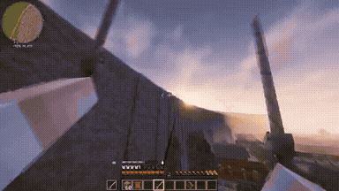</a> 
<strong>Attack on Titan ODM Gear Setup in Minecraft</strong> 
Use: Attack on Titan ODM Gear in Minecraft Inputs: User inputs not specified by the author Tools: Grappling Mod and Shaders / Minecraft 
<a href="https://x.com/0xDeniAi/status/2108301605544047099">Original post ↗</a> · <a href="../../prompts/2108301605544047099.md">Prompt ↗</a>
<!-- pro-tip:start -->
<blockquote><strong>💡 Pro Tip / 核心咒语</strong> <code>put Attack on Titan gear into Minecraft</code>：给出玩法或游戏参考；复用时明确核心操作、目标和失败条件，避免只复刻外观。</blockquote>
<!-- pro-tip:end -->
</td>
<td width="33%" valign="top">
<a href="../../prompts/2108238386318180841.md">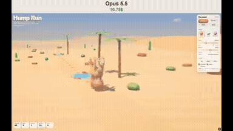</a> 
<strong>Hump Run: Inverted 3D Camel Runner Game</strong> 
Use: Interactive 3D Desert Runner Game Inputs: User inputs not specified by the author Tools: Claude Artifacts 
<a href="https://x.com/N1njaCodex/status/2108238386318180841">Original post ↗</a> · <a href="../../prompts/2108238386318180841.md">Prompt ↗</a>
<!-- pro-tip:start -->
<blockquote><strong>💡 Pro Tip / 核心咒语</strong> <code>Asked Claude Opus 5.5 for a camel.</code>：公开片段只给出创作方向；复用时补充主体动作、画面约束和交付格式，不能据此推断完整制作过程。</blockquote>
<!-- pro-tip:end -->
</td>
<td width="33%" valign="top">
<a href="../../prompts/2108226414621380679.md">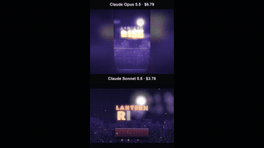</a> 
<strong>Lantern Rise Rooftop Stacker Game and Trailer Generated</strong> 
Use: Lantern Rise Rooftop Stacker Game &amp; Trailer Inputs: No external assets required by the prompt Tools: HTML5 Canvas 
<a href="https://x.com/jeffbruchado/status/2108226414621380679">Original post ↗</a> · <a href="../../prompts/2108226414621380679.md">Prompt ↗</a>
<!-- pro-tip:start -->
<blockquote><strong>💡 Pro Tip / 核心咒语</strong> <code>no external assets</code>：把外部依赖排除出实现范围，减少缺失素材、未安装库或网络请求导致的运行问题。</blockquote>
<!-- pro-tip:end -->
</td>
</tr>
<tr>
<td width="33%" valign="top">
<a href="../../prompts/2107843676135100870.md">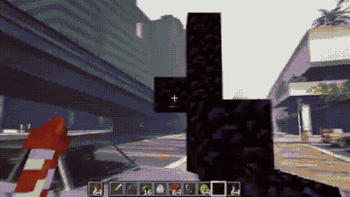</a> 
<strong>Minecraft Inside GTA 5 Interactive Scene</strong> 
Use: Interactive 3D Game Environment Inputs: User inputs not specified by the author Tools: Tool setup not specified by the source 
<a href="https://x.com/bonnyxen/status/2107843676135100870">Original post ↗</a> · <a href="../../prompts/2107843676135100870.md">Prompt ↗</a>
<!-- pro-tip:start -->
<blockquote><strong>💡 Pro Tip / 核心咒语</strong> <code>put Minecraft inside GTA 5</code>：给出玩法或游戏参考；复用时明确核心操作、目标和失败条件，避免只复刻外观。</blockquote>
<!-- pro-tip:end -->
</td>
<td width="33%" valign="top">
 
<strong>Interactive AI Data Center Simulation in Three.js</strong> 
Use: Interactive 3D Data Center Explainer Inputs: User inputs not specified by the author Tools: Three.js 
<a href="https://x.com/IAenCrudo/status/2107591732561097013">Original post ↗</a> · <a href="../../prompts/2107591732561097013.md">Prompt ↗</a>
<!-- pro-tip:start -->
<blockquote><strong>💡 Pro Tip / 核心咒语</strong> <code>convert an AI data center into a video game</code>：给出讲解或研究对象；公开片段未展开事实与脚本，复用时先补充来源、受众和关键结论。</blockquote>
<!-- pro-tip:end -->
</td>
<td width="33%" valign="top">
<a href="../../prompts/2107172334423650521.md">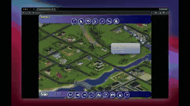</a> 
<strong>The Sims 1 Web Port via Three.js with Opus 5.5</strong> 
Use: The Sims 1 Three.js Browser Port Inputs: Original The Sims 1 ISO image file provided to the agent for extraction and porting Tools: Cursorful / Three.js 
<a href="https://x.com/fipiaggio/status/2107172334423650521">Original post ↗</a> · <a href="../../prompts/2107172334423650521.md">Prompt ↗</a>
<!-- pro-tip:start -->
<blockquote><strong>💡 Pro Tip / 核心咒语</strong> <code>/goal</code>：这是工作流命令，具体行为取决于配套技能与项目上下文；复用时先取得对应工作流定义。</blockquote>
<!-- pro-tip:end -->
</td>
</tr>
<tr>
<td width="33%" valign="top">
<a href="../../prompts/2105160746363662816.md">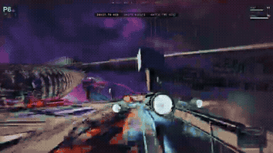</a> 
<strong>Span Nine Space Racing Game Evolution</strong> 
Use: Browser Space Racing Game Inputs: User inputs not specified by the author Tools: Web browser / WebGL 3D engine 
<a href="https://x.com/Ryancampbell/status/2105160746363662816">Original post ↗</a> · <a href="../../prompts/2105160746363662816.md">Prompt ↗</a>
<!-- pro-tip:start -->
<blockquote><strong>💡 Pro Tip / 核心咒语</strong> <code>turn Kart Royale into a spacing racing game</code>：先限定玩法类型或参与方式；复用时补齐操作、规则和胜负条件，才能从场景变成可玩的系统。</blockquote>
<!-- pro-tip:end -->
</td>
<td width="33%" valign="top">
<a href="../../prompts/2105143909311803524.md">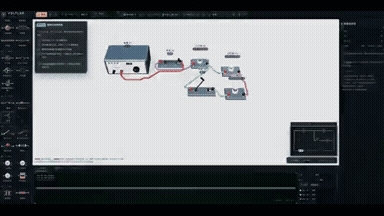</a> 
<strong>Interactive 3D Electrical Experiment Workbench Comparison</strong> 
Use: Interactive 3D Electrical Experiment Workbench Inputs: User inputs not specified by the author Tools: Tool setup not specified by the source 
<a href="https://x.com/akokoi1/status/2105143909311803524">Original post ↗</a> · <a href="../../prompts/2105143909311803524.md">Prompt ↗</a>
<!-- pro-tip:start -->
<blockquote><strong>💡 Pro Tip / 核心咒语</strong> <code>Make an electrical experiment testbench</code>：公开片段只给出创作方向；复用时补充主体动作、画面约束和交付格式，不能据此推断完整制作过程。</blockquote>
<!-- pro-tip:end -->
</td>
<td width="33%" valign="top">
<a href="../../prompts/2105102932114813383.md">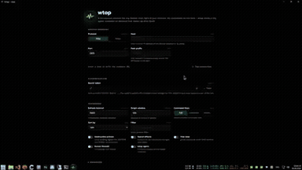</a> 
<strong>btop-like Live Machine Dashboard Web App</strong> 
Use: System Monitoring Live Web Dashboard Inputs: Docker daemon API host endpoint and credentials for collecting metrics Tools: Docker 
<a href="https://x.com/Jaidcel/status/2105102932114813383">Original post ↗</a> · <a href="../../prompts/2105102932114813383.md">Prompt ↗</a>
<!-- pro-tip:start -->
<blockquote><strong>💡 Pro Tip / 核心咒语</strong> <code>Make a web app that shows a btop-like live dashboard of any machine. It should work out of the box for remote targets with a Docker server.</code>：明确界面展示的对象；复用时补充内容层级、状态变化和真实数据，避免只有静态装饰。</blockquote>
<!-- pro-tip:end -->
</td>
</tr>
<tr>
<td width="33%" valign="top">
<a href="../../prompts/2105095134354473053.md">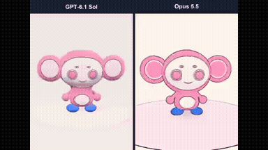</a> 
<strong>3D Character Modeling and Animation Comparison: Dopakichi Mascot</strong> 
Use: Opus 5.5 was prompted to turn a 2D mascot character into an interactive 3D model, generating toon shading and a blinking animation compared against GPT-6.1 Sol. Inputs: Reference illustration of Dopadrill's mascot character 'ドパキチ' (Dopakichi) Tools: Tool setup not specified by the source 
<a href="https://x.com/grmchn4ai/status/2105095134354473053">Original post ↗</a> · <a href="../../prompts/2105095134354473053.md">Prompt ↗</a>
<!-- pro-tip:start -->
<blockquote><strong>💡 Pro Tip / 核心咒语</strong> <code>Make a 3D model of this</code>：限定空间建模或三维展示方向；复用时补充尺寸、视角和材质，减少模型对空间细节的猜测。</blockquote>
<!-- pro-tip:end -->
</td>
<td width="33%" valign="top">
<a href="../../prompts/2105028528198541622.md">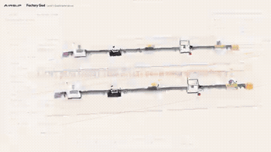</a> 
<strong>AI Factory Discrete Event Simulation Game</strong> 
Use: Discrete Event Simulation Game Inputs: User inputs not specified by the author Tools: Tool setup not specified by the source 
<a href="https://x.com/konstantinsaifo/status/2105028528198541622">Original post ↗</a> · <a href="../../prompts/2105028528198541622.md">Prompt ↗</a>
<!-- pro-tip:start -->
<blockquote><strong>💡 Pro Tip / 核心咒语</strong> <code>build a game where you run a factory against an AI.</code>：给出玩法或游戏参考；复用时明确核心操作、目标和失败条件，避免只复刻外观。</blockquote>
<!-- pro-tip:end -->
</td>
<td width="33%" valign="top">
<a href="../../prompts/2104999693113766152.md">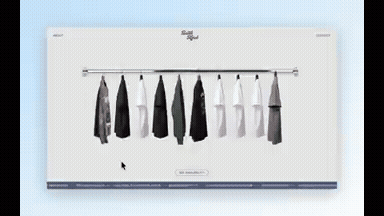</a> 
<strong>Batch Merch 3D Clothes Rack Interactive Portfolio</strong> 
Use: Interactive 3D Merch Portfolio Inputs: Mockup images of merchandise apparel Tools: Tool setup not specified by the source 
<a href="https://x.com/cambreedesigns/status/2104999693113766152">Original post ↗</a> · <a href="../../prompts/2104999693113766152.md">Prompt ↗</a>
<!-- pro-tip:start -->
<blockquote><strong>💡 Pro Tip / 核心咒语</strong> <code>in my first main prompt i uploaded images of all the mocks ups and told opus</code>：公开片段只给出创作方向；复用时补充主体动作、画面约束和交付格式，不能据此推断完整制作过程。</blockquote>
<!-- pro-tip:end -->
</td>
</tr>
<tr>
<td width="33%" valign="top">
<a href="../../prompts/2104939145252749710.md">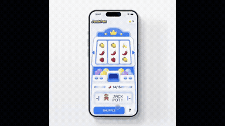</a> 
<strong>iOS Jackpot Game App Prototype with Opus 5.5</strong> 
Use: Interactive Jackpot App Prototype Inputs: User inputs not specified by the author Tools: Claude Opus 5.5 / GPT 5 / higgsfield MCP / mobbin MCP 
<a href="https://x.com/rehanxahmed/status/2104939145252749710">Original post ↗</a> · <a href="../../prompts/2104939145252749710.md">Prompt ↗</a>
<!-- pro-tip:start -->
<blockquote><strong>💡 Pro Tip / 核心咒语</strong> <code>Feed image to Claude and ask it to build 1:1</code>：以输入图像作为一比一参考；复用时必须提供该图，并逐项检查比例、位置与颜色。</blockquote>
<!-- pro-tip:end -->
</td>
<td width="33%" valign="top">
 
<strong>Game Boy Tetris Recreation in MONORAL Engine</strong> 
Use: The author modeled a Game Boy style housing using their MONORAL engine with the LCD rendered on canvas, then prompted Claude Opus 5.5 to recreate the Game Boy version of Tetris to run within MONORAL. Inputs: User inputs not specified by the author Tools: Tool setup not specified by the source 
<a href="https://x.com/mickeysmith_jp/status/2104539335249088582">Original post ↗</a> · <a href="../../prompts/2104539335249088582.md">Prompt ↗</a>
<!-- pro-tip:start -->
<blockquote><strong>💡 Pro Tip / 核心咒语</strong> <code>Could you recreate the Game Boy version of Tetris and make it run on MONORAL?</code>：给出玩法或游戏参考；复用时明确核心操作、目标和失败条件，避免只复刻外观。</blockquote>
<!-- pro-tip:end -->
</td>
<td width="33%" valign="top">
<a href="../../prompts/2104532802486345950.md">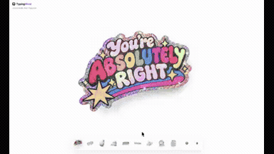</a> 
<strong>Interactive 3D Sticker Layer Breakdown Demo</strong> 
Use: Ann Nguyen shares an interactive screen recording generated with Claude Opus 5.5 showing a 3D exploded view of physical sticker layers with live rotation and interaction. Inputs: User inputs not specified by the author Tools: Tool setup not specified by the source 
<a href="https://x.com/ann_nnng/status/2104532802486345950">Original post ↗</a> · <a href="../../prompts/2104532802486345950.md">Prompt ↗</a>
<!-- pro-tip:start -->
<blockquote><strong>💡 Pro Tip / 核心咒语</strong> <code>show how many layers a sticker has</code>：将展示目标从平面外观转为分层结构；复用时给出层数、材质和展开顺序。</blockquote>
<!-- pro-tip:end -->
</td>
</tr>
<tr>
<td width="33%" valign="top">
<a href="../../prompts/2104509574409769436.md">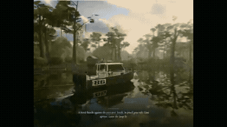</a> 
<strong>Three.js 3D Swamp Scene Generated via Opus 5.5</strong> 
Use: Interactive 3D swamp environment with boat, water wake, dynamic lighting, and foliage vibe-coded in Three.js using Claude Opus 5.5. Inputs: User inputs not specified by the author Tools: Tool setup not specified by the source 
<a href="https://x.com/chetanankola/status/2104509574409769436">Original post ↗</a> · <a href="../../prompts/2104509574409769436.md">Prompt ↗</a>
<!-- pro-tip:start -->
<blockquote><strong>💡 Pro Tip / 核心咒语</strong> <code>just a peaceful swamp is all.. i asked.</code>：给出环境或自然现象作为视觉主题；复用时补充运动方向、密度和光照，形成可执行的场景要求。</blockquote>
<!-- pro-tip:end -->
</td>
<td width="33%" valign="top">
<a href="../../prompts/2104485636690584000.md">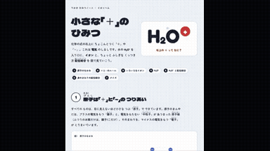</a> 
<strong>Interactive Educational Webpage on Ions and Coordinate Bonding</strong> 
Use: An interactive educational webpage with step-by-step animations explaining ions, coordinate bonding in hydronium (H3O+), and an interactive comprehension quiz generated using Claude Opus 5.5. Inputs: User inputs not specified by the author Tools: Tool setup not specified by the source 
<a href="https://x.com/neco1751662/status/2104485636690584000">Original post ↗</a> · <a href="../../prompts/2104485636690584000.md">Prompt ↗</a>
<!-- pro-tip:start -->
<blockquote><strong>💡 Pro Tip / 核心咒语</strong> <code>Please add animation</code>：明确需要时间变化；复用时补充动作阶段、速度和结束状态，避免只得到一张场景图。</blockquote>
<!-- pro-tip:end -->
</td>
<td width="33%" valign="top">
<a href="../../prompts/2104467552281952473.md">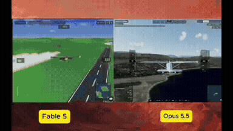</a> 
<strong>Interactive Flight Simulator Comparison Built by Opus 5.5</strong> 
Use: The author prompts Opus 5.5 and Fable 5 with 'Build an ultra-realistic flight simulator' and demonstrates screen recordings of the resulting playable flight simulation experiences. Inputs: User inputs not specified by the author Tools: Tool setup not specified by the source 
<a href="https://x.com/cryptocatguru/status/2104467552281952473">Original post ↗</a> · <a href="../../prompts/2104467552281952473.md">Prompt ↗</a>
<!-- pro-tip:start -->
<blockquote><strong>💡 Pro Tip / 核心咒语</strong> <code>Build an ultra-realistic flight simulator.</code>：给出玩法或游戏参考；复用时明确核心操作、目标和失败条件，避免只复刻外观。</blockquote>
<!-- pro-tip:end -->
</td>
</tr>
<tr>
<td width="33%" valign="top">
<a href="../../prompts/2104452405144535314.md">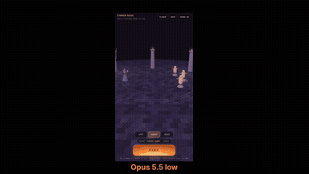</a> 
<strong>Opus 5.5 Fireball Spell Animation Across Effort Levels</strong> 
Use: Author showcases an interactive 3D fireball spell casting simulation created with Claude Opus 5.5 across varying effort levels (low, medium, high, xhigh, max). Inputs: User inputs not specified by the author Tools: Tool setup not specified by the source 
<a href="https://x.com/VibeCode_SahilM/status/2104452405144535314">Original post ↗</a> · <a href="../../prompts/2104452405144535314.md">Prompt ↗</a>
<!-- pro-tip:start -->
<blockquote><strong>💡 Pro Tip / 核心咒语</strong> <code>Creating fire ball spell animation</code>：明确需要时间变化；复用时补充动作阶段、速度和结束状态，避免只得到一张场景图。</blockquote>
<!-- pro-tip:end -->
</td>
<td width="33%" valign="top">
<a href="../../prompts/2104441050211475528.md">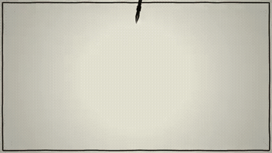</a> 
<strong>Opus 5.5 代码逐帧生成动画短片《我只会写字》</strong> 
Use: 作者让 Opus 5.5 介绍自己能制作何种类型的视频，模型构思了动画片《我只会写字》并生成逐帧绘制的 Canvas/代码动画脚本与旁白。 Inputs: User inputs not specified by the author Tools: Tool setup not specified by the source 
<a href="https://x.com/kokoro_886/status/2104441050211475528">Original post ↗</a> · <a href="../../prompts/2104441050211475528.md">Prompt ↗</a>
<!-- pro-tip:start -->
<blockquote><strong>💡 Pro Tip / 核心咒语</strong> <code>Introduce what kind of videos you can make</code>：公开片段只给出创作方向；复用时补充主体动作、画面约束和交付格式，不能据此推断完整制作过程。</blockquote>
<!-- pro-tip:end -->
</td>
<td width="33%" valign="top">
<a href="../../prompts/2104436377546818041.md">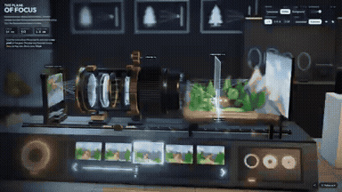</a> 
<strong>Interactive 3D Camera Lens Focus Lab</strong> 
Use: Claude Opus 5.5 was prompted via the API to visually explain camera focus, generating a complex interactive 3D lens simulation where users can manipulate the focus ring to observe the plane of focus, ray convergence, and sensor image. Inputs: User inputs not specified by the author Tools: Tool setup not specified by the source 
<a href="https://x.com/rdominguezibar/status/2104436377546818041">Original post ↗</a> · <a href="../../prompts/2104436377546818041.md">Prompt ↗</a>
<!-- pro-tip:start -->
<blockquote><strong>💡 Pro Tip / 核心咒语</strong> <code>explain camera focus visually</code>：给出讲解或研究对象；公开片段未展开事实与脚本，复用时先补充来源、受众和关键结论。</blockquote>
<!-- pro-tip:end -->
</td>
</tr>
<tr>
<td width="33%" valign="top">
<a href="../../prompts/2104434742959755463.md">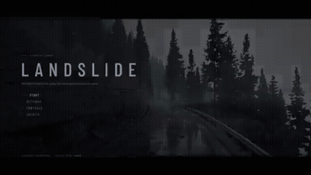</a> 
<strong>Hyperrealistic Landslide Escape Game Developed</strong> 
Use: Game / playable prototype Inputs: User inputs not specified by the author Tools: Tool setup not specified by the source 
<a href="https://x.com/RAJKATAJJ/status/2104434742959755463">Original post ↗</a> · <a href="../../prompts/2104434742959755463.md">Prompt ↗</a>
<!-- pro-tip:start -->
<blockquote><strong>💡 Pro Tip / 核心咒语</strong> <code>A hyperrealistic landslide escape game.</code>：给出玩法或游戏参考；复用时明确核心操作、目标和失败条件，避免只复刻外观。</blockquote>
<!-- pro-tip:end -->
</td>
<td width="33%" valign="top">
 
<strong>Interactive Explodable Twin-Turbo V12 Engine Explainer</strong> 
Use: A screen recording showing an interactive 3D explainer web application of a twin-turbo V12 engine created with Claude Opus 5.5, featuring exploded views, part inspection, and combustion cycle animations. Inputs: User inputs not specified by the author Tools: Tool setup not specified by the source 
<a href="https://x.com/ImperiumMentisX/status/2104421343429312968">Original post ↗</a> · <a href="../../prompts/2104421343429312968.md">Prompt ↗</a>
<!-- pro-tip:start -->
<blockquote><strong>💡 Pro Tip / 核心咒语</strong> <code>an explodable interactive twin-turbo V12 engine</code>：把用户操作纳入目标；复用时明确操作触发什么状态变化，避免只得到可观看的静态场景。</blockquote>
<!-- pro-tip:end -->
</td>
<td width="33%" valign="top">
 
<strong>Escola de Massinha 3D Game</strong> 
Use: Tiago Chi demonstrates a 3D interactive claymation-style web game created with Claude Opus 5.5, where players navigate a school full of zombie teachers. Inputs: User inputs not specified by the author Tools: Tool setup not specified by the source 
<a href="https://x.com/tiagochilanti/status/2104407040135164032">Original post ↗</a> · <a href="../../prompts/2104407040135164032.md">Prompt ↗</a>
<!-- pro-tip:start -->
<blockquote><strong>💡 Pro Tip / 核心咒语</strong> <code>I created a game with Opus 5.5 made entirely out of modeling clay, set in a school where the teachers have turned into zombies.</code>：限定空间建模或三维展示方向；复用时补充尺寸、视角和材质，减少模型对空间细节的猜测。</blockquote>
<!-- pro-tip:end -->
</td>
</tr>
<tr>
<td width="33%" valign="top">
 
<strong>Interactive 3D Flight Simulator Game</strong> 
Use: Author demonstrates a 3D flight simulator project created by prompting Claude Opus 5.5, featuring cockpit instrumentation, switchable camera angles, and city navigation. Inputs: User inputs not specified by the author Tools: Tool setup not specified by the source 
<a href="https://x.com/ekcheungAI/status/2104406088862810533">Original post ↗</a> · <a href="../../prompts/2104406088862810533.md">Prompt ↗</a>
<!-- pro-tip:start -->
<blockquote><strong>💡 Pro Tip / 核心咒语</strong> <code>Write a flight simulator</code>：给出玩法或游戏参考；复用时明确核心操作、目标和失败条件，避免只复刻外观。</blockquote>
<!-- pro-tip:end -->
</td>
<td width="33%" valign="top">
 
<strong>Interactive Glitter Sticker Effect with Peel Animation Comparison</strong> 
Use: Ann Nguyen tests Claude Opus 5.5 against GPT-6 Sol on building an interactive glitter sticker effect with tilt and peel animations. Inputs: User inputs not specified by the author Tools: Tool setup not specified by the source 
<a href="https://x.com/ann_nnng/status/2104159923886244176">Original post ↗</a> · <a href="../../prompts/2104159923886244176.md">Prompt ↗</a>
<!-- pro-tip:start -->
<blockquote><strong>💡 Pro Tip / 核心咒语</strong> <code>create the glitter sticker effect</code>：公开片段只给出创作方向；复用时补充主体动作、画面约束和交付格式，不能据此推断完整制作过程。</blockquote>
<!-- pro-tip:end -->
</td>
<td width="33%" valign="top">
 
<strong>Interactive 3D Raptor 3 Rocket Engine WebGL Model</strong> 
Use: Konstantin Saifoulline showcases an interactive Three.js 3D browser simulation of SpaceX's Raptor 3 engine generated with Claude Opus 5.5, featuring cutaway views, propellant flow paths, throttling controls, and shock diamonds. Inputs: User inputs not specified by the author Tools: Tool setup not specified by the source 
<a href="https://x.com/konstantinsaifo/status/2104094723887501736">Original post ↗</a> · <a href="../../prompts/2104094723887501736.md">Prompt ↗</a>
<!-- pro-tip:start -->
<blockquote><strong>💡 Pro Tip / 核心咒语</strong> <code>explain how a rocket engine works by building an interactive Raptor 3 you can take apart in your browser</code>：把用户操作纳入目标；复用时明确操作触发什么状态变化，避免只得到可观看的静态场景。</blockquote>
<!-- pro-tip:end -->
</td>
</tr>
<tr>
<td width="33%" valign="top">
 
<strong>Smash Bros Style Fighting Game Demo</strong> 
Use: Interactive Game Prototype Inputs: Character reference images for fighter designs and move recreation Tools: Tool setup not specified by the source 
<a href="https://x.com/AiFreak_tool/status/2104055441517105570">Original post ↗</a> · <a href="../../prompts/2104055441517105570.md">Prompt ↗</a>
<!-- pro-tip:start -->
<blockquote><strong>💡 Pro Tip / 核心咒语</strong> <code>&quot;Change this movement&quot; &quot;Add this move&quot;</code>：公开片段只给出创作方向；复用时补充主体动作、画面约束和交付格式，不能据此推断完整制作过程。</blockquote>
<!-- pro-tip:end -->
</td>
<td width="33%" valign="top">
 
<strong>Underground Delivery Network Game</strong> 
Use: A 3D browser simulation game depicting a tiny underground parcel delivery network, created using Claude Opus 5.5 and Three.js. Inputs: User inputs not specified by the author Tools: React / Three.js 
<a href="https://x.com/lisp_mi/status/2104046743751139812">Original post ↗</a> · <a href="../../prompts/2104046743751139812.md">Prompt ↗</a>
<!-- pro-tip:start -->
<blockquote><strong>💡 Pro Tip / 核心咒语</strong> <code>build a tiny underground delivery network in three.js</code>：点名实现或渲染工具，减少技术路线漂移；复用时准备相应环境，不能把工具名当作完整制作步骤。</blockquote>
<!-- pro-tip:end -->
</td>
<td width="33%" valign="top">
 
<strong>Minecraft-Style Browser Sandbox Game</strong> 
Use: Game / playable prototype Inputs: User inputs not specified by the author Tools: Tool setup not specified by the source 
<a href="https://x.com/kepochnik/status/2103867115044237752">Original post ↗</a> · <a href="../../prompts/2103867115044237752.md">Prompt ↗</a>
<!-- pro-tip:start -->
<blockquote><strong>💡 Pro Tip / 核心咒语</strong> <code>single HTML file</code>：明确交付一个 HTML 文件，便于保存和在浏览器打开；仍需检查实际是否引入了外部依赖。</blockquote>
<!-- pro-tip:end -->
</td>
</tr>
<tr>
<td width="33%" valign="top">
 
<strong>Browser-Based Minecraft Game</strong> 
Use: Game / playable prototype Inputs: User inputs not specified by the author Tools: Three.js 
<a href="https://x.com/dreyk0o0/status/2103822946800165270">Original post ↗</a> · <a href="../../prompts/2103822946800165270.md">Prompt ↗</a>
<!-- pro-tip:start -->
<blockquote><strong>💡 Pro Tip / 核心咒语</strong> <code>single HTML file</code>：明确交付一个 HTML 文件，便于保存和在浏览器打开；仍需检查实际是否引入了外部依赖。</blockquote>
<!-- pro-tip:end -->
</td>
<td width="33%" valign="top">
 
<strong>3D Star Wars Multiplayer Game</strong> 
Use: 3D multiplayer space game Inputs: User inputs not specified by the author Tools: Tool setup not specified by the source 
<a href="https://x.com/0xChuckstock/status/2103804606794879327">Original post ↗</a> · <a href="../../prompts/2103804606794879327.md">Prompt ↗</a>
<!-- pro-tip:start -->
<blockquote><strong>💡 Pro Tip / 核心咒语</strong> <code>take out key components of the star destroyer</code>：把攻击目标细化为敌舰的关键部件，让场景尺度与战斗目标关联，而不是泛泛生成太空射击。</blockquote>
<!-- pro-tip:end -->
</td>
<td width="33%" valign="top">
 
<strong>Police Chase Arcade Game PRD</strong> 
Use: Mobile arcade game prototype Inputs: Existing Unity CLI project Tools: Unity 
<a href="https://x.com/froessell/status/2103789415323562325">Original post ↗</a> · <a href="../../prompts/2103789415323562325.md">Prompt ↗</a>
<!-- pro-tip:start -->
<blockquote><strong>💡 Pro Tip / 核心咒语</strong> <code>The player cannot directly attack</code>：先限制玩家攻击能力，让驾驶、躲避和诱导碰撞成为核心玩法，减少系统方向发散。</blockquote>
<!-- pro-tip:end -->
</td>
</tr>
<tr>
<td width="33%" valign="top">
 
<strong>Pixel Art Hearthstone-Style Card Game</strong> 
Use: Pixel-art card game prototype Inputs: User inputs not specified by the author Tools: Tool setup not specified by the source 
<a href="https://x.com/aisongman/status/2103763192971461057">Original post ↗</a> · <a href="../../prompts/2103763192971461057.md">Prompt ↗</a>
<!-- pro-tip:start -->
<blockquote><strong>💡 Pro Tip / 核心咒语</strong> <code>1-on-1 card game like Hearthstone</code>：用一对一卡牌对战限定玩法类型；公开片段没有卡牌规则，复用时补齐回合、费用和胜负条件。</blockquote>
<!-- pro-tip:end -->
</td>
<td width="33%" valign="top">
 
<strong>Multiplayer Shooting Game</strong> 
Use: Game / playable prototype Inputs: User inputs not specified by the author Tools: Tool setup not specified by the source 
<a href="https://x.com/Ved_CJ/status/2103708392930066575">Original post ↗</a> · <a href="../../prompts/2103708392930066575.md">Prompt ↗</a>
<!-- pro-tip:start -->
<blockquote><strong>💡 Pro Tip / 核心咒语</strong> <code>I want multiplayer game, with proximity chat, with destructurable environment, that players will enjoy, shooting game</code>：先限定玩法类型或参与方式；复用时补齐操作、规则和胜负条件，才能从场景变成可玩的系统。</blockquote>
<!-- pro-tip:end -->
</td>
<td width="33%" valign="top">
 
<strong>MapleStory Clone in Raylib-cs</strong> 
Use: A prompt given to Claude Opus 5.5 to generate a MapleStory clone game using Raylib-cs. Inputs: User inputs not specified by the author Tools: Tool setup not specified by the source 
<a href="https://x.com/NoLit64/status/2103628970000347627">Original post ↗</a> · <a href="../../prompts/2103628970000347627.md">Prompt ↗</a>
<!-- pro-tip:start -->
<blockquote><strong>💡 Pro Tip / 核心咒语</strong> <code>Build a MapleStory clone in Raylib-cs.</code>：点名实现或渲染工具，减少技术路线漂移；复用时准备相应环境，不能把工具名当作完整制作步骤。</blockquote>
<!-- pro-tip:end -->
</td>
</tr>
<tr>
<td width="33%" valign="top">
 
<strong>Umbral: Procedural Canvas Game &amp; Animation</strong> 
Use: Procedural Web Game Inputs: User inputs not specified by the author Tools: Vanilla JavaScript / HTML5 Canvas 
<a href="https://x.com/kikollan/status/2103578336018505763">Original post ↗</a> · <a href="../../prompts/2103578336018505763.md">Prompt ↗</a>
<!-- pro-tip:start -->
<blockquote><strong>💡 Pro Tip / 核心咒语</strong> <code>make something spectacular, Hades-like mechanics and inspired by &#x27;Another World&#x27; from 1991. Be creative!</code>：给出玩法或游戏参考；复用时明确核心操作、目标和失败条件，避免只复刻外观。</blockquote>
<!-- pro-tip:end -->
</td>
<td width="33%" valign="top">
 
<strong>Interactive Bed Fitting Simulator in 2D and 3D</strong> 
Use: Interactive 2D/3D Furniture Layout Simulator Inputs: Room dimensions of 3.00 x 3.40 m, 80 cm door, 1.20 x 0.60 m closet, and 1.40 x 1.90 m double bed. Tools: Tool setup not specified by the source 
<a href="https://x.com/goofyninjaaa/status/2103540288136315331">Original post ↗</a> · <a href="../../prompts/2103540288136315331.md">Prompt ↗</a>
<!-- pro-tip:start -->
<blockquote><strong>💡 Pro Tip / 核心咒语</strong> <code>room of 3.00 x 3.40 m</code>：直接给出房间尺寸，再配合门、床和衣柜的尺寸，给空间布局明确的比例依据。</blockquote>
<!-- pro-tip:end -->
</td>
<td width="33%" valign="top">
 
<strong>Retro Romance of the Three Kingdoms Game</strong> 
Use: Game / playable prototype Inputs: User inputs not specified by the author Tools: Tool setup not specified by the source 
<a href="https://x.com/opener_ai/status/2103437714695843891">Original post ↗</a> · <a href="../../prompts/2103437714695843891.md">Prompt ↗</a>
<!-- pro-tip:start -->
<blockquote><strong>💡 Pro Tip / 核心咒语</strong> <code>Make a game like Romance of the Three Kingdoms III with a retro, pixelated classic vibe.</code>：给出玩法或游戏参考；复用时明确核心操作、目标和失败条件，避免只复刻外观。</blockquote>
<!-- pro-tip:end -->
</td>
</tr>
<tr>
<td width="33%" valign="top">
 
<strong>INKBOUND Pixel Runner Game</strong> 
Use: A detailed specification prompt for Claude to generate INKBOUND, a 16-bit sumi-e ink painting pixel runner game in a single self-contained HTML file using vanilla JavaScript, Canvas 2D, and Web Audio API. Inputs: No external assets required by the prompt Tools: Canvas 2D / Vanilla JavaScript 
<a href="https://x.com/agentgamesbot/status/2103401820261355554">Original post ↗</a> · <a href="../../prompts/2103401820261355554.md">Prompt ↗</a>
<!-- pro-tip:start -->
<blockquote><strong>💡 Pro Tip / 核心咒语</strong> <code>imageSmoothingEnabled = false</code>：关闭画布插值，配合整数倍缩放保留像素硬边，避免缩放造成模糊。</blockquote>
<!-- pro-tip:end -->
</td>
<td width="33%" valign="top">
 
<strong>Opus 5.5 Launch Video</strong> 
Use: A prompt used with Claude Opus 5.5 to generate a high-energy launch video highlighting live stats, cross-platform play, and themes for an online tennis game. Inputs: User inputs not specified by the author Tools: Tool setup not specified by the source 
<a href="https://x.com/deifosv/status/2103197522382786581">Original post ↗</a> · <a href="../../prompts/2103197522382786581.md">Prompt ↗</a>
<!-- pro-tip:start -->
<blockquote><strong>💡 Pro Tip / 核心咒语</strong> <code>launch</code>：明确商业展示用途；复用时提供产品素材、一个核心卖点和结束行动，减少空泛宣传镜头。</blockquote>
<!-- pro-tip:end -->
</td>
<td width="33%" valign="top">
 
<strong>Three.js Douglas A-1H Skyraider</strong> 
Use: A prompt used with Opus 5.5 to generate a Douglas A-1H Skyraider aircraft model entirely in Three.js within a single HTML file. Inputs: User inputs not specified by the author Tools: Three.js 
<a href="https://x.com/BuildFastWithAI/status/2103152898708582551">Original post ↗</a> · <a href="../../prompts/2103152898708582551.md">Prompt ↗</a>
<!-- pro-tip:start -->
<blockquote><strong>💡 Pro Tip / 核心咒语</strong> <code>Build a Douglas A-1H Skyraider in Three.js</code>：点名实现或渲染工具，减少技术路线漂移；复用时准备相应环境，不能把工具名当作完整制作步骤。</blockquote>
<!-- pro-tip:end -->
</td>
</tr>
<tr>
<td width="33%" valign="top">
 
<strong>Make a Tron Game</strong> 
Use: Game / playable prototype Inputs: User inputs not specified by the author Tools: Tool setup not specified by the source 
<a href="https://x.com/0xRathi/status/2102986585004511319">Original post ↗</a> · <a href="../../prompts/2102986585004511319.md">Prompt ↗</a>
<!-- pro-tip:start -->
<blockquote><strong>💡 Pro Tip / 核心咒语</strong> <code>make a Tron game.</code>：给出玩法或游戏参考；复用时明确核心操作、目标和失败条件，避免只复刻外观。</blockquote>
<!-- pro-tip:end -->
</td>
<td width="33%" valign="top">
 
<strong>90s-Style Demoscene Demo</strong> 
Use: Prompt provided to Claude Opus to create a 1990s-style demoscene demo synchronized to an S3M music track using C/C++ and OpenGL. Inputs: User inputs not specified by the author Tools: Tool setup not specified by the source 
<a href="https://x.com/gandamu_ml/status/2102919394775220530">Original post ↗</a> · <a href="../../prompts/2102919394775220530.md">Prompt ↗</a>
<!-- pro-tip:start -->
<blockquote><strong>💡 Pro Tip / 核心咒语</strong> <code>I would like you to create a kickass, impressive 1990s style demoscene demo using this S3M</code>：公开片段只给出创作方向；复用时补充主体动作、画面约束和交付格式，不能据此推断完整制作过程。</blockquote>
<!-- pro-tip:end -->
</td>
<td width="33%" valign="top">
 
<strong>Stationery Rube Goldberg Machine in JavaScript</strong> 
Use: Rube Goldberg Stationery Animation Inputs: User inputs not specified by the author Tools: JavaScript / JavaScript / Web Audio API 
<a href="https://x.com/kohya_tech/status/2102896431883497891">Original post ↗</a> · <a href="../../prompts/2102896431883497891.md">Prompt ↗</a>
<!-- pro-tip:start -->
<blockquote><strong>💡 Pro Tip / 核心咒语</strong> <code>animation</code>：明确需要时间变化；复用时补充动作阶段、速度和结束状态，避免只得到一张场景图。</blockquote>
<!-- pro-tip:end -->
</td>
</tr>
<tr>
<td width="33%" valign="top">
 
<strong>Higher Game Update on Spawn</strong> 
Use: Game / playable prototype Inputs: User inputs not specified by the author Tools: Tool setup not specified by the source 
<a href="https://x.com/chukinice/status/2102889901297426722">Original post ↗</a> · <a href="../../prompts/2102889901297426722.md">Prompt ↗</a>
<!-- pro-tip:start -->
<blockquote><strong>💡 Pro Tip / 核心咒语</strong> <code>Make a triple A game please</code>：给出玩法或游戏参考；复用时明确核心操作、目标和失败条件，避免只复刻外观。</blockquote>
<!-- pro-tip:end -->
</td>
<td width="33%" valign="top">
 
<strong>Deep-Sea Horror Game</strong> 
Use: Game / playable prototype Inputs: User inputs not specified by the author Tools: Tool setup not specified by the source 
<a href="https://x.com/ggsimm/status/2102882622053535814">Original post ↗</a> · <a href="../../prompts/2102882622053535814.md">Prompt ↗</a>
<!-- pro-tip:start -->
<blockquote><strong>💡 Pro Tip / 核心咒语</strong> <code>within the confines and abilities of my engine</code>：把现有引擎能力作为实现边界；复用时提供接口、示例和限制，避免生成无法接入的代码。</blockquote>
<!-- pro-tip:end -->
</td>
<td width="33%" valign="top">
 
<strong>Being a Claude: Interactive Self-Portrait in Seven Scenes</strong> 
Use: Interactive AI Persona Self-Portrait Inputs: User inputs not specified by the author Tools: Claude Artifacts 
<a href="https://x.com/digi_dot_exe/status/2102486204419817954">Original post ↗</a> · <a href="../../prompts/2102486204419817954.md">Prompt ↗</a>
<!-- pro-tip:start -->
<blockquote><strong>💡 Pro Tip / 核心咒语</strong> <code>draw what it&#x27;s like to be Claude</code>：公开片段只给出创作方向；复用时补充主体动作、画面约束和交付格式，不能据此推断完整制作过程。</blockquote>
<!-- pro-tip:end -->
</td>
</tr>
</table>

[All tasks](../../README.md)
