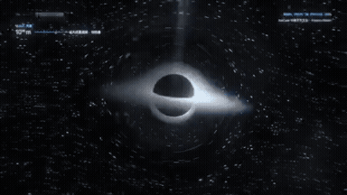
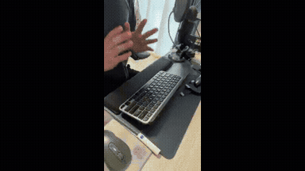
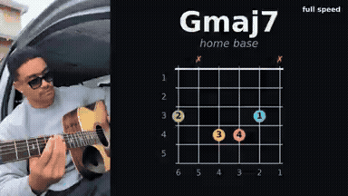
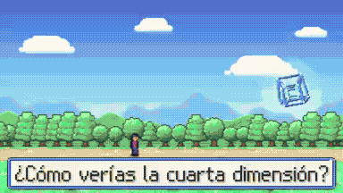
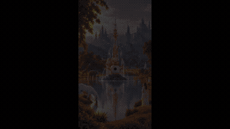
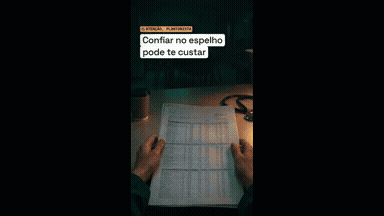
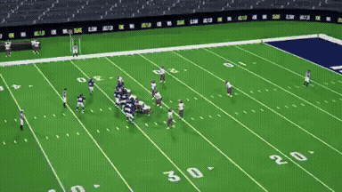
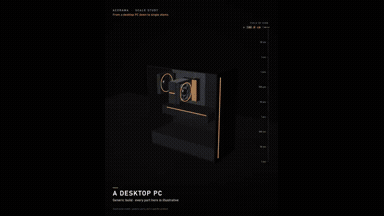
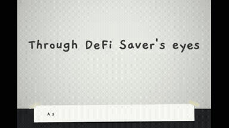

# Explainers & Education

<table>
<tr>
<td width="33%" valign="top">
 
<strong>Claude Opus 5.5 Gravity Motion Graphics Explainer</strong> 
Use: Gravity Scientific Explainer Animation Inputs: User inputs not specified by the author Tools: Tool setup not specified by the source 
<a href="https://x.com/redbickey/status/2108685334343221621">Original post ↗</a> · <a href="../../prompts/2108685334343221621.md">Prompt ↗</a>
<!-- pro-tip:start -->
<blockquote><strong>💡 Pro Tip / 核心咒语</strong> <code>Topic: Gravity Can you make one?</code>：把任务限定为可观察的模拟现象；复用时补充运动规则、参数和交互，避免只有相似外观。</blockquote>
<!-- pro-tip:end -->
</td>
<td width="33%" valign="top">
 
<strong>Nobel Prize Neutrino Astronomy Scientific Explainer Motion Graph…</strong> 
Use: Neutrino Astronomy 3D Scientific Explainer Inputs: SRT timing file and lyrics about Nobel prize neutrino physics Tools: Claude CLI / GLSL / 3D Graphics / Suno 
<a href="https://x.com/beebidao/status/2108567783789515051">Original post ↗</a> · <a href="../../prompts/2108567783789515051.md">Prompt ↗</a>
<!-- pro-tip:start -->
<blockquote><strong>💡 Pro Tip / 核心咒语</strong> <code>Fly Through</code>：明确镜头或浏览方式，使场景围绕实际观看路径组织；复用时检查转向和移动速度。</blockquote>
<!-- pro-tip:end -->
</td>
<td width="33%" valign="top">
 
<strong>Claude Opus 5.5 生成 AI 发展史动画视频</strong> 
Use: AI 发展史动效科普视频 Inputs: 要求制作 AI 发展史介绍视频的一句话提示词 Tools: HTML + SVG Animation Engine / Speech &amp; Music Synthesizer / Video Encoder (H.264) 
<a href="https://x.com/Nuseti5/status/2108506248341856721">Original post ↗</a> · <a href="../../prompts/2108506248341856721.md">Prompt ↗</a>
<!-- pro-tip:start -->
<blockquote><strong>💡 Pro Tip / 核心咒语</strong> <code>Help me make an introductory video on the history of AI, as stunning as an interview portfolio.</code>：给出讲解或研究对象；公开片段未展开事实与脚本，复用时先补充来源、受众和关键结论。</blockquote>
<!-- pro-tip:end -->
</td>
</tr>
<tr>
<td width="33%" valign="top">
 
<strong>Polymarket Election Odds Explainer Video via HyperFrames</strong> 
Use: Editorial News Explainer Inputs: User inputs not specified by the author Tools: ElevenLabs / GSAP ScrollTrigger / HyperFrames / Whisper 
<a href="https://x.com/condzxyz/status/2107594959666728991">Original post ↗</a> · <a href="../../prompts/2107594959666728991.md">Prompt ↗</a>
<!-- pro-tip:start -->
<blockquote><strong>💡 Pro Tip / 核心咒语</strong> <code>16:9</code>：先规定画幅或分辨率，帮助构图适配目标发布场景，减少导出后再裁切。</blockquote>
<!-- pro-tip:end -->
</td>
<td width="33%" valign="top">
 
<strong>Minimalist Optogenetics Explainer Video</strong> 
Use: Science Explainer Inputs: User inputs not specified by the author Tools: Tool setup not specified by the source 
<a href="https://x.com/miguelgarciadev/status/2107478638501220672">Original post ↗</a> · <a href="../../prompts/2107478638501220672.md">Prompt ↗</a>
<!-- pro-tip:start -->
<blockquote><strong>💡 Pro Tip / 核心咒语</strong> <code>educational</code>：明确讲解或可视化用途；复用时补充受众、关键结论和例子，并核对知识与数据。</blockquote>
<!-- pro-tip:end -->
</td>
<td width="33%" valign="top">
 
<strong>Interactive Architecture Canvas Generator</strong> 
Use: Interactive Architecture Map Inputs: Full application codebase and architecture configuration for the target app Tools: Web Browser Canvas 
<a href="https://x.com/robinebers/status/2105309987983745060">Original post ↗</a> · <a href="../../prompts/2105309987983745060.md">Prompt ↗</a>
<!-- pro-tip:start -->
<blockquote><strong>💡 Pro Tip / 核心咒语</strong> <code>visualization</code>：明确讲解或可视化用途；复用时补充受众、关键结论和例子，并核对知识与数据。</blockquote>
<!-- pro-tip:end -->
</td>
</tr>
<tr>
<td width="33%" valign="top">
 
<strong>Solar System and Milky Way Explainer</strong> 
Use: Solar System and Milky Way Educational Explainer Inputs: User inputs not specified by the author Tools: edge-tts / ffprobe / Mixkit / Remotion / Three.js 
<a href="https://x.com/Grace_sunnyy/status/2105180179836576206">Original post ↗</a> · <a href="../../prompts/2105180179836576206.md">Prompt ↗</a>
<!-- pro-tip:start -->
<blockquote><strong>💡 Pro Tip / 核心咒语</strong> <code>3-minute video</code>：给成片设定时间边界，让内容和动作有明确预算；复用时按时长分配镜头和节奏。</blockquote>
<!-- pro-tip:end -->
</td>
<td width="33%" valign="top">
 
<strong>中国烟草发展史纪录风格短片</strong> 
Use: 中国烟草简史互动式纪录短片演示 Inputs: User inputs not specified by the author Tools: Tool setup not specified by the source 
<a href="https://x.com/zhishiai6/status/2104939693355995311">Original post ↗</a> · <a href="../../prompts/2104939693355995311.md">Prompt ↗</a>
<!-- pro-tip:start -->
<blockquote><strong>💡 Pro Tip / 核心咒语</strong> <code>Make a documentary-style short video about the history of Chinese tobacco development</code>：给出讲解或研究对象；公开片段未展开事实与脚本，复用时先补充来源、受众和关键结论。</blockquote>
<!-- pro-tip:end -->
</td>
<td width="33%" valign="top">
 
<strong>Computer History Motion Graphics Explainer</strong> 
Use: Computer History Motion Explainer Inputs: User inputs not specified by the author Tools: Claude Opus 5.5 / Jimeng (即梦) 
<a href="https://x.com/TheHappyWang/status/2104931748014702918">Original post ↗</a> · <a href="../../prompts/2104931748014702918.md">Prompt ↗</a>
<!-- pro-tip:start -->
<blockquote><strong>💡 Pro Tip / 核心咒语</strong> <code>explainer</code>：明确讲解或可视化用途；复用时补充受众、关键结论和例子，并核对知识与数据。</blockquote>
<!-- pro-tip:end -->
</td>
</tr>
<tr>
<td width="33%" valign="top">
 
<strong>Automated Corporate Explainer Video Generated from Lark Meeting…</strong> 
Use: Corporate Philosophy Explainer Video Inputs: Lark database containing messages, documents, meeting recordings, transcripts, and emails. Tools: Claude Code / Lark 
<a href="https://x.com/NishizawaShimon/status/2104923224614326394">Original post ↗</a> · <a href="../../prompts/2104923224614326394.md">Prompt ↗</a>
<!-- pro-tip:start -->
<blockquote><strong>💡 Pro Tip / 核心咒语</strong> <code>Summarize the key points and proposals I especially emphasize in my past business negotiations and meetings into a video.</code>：给出成片用途或形式；公开片段未展开制作约束，复用时补充时长、画幅、素材和交付格式。</blockquote>
<!-- pro-tip:end -->
</td>
<td width="33%" valign="top">
 
<strong>Educational Motion-Graphics on Recursive AI Agent Limitations</strong> 
Use: Educational motion graphics / AI agents Inputs: User inputs not specified by the author Tools: GPT Image 2.5 on Fal AI 
<a href="https://x.com/M_Adrian2/status/2104542961081983435">Original post ↗</a> · <a href="../../prompts/2104542961081983435.md">Prompt ↗</a>
<!-- pro-tip:start -->
<blockquote><strong>💡 Pro Tip / 核心咒语</strong> <code>Before animating, study articles from the last three months</code>：先研究近期材料再写动画故事，明确知识内容的时效要求；引用与结论仍要人工核对。</blockquote>
<!-- pro-tip:end -->
</td>
<td width="33%" valign="top">
 
<strong>Opus 5.5 Hand-Drawn P(Doom) Educational Video</strong> 
Use: Claude Opus 5.5 generated a 15-second hand-drawn style animation explaining P(Doom). Inputs: User inputs not specified by the author Tools: Tool setup not specified by the source 
<a href="https://x.com/itnavi2022/status/2104468704490909880">Original post ↗</a> · <a href="../../prompts/2104468704490909880.md">Prompt ↗</a>
<!-- pro-tip:start -->
<blockquote><strong>💡 Pro Tip / 核心咒语</strong> <code>Please create a 15-second hand-drawn style video themed around P(Doom).</code>：给出可辨认的视觉参考；复用时再明确配色、材质和运动方式，避免只停留在风格标签。</blockquote>
<!-- pro-tip:end -->
</td>
</tr>
<tr>
<td width="33%" valign="top">
 
<strong>Claude Opus 5.5 Animated Explanation of Yun Tianming's Three Fai…</strong> 
Use: Educational / explainer video Inputs: User inputs not specified by the author Tools: Tool setup not specified by the source 
<a href="https://x.com/imxishi/status/2104459910247235966">Original post ↗</a> · <a href="../../prompts/2104459910247235966.md">Prompt ↗</a>
<!-- pro-tip:start -->
<blockquote><strong>💡 Pro Tip / 核心咒语</strong> <code>Can you make a video explanation for the three fairy tales told by Yun Tianming to Cheng Xin in &#x27;The Three-Body Problem 3&#x27;?</code>：给出成片用途或形式；公开片段未展开制作约束，复用时补充时长、画幅、素材和交付格式。</blockquote>
<!-- pro-tip:end -->
</td>
<td width="33%" valign="top">
 
<strong>A Máquina Transformer Mini-Documentary</strong> 
Use: Transformer Architecture Explainer Inputs: User inputs not specified by the author Tools: Code-based audio and visual generation 
<a href="https://x.com/joaoli13/status/2103901720539476209">Original post ↗</a> · <a href="../../prompts/2103901720539476209.md">Prompt ↗</a>
<!-- pro-tip:start -->
<blockquote><strong>💡 Pro Tip / 核心咒语</strong> <code>explaining</code>：明确讲解或可视化用途；复用时补充受众、关键结论和例子，并核对知识与数据。</blockquote>
<!-- pro-tip:end -->
</td>
<td width="33%" valign="top">
 
<strong>Opus 5.5 and Manim Educational Video Explaining Derivatives</strong> 
Use: Derivative concept lesson Inputs: User inputs not specified by the author Tools: edge-tts / Manim 
<a href="https://x.com/LinearUncle/status/2103128559174971663">Original post ↗</a> · <a href="../../prompts/2103128559174971663.md">Prompt ↗</a>
<!-- pro-tip:start -->
<blockquote><strong>💡 Pro Tip / 核心咒语</strong> <code>Use edge-tts for dubbing</code>：把配音明确交给 edge-tts，与前文 Manim 动画分工；复用时还要检查音画时长是否对齐。</blockquote>
<!-- pro-tip:end -->
</td>
</tr>
<tr>
<td width="33%" valign="top">
 
<strong>Negroni Cocktail Explainer Motion Graphic in HTML</strong> 
Use: Cocktail recipe explainer Inputs: Reference cocktail recipe illustration image attached to the prompt Tools: JavaScript 
<a href="https://x.com/Ror_Fly/status/2102853258582880547">Original post ↗</a> · <a href="../../prompts/2102853258582880547.md">Prompt ↗</a>
<!-- pro-tip:start -->
<blockquote><strong>💡 Pro Tip / 核心咒语</strong> <code>empty glass to completed cocktail</code>：用空杯到成品的完整流程限定镜头顺序，让配方讲解有可检查的起点和终点。</blockquote>
<!-- pro-tip:end -->
</td>
<td width="33%" valign="top">
 
<strong>Pythagorean Theorem Explainer Video in JavaScript</strong> 
Use: Pythagorean Theorem Explainer Animation Inputs: User inputs not specified by the author Tools: JavaScript 
<a href="https://x.com/hyuki/status/2102832558602072560">Original post ↗</a> · <a href="../../prompts/2102832558602072560.md">Prompt ↗</a>
<!-- pro-tip:start -->
<blockquote><strong>💡 Pro Tip / 核心咒语</strong> <code>Make an approximately 30-second explanatory video of the Pythagorean theorem in JavaScript</code>：给出讲解或研究对象；公开片段未展开事实与脚本，复用时先补充来源、受众和关键结论。</blockquote>
<!-- pro-tip:end -->
</td>
<td width="33%" valign="top">
 
<strong>LLM Context Window Animated Explainer</strong> 
Use: Context Window Explainer Inputs: User inputs not specified by the author Tools: JavaScript / MP4 Converter 
<a href="https://x.com/joaoli13/status/2102805376466891137">Original post ↗</a> · <a href="../../prompts/2102805376466891137.md">Prompt ↗</a>
<!-- pro-tip:start -->
<blockquote><strong>💡 Pro Tip / 核心咒语</strong> <code>animation</code>：明确需要时间变化；复用时补充动作阶段、速度和结束状态，避免只得到一张场景图。</blockquote>
<!-- pro-tip:end -->
</td>
</tr>
<tr>
<td width="33%" valign="top">
 
<strong>250 Years of U.S. History Sand Animation</strong> 
Use: 250 Years of U.S. History Sand Animation Inputs: User inputs not specified by the author Tools: Python / mido 
<a href="https://x.com/Michaelzsguo/status/2102592355165782312">Original post ↗</a> · <a href="../../prompts/2102592355165782312.md">Prompt ↗</a>
<!-- pro-tip:start -->
<blockquote><strong>💡 Pro Tip / 核心咒语</strong> <code>history</code>：给出讲解或研究对象；公开片段未展开事实与脚本，复用时先补充来源、受众和关键结论。</blockquote>
<!-- pro-tip:end -->
</td>
<td width="33%" valign="top">
 
<strong>Opus 5.5 Agent Generates Daily AI News Explainer with Paper-Cut…</strong> 
Use: Paper-cut style daily AI news explainer video Inputs: User inputs not specified by the author Tools: Grok Bot 
<a href="https://x.com/yolohair/status/2109146914000457838">Original post ↗</a> · <a href="../../prompts/2109146914000457838.md">Prompt ↗</a>
<!-- pro-tip:start -->
<blockquote><strong>💡 Pro Tip / 核心咒语</strong> <code>Make me an AI morning news video every day</code>：给出讲解或研究对象；公开片段未展开事实与脚本，复用时先补充来源、受众和关键结论。</blockquote>
<!-- pro-tip:end -->
</td>
<td width="33%" valign="top">
 
<strong>Automated Short Video Editing with Claude Code and Remotion</strong> 
Use: Automated Short Video Production Inputs: Original raw footage of the presenter speaking at their desk. Tools: Claude Code / Remotion 
<a href="https://x.com/mitsunarinoai/status/2109057244864164019">Original post ↗</a> · <a href="../../prompts/2109057244864164019.md">Prompt ↗</a>
<!-- pro-tip:start -->
<blockquote><strong>💡 Pro Tip / 核心咒语</strong> <code>Edit it</code>：给出成片用途或形式；公开片段未展开制作约束，复用时补充时长、画幅、素材和交付格式。</blockquote>
<!-- pro-tip:end -->
</td>
</tr>
<tr>
<td width="33%" valign="top">
 
<strong>13.8 Billion Years of Human Revelations Told Through Hands</strong> 
Use: AI-Directed Historical Video Essay Inputs: User inputs not specified by the author Tools: ElevenLabs / Tesseract 
<a href="https://x.com/nett0eth/status/2108729269681520726">Original post ↗</a> · <a href="../../prompts/2108729269681520726.md">Prompt ↗</a>
<!-- pro-tip:start -->
<blockquote><strong>💡 Pro Tip / 核心咒语</strong> <code>everything told through hands</code>：用“只通过手讲述”统一视觉语言，让跨度很大的历史主题仍有共同叙事载体。</blockquote>
<!-- pro-tip:end -->
</td>
<td width="33%" valign="top">
 
<strong>Educational Explainer on the Riemann Hypothesis</strong> 
Use: Mathematics Explainer Video Inputs: User inputs not specified by the author Tools: FFmpeg / Kokoro TTS / matplotlib / mpmath / pycairo 
<a href="https://x.com/insideology/status/2108716885646639338">Original post ↗</a> · <a href="../../prompts/2108716885646639338.md">Prompt ↗</a>
<!-- pro-tip:start -->
<blockquote><strong>💡 Pro Tip / 核心咒语</strong> <code>an educational video about the Riemann hypothesis, starting from prime numbers, &quot;Stephen Hawking style&quot;</code>：明确讲解或可视化用途；复用时补充受众、关键结论和例子，并核对知识与数据。</blockquote>
<!-- pro-tip:end -->
</td>
<td width="33%" valign="top">
 
<strong>Animated Explainer on the Bipartisan American Affordability and…</strong> 
Use: BAAJA Energy Permitting Explainer Inputs: User inputs not specified by the author Tools: Tool setup not specified by the source 
<a href="https://x.com/__drewface/status/2108663466383016430">Original post ↗</a> · <a href="../../prompts/2108663466383016430.md">Prompt ↗</a>
<!-- pro-tip:start -->
<blockquote><strong>💡 Pro Tip / 核心咒语</strong> <code>explain BAAJA (the Bipartisan American Affordability and Jobs Act) by making an animated video</code>：给出讲解或研究对象；公开片段未展开事实与脚本，复用时先补充来源、受众和关键结论。</blockquote>
<!-- pro-tip:end -->
</td>
</tr>
<tr>
<td width="33%" valign="top">
 
<strong>Explainer for the 2026 Nobel Prize in Literature (Anne Carson)</strong> 
Use: 2026 Nobel Prize in Literature Explainer Inputs: User inputs not specified by the author Tools: Kokoro-82M / Scott Buckley Music 
<a href="https://x.com/moreisdifferent/status/2108563710260170985">Original post ↗</a> · <a href="../../prompts/2108563710260170985.md">Prompt ↗</a>
<!-- pro-tip:start -->
<blockquote><strong>💡 Pro Tip / 核心咒语</strong> <code>Do some research on the 2026 Nobel Prize in</code>：公开片段只给出创作方向；复用时补充主体动作、画面约束和交付格式，不能据此推断完整制作过程。</blockquote>
<!-- pro-tip:end -->
</td>
<td width="33%" valign="top">
 
<strong>Simulating the Moon Crashing into Earth</strong> 
Use: Orbital collision physics explainer Inputs: User inputs not specified by the author Tools: Tool setup not specified by the source 
<a href="https://x.com/ottollm/status/2108517404712325592">Original post ↗</a> · <a href="../../prompts/2108517404712325592.md">Prompt ↗</a>
<!-- pro-tip:start -->
<blockquote><strong>💡 Pro Tip / 核心咒语</strong> <code>simulate the moon crashing into earth</code>：把任务限定为可观察的模拟现象；复用时补充运动规则、参数和交互，避免只有相似外观。</blockquote>
<!-- pro-tip:end -->
</td>
<td width="33%" valign="top">
 
<strong>GenLayer ELI5 Motion Design Explainer</strong> 
Use: GenLayer Explainer Animation Inputs: User inputs not specified by the author Tools: Tool setup not specified by the source 
<a href="https://x.com/RahilBuilds/status/2108505330066092060">Original post ↗</a> · <a href="../../prompts/2108505330066092060.md">Prompt ↗</a>
<!-- pro-tip:start -->
<blockquote><strong>💡 Pro Tip / 核心咒语</strong> <code>research genlayer and explain it like i&#x27;m 5 using motion design</code>：给出讲解或研究对象；公开片段未展开事实与脚本，复用时先补充来源、受众和关键结论。</blockquote>
<!-- pro-tip:end -->
</td>
</tr>
<tr>
<td width="33%" valign="top">
 
<strong>Bike Gears Explainer 3D Wireframe Animation</strong> 
Use: Bike Gears Mechanism 3D Explainer Inputs: User inputs not specified by the author Tools: Claude Artifacts 
<a href="https://x.com/harshitsatija/status/2108410208708169910">Original post ↗</a> · <a href="../../prompts/2108410208708169910.md">Prompt ↗</a>
<!-- pro-tip:start -->
<blockquote><strong>💡 Pro Tip / 核心咒语</strong> <code>How do bike gears work?</code>：公开片段只给出创作方向；复用时补充主体动作、画面约束和交付格式，不能据此推断完整制作过程。</blockquote>
<!-- pro-tip:end -->
</td>
<td width="33%" valign="top">
 
<strong>Automated Guitar Chord Visualization from Video Reel</strong> 
Use: Synchronized Guitar Chord Explainer Video Inputs: User inputs not specified by the author Tools: Tool setup not specified by the source 
<a href="https://x.com/keikumata/status/2108329031892713883">Original post ↗</a> · <a href="../../prompts/2108329031892713883.md">Prompt ↗</a>
<!-- pro-tip:start -->
<blockquote><strong>💡 Pro Tip / 核心咒语</strong> <code>pass it an IG reel and ask it to outline the chords for me</code>：以歌曲或音乐作为创作依据；复用时提供可用音轨，并明确节拍、歌词与画面的对应关系。</blockquote>
<!-- pro-tip:end -->
</td>
<td width="33%" valign="top">
 
<strong>MTMC Multi-Camera Tracking Explainer Animation</strong> 
Use: Multi-Camera Tracking Technical Explainer Inputs: Markdown document explaining multi-camera tracking logic Tools: Tool setup not specified by the source 
<a href="https://x.com/Xterbase/status/2108161031243759993">Original post ↗</a> · <a href="../../prompts/2108161031243759993.md">Prompt ↗</a>
<!-- pro-tip:start -->
<blockquote><strong>💡 Pro Tip / 核心咒语</strong> <code>Gave it an md file and asked it to draw it so it can be shown</code>：公开片段只给出创作方向；复用时补充主体动作、画面约束和交付格式，不能据此推断完整制作过程。</blockquote>
<!-- pro-tip:end -->
</td>
</tr>
<tr>
<td width="33%" valign="top">
 
<strong>Cinematic Differentiation Math Explainer Animation</strong> 
Use: Cinematic Differentiation Explainer Animation Inputs: User inputs not specified by the author Tools: Claude Opus 5.5 
<a href="https://x.com/yoshtakisaka/status/2107757882561208410">Original post ↗</a> · <a href="../../prompts/2107757882561208410.md">Prompt ↗</a>
<!-- pro-tip:start -->
<blockquote><strong>💡 Pro Tip / 核心咒语</strong> <code>Try making a cinematic differentiation explanation video</code>：给出成片用途或形式；公开片段未展开制作约束，复用时补充时长、画幅、素材和交付格式。</blockquote>
<!-- pro-tip:end -->
</td>
<td width="33%" valign="top">
 
<strong>Fourth Dimension Explainer in SNES Pokémon 16-Bit Style</strong> 
Use: 16-Bit Retro Game 4D Physics Explainer Inputs: User inputs not specified by the author Tools: Claude Code / Custom programmatic rendering script 
<a href="https://x.com/camilodesan/status/2107648310714442230">Original post ↗</a> · <a href="../../prompts/2107648310714442230.md">Prompt ↗</a>
<!-- pro-tip:start -->
<blockquote><strong>💡 Pro Tip / 核心咒语</strong> <code>a video explaining the fourth dimension like a Super Nintendo game, Pokémon style</code>：明确讲解或可视化用途；复用时补充受众、关键结论和例子，并核对知识与数据。</blockquote>
<!-- pro-tip:end -->
</td>
<td width="33%" valign="top">
 
<strong>Garden of Earthly Delights Film Trailer</strong> 
Use: AI Film Trailer Production Inputs: Seedance API key provided to Claude Opus.; White Lotus theme song / audio track. Tools: Seedance API 
<a href="https://x.com/mickeyxfriedman/status/2107230816871055641">Original post ↗</a> · <a href="../../prompts/2107230816871055641.md">Prompt ↗</a>
<!-- pro-tip:start -->
<blockquote><strong>💡 Pro Tip / 核心咒语</strong> <code>make a film trailer exploring hieronymus bosch&#x27;s garden of earthly delights</code>：给出成片用途或形式；公开片段未展开制作约束，复用时补充时长、画幅、素材和交付格式。</blockquote>
<!-- pro-tip:end -->
</td>
</tr>
<tr>
<td width="33%" valign="top">
 
<strong>Med Organizer TikTok Explainer via Remotion</strong> 
Use: Mobile Product Explainer Inputs: MED product repository components Tools: GPT Image 2.5 / Python / Remotion / Sonilo Music 
<a href="https://x.com/WillDobrev/status/2106843639879987460">Original post ↗</a> · <a href="../../prompts/2106843639879987460.md">Prompt ↗</a>
<!-- pro-tip:start -->
<blockquote><strong>💡 Pro Tip / 核心咒语</strong> <code>hook in the first 3 seconds</code>：给开头吸引注意力设定明确时间窗口，避免铺垫占满短视频前段。</blockquote>
<!-- pro-tip:end -->
</td>
<td width="33%" valign="top">
 
<strong>AI Agent Explainer Sea Shanty Animation Canvas Code</strong> 
Use: Sea shanty AI agent vertical explainer Inputs: User inputs not specified by the author Tools: Chromium headless / Claude Opus 5.5 / ffmpeg / Suno v6 / Whisper 
<a href="https://x.com/leploutos/status/2106728230707159472">Original post ↗</a> · <a href="../../prompts/2106728230707159472.md">Prompt ↗</a>
<!-- pro-tip:start -->
<blockquote><strong>💡 Pro Tip / 核心咒语</strong> <code>an opening question with a number, a chain of causes, a &quot;but that&#x27;s not enough&quot; to</code>：公开片段只给出创作方向；复用时补充主体动作、画面约束和交付格式，不能据此推断完整制作过程。</blockquote>
<!-- pro-tip:end -->
</td>
<td width="33%" valign="top">
 
<strong>Sweeply CLI Launch Explainer Video</strong> 
Use: CLI Tool Launch Explainer Inputs: Sweeply open-source project repository containing project context and functionality Tools: /brag 
<a href="https://x.com/ElforaDev/status/2105188480817230124">Original post ↗</a> · <a href="../../prompts/2105188480817230124.md">Prompt ↗</a>
<!-- pro-tip:start -->
<blockquote><strong>💡 Pro Tip / 核心咒语</strong> <code>/brag</code>：这是工作流命令，具体行为取决于配套技能与项目上下文；复用时先取得对应工作流定义。</blockquote>
<!-- pro-tip:end -->
</td>
</tr>
<tr>
<td width="33%" valign="top">
 
<strong>First &amp; 10 Yellow Line Explainer Video</strong> 
Use: First &amp; 10 System Explainer Inputs: User inputs not specified by the author Tools: Tool setup not specified by the source 
<a href="https://x.com/blueoctopusai/status/2105116391439270222">Original post ↗</a> · <a href="../../prompts/2105116391439270222.md">Prompt ↗</a>
<!-- pro-tip:start -->
<blockquote><strong>💡 Pro Tip / 核心咒语</strong> <code>Make a motion graphics video that explains how the First &amp; 10 Yellow Line works.</code>：给出成片用途或形式；公开片段未展开制作约束，复用时补充时长、画幅、素材和交付格式。</blockquote>
<!-- pro-tip:end -->
</td>
<td width="33%" valign="top">
 
<strong>Note Article to Explainer Video via Claude Code and HyperFrames</strong> 
Use: An author generated a 95-second structured explainer video from a blog post using Claude Opus 5.5 via Claude Code, orchestrating the script, voiceover, subtitles, and HTML-based animation in HyperFrames. Inputs: User inputs not specified by the author Tools: Tool setup not specified by the source 
<a href="https://x.com/koumei_ai5566/status/2105077598934241383">Original post ↗</a> · <a href="../../prompts/2105077598934241383.md">Prompt ↗</a>
<!-- pro-tip:start -->
<blockquote><strong>💡 Pro Tip / 核心咒语</strong> <code>landscape orientation and 90 seconds</code>：同时规定横屏和时长，给信息密度与镜头构图边界；原文章链接仍是必要输入。</blockquote>
<!-- pro-tip:end -->
</td>
<td width="33%" valign="top">
 
<strong>Agentic Neocloud Business Explainer Video via Claude Code and Op…</strong> 
Use: Neocloud business explainer Inputs: CoreWeave Form 10-K fiscal year 2025 report data, model.py, and assumptions.yaml referenced in video footers Tools: Claude Code / ElevenLabs / ffmpeg / Gemini 3.8 TTS / Manim / Hyperframes / Motion Canvas / OpenRouter API / OpenTimelineIO 
<a href="https://x.com/deedydas/status/2104957026199900220">Original post ↗</a> · <a href="../../prompts/2104957026199900220.md">Prompt ↗</a>
<!-- pro-tip:start -->
<blockquote><strong>💡 Pro Tip / 核心咒语</strong> <code>Narrate like a university professor.</code>：明确口播或旁白需求；复用时补充文稿、语速和音画对齐方式。</blockquote>
<!-- pro-tip:end -->
</td>
</tr>
<tr>
<td width="33%" valign="top">
 
<strong>Claude 发展史动态解说视频</strong> 
Use: Claude Evolution History Explainer Inputs: User inputs not specified by the author Tools: Tool setup not specified by the source 
<a href="https://x.com/LawrenceW_Zen/status/2104934916505108662">Original post ↗</a> · <a href="../../prompts/2104934916505108662.md">Prompt ↗</a>
<!-- pro-tip:start -->
<blockquote><strong>💡 Pro Tip / 核心咒语</strong> <code>Make a Claude history</code>：给出讲解或研究对象；公开片段未展开事实与脚本，复用时先补充来源、受众和关键结论。</blockquote>
<!-- pro-tip:end -->
</td>
<td width="33%" valign="top">
 
<strong>Interactive 3D AI Data Center Explainer in WebGL</strong> 
Use: Interactive 3D Data Center Explainer Inputs: User inputs not specified by the author Tools: JavaScript / WebGL 
<a href="https://x.com/konstantinsaifo/status/2104895018683044262">Original post ↗</a> · <a href="../../prompts/2104895018683044262.md">Prompt ↗</a>
<!-- pro-tip:start -->
<blockquote><strong>💡 Pro Tip / 核心咒语</strong> <code>one you can take apart in your browser</code>：把知识讲解变成可拆解的浏览器模型，让系统组成与交互动作对应。</blockquote>
<!-- pro-tip:end -->
</td>
<td width="33%" valign="top">
 
<strong>Explainer Animation on AI Chat vs Agents Generated</strong> 
Use: AI Concepts Explainer Animation Inputs: Two panda character illustration assets; Explainer video script covering the difference between AI chat and agent Tools: Claude Code 
<a href="https://x.com/Fuyutopandasan/status/2104893606679253047">Original post ↗</a> · <a href="../../prompts/2104893606679253047.md">Prompt ↗</a>
<!-- pro-tip:start -->
<blockquote><strong>💡 Pro Tip / 核心咒语</strong> <code>Make an explainer video</code>：明确讲解或可视化用途；复用时补充受众、关键结论和例子，并核对知识与数据。</blockquote>
<!-- pro-tip:end -->
</td>
</tr>
<tr>
<td width="33%" valign="top">
 
<strong>Kling 4.0 Flash Review Animated Explainer Video</strong> 
Use: AI Model Review Explainer Animation Inputs: Author's headphone-wearing mascot avatar used across slides Tools: Notion AI 
<a href="https://x.com/nbykos/status/2104880176580731165">Original post ↗</a> · <a href="../../prompts/2104880176580731165.md">Prompt ↗</a>
<!-- pro-tip:start -->
<blockquote><strong>💡 Pro Tip / 核心咒语</strong> <code>Make a pop and cute commentary/explainer video</code>：明确讲解或可视化用途；复用时补充受众、关键结论和例子，并核对知识与数据。</blockquote>
<!-- pro-tip:end -->
</td>
<td width="33%" valign="top">
 
<strong>Claude Opus 5.5 Update Explainer Video</strong> 
Use: Claude Opus 5.5 Update Explainer Animation Inputs: User inputs not specified by the author Tools: Tool setup not specified by the source 
<a href="https://x.com/mira_ai_base/status/2104872812674793697">Original post ↗</a> · <a href="../../prompts/2104872812674793697.md">Prompt ↗</a>
<!-- pro-tip:start -->
<blockquote><strong>💡 Pro Tip / 核心咒语</strong> <code>Make a video showing what changed</code>：给出成片用途或形式；公开片段未展开制作约束，复用时补充时长、画幅、素材和交付格式。</blockquote>
<!-- pro-tip:end -->
</td>
<td width="33%" valign="top">
 
<strong>PostgreSQL Animated Explainer with Mascot Animation</strong> 
Use: PostgreSQL Architecture and History Explainer Inputs: User inputs not specified by the author Tools: Tool setup not specified by the source 
<a href="https://x.com/kokaneka/status/2104843907594875185">Original post ↗</a> · <a href="../../prompts/2104843907594875185.md">Prompt ↗</a>
<!-- pro-tip:start -->
<blockquote><strong>💡 Pro Tip / 核心咒语</strong> <code>create an animated explainer about the OG Postgres</code>：明确讲解或可视化用途；复用时补充受众、关键结论和例子，并核对知识与数据。</blockquote>
<!-- pro-tip:end -->
</td>
</tr>
<tr>
<td width="33%" valign="top">
 
<strong>Opus 5.5 Motion Graphics: Chronicle of Two</strong> 
Use: The author prompted Claude Opus 5.5 with high reasoning level to inspect memory and generate a motion graphics animation recounting their shared history, titled 'A story of the moon &amp; a little star'. Inputs: User inputs not specified by the author Tools: Tool setup not specified by the source 
<a href="https://x.com/monya_for_io/status/2104554735382778328">Original post ↗</a> · <a href="../../prompts/2104554735382778328.md">Prompt ↗</a>
<!-- pro-tip:start -->
<blockquote><strong>💡 Pro Tip / 核心咒语</strong> <code>Look at our memory and make it into the history of the two of us~</code>：给出讲解或研究对象；公开片段未展开事实与脚本，复用时先补充来源、受众和关键结论。</blockquote>
<!-- pro-tip:end -->
</td>
<td width="33%" valign="top">
 
<strong>History of Space Exploration Animated Video</strong> 
Use: Video covering space exploration milestones generated via code and audio written by Claude Opus 5.5. Inputs: User inputs not specified by the author Tools: Tool setup not specified by the source 
<a href="https://x.com/0xSarthak/status/2104543926644564036">Original post ↗</a> · <a href="../../prompts/2104543926644564036.md">Prompt ↗</a>
<!-- pro-tip:start -->
<blockquote><strong>💡 Pro Tip / 核心咒语</strong> <code>make a video on history of space exploration</code>：给出讲解或研究对象；公开片段未展开事实与脚本，复用时先补充来源、受众和关键结论。</blockquote>
<!-- pro-tip:end -->
</td>
<td width="33%" valign="top">
 
<strong>History of Internet Money Code Animation</strong> 
Use: Cryptocatguru showcases an animated timeline video covering the history of internet money from 1989 to present, stating that Claude Opus 5.5 generated the animation by writing code to draw each frame. Inputs: User inputs not specified by the author Tools: Tool setup not specified by the source 
<a href="https://x.com/cryptocatguru/status/2104525804604645802">Original post ↗</a> · <a href="../../prompts/2104525804604645802.md">Prompt ↗</a>
<!-- pro-tip:start -->
<blockquote><strong>💡 Pro Tip / 核心咒语</strong> <code>a video on the history of internet money</code>：给出讲解或研究对象；公开片段未展开事实与脚本，复用时先补充来源、受众和关键结论。</blockquote>
<!-- pro-tip:end -->
</td>
</tr>
<tr>
<td width="33%" valign="top">
 
<strong>Opus 5.5 制作《星际穿越里的真物理》黑洞篇动效科普视频</strong> 
Use: 作者展示使用 Claude Opus 5.5 基于单句主题「《星际穿越里的真物理》——黑洞篇」生成的科学动效解说视频，呈现了卡冈图雅黑洞、引力透镜、时间膨胀与事件视界望远镜对比等复杂视觉与双语字幕。 Inputs: User inputs not specified by the author Tools: Tool setup not specified by the source 
<a href="https://x.com/AndyL5cc/status/2104519528873103773">Original post ↗</a> · <a href="../../prompts/2104519528873103773.md">Prompt ↗</a>
<!-- pro-tip:start -->
<blockquote><strong>💡 Pro Tip / 核心咒语</strong> <code>The Real Physics of Interstellar: The Black Hole Chapter.</code>：把任务限定为可观察的模拟现象；复用时补充运动规则、参数和交互，避免只有相似外观。</blockquote>
<!-- pro-tip:end -->
</td>
<td width="33%" valign="top">
 
<strong>History of Machine Communications Motion Graphic Video</strong> 
Use: Claude Opus 5.5 was prompted to create a motion graphic video about the history of technology, resulting in animated kinetic typography and timeline visuals illustrating humanity's first transmitted messages. Inputs: User inputs not specified by the author Tools: Tool setup not specified by the source 
<a href="https://x.com/egemntoprak/status/2104506459530866869">Original post ↗</a> · <a href="../../prompts/2104506459530866869.md">Prompt ↗</a>
<!-- pro-tip:start -->
<blockquote><strong>💡 Pro Tip / 核心咒语</strong> <code>90-second video</code>：给成片设定时间边界，让内容和动作有明确预算；复用时按时长分配镜头和节奏。</blockquote>
<!-- pro-tip:end -->
</td>
<td width="33%" valign="top">
 
<strong>India's Got Latent Explainer Breakdown</strong> 
Use: Ratnaksh Tyagi shares an animated motion graphics explainer breaking down the comedy talent show 'India's Got Latent', attributing the generation task to Opus 5.5. Inputs: User inputs not specified by the author Tools: Tool setup not specified by the source 
<a href="https://x.com/ratnakshtyagi27/status/2104474644279697754">Original post ↗</a> · <a href="../../prompts/2104474644279697754.md">Prompt ↗</a>
<!-- pro-tip:start -->
<blockquote><strong>💡 Pro Tip / 核心咒语</strong> <code>break down what India’s Got Lalent really is</code>：公开片段只给出创作方向；复用时补充主体动作、画面约束和交付格式，不能据此推断完整制作过程。</blockquote>
<!-- pro-tip:end -->
</td>
</tr>
<tr>
<td width="33%" valign="top">
 
<strong>Remotion Search History 15s Timeline Animation</strong> 
Use: Author used Claude Opus 5.5 to write Remotion code generating a 15-second motion graphics timeline depicting the history of search from 1996 to 2015 with neon numbers and SVG illustrations. Inputs: User inputs not specified by the author Tools: Tool setup not specified by the source 
<a href="https://x.com/rpa_dake/status/2104466394859593915">Original post ↗</a> · <a href="../../prompts/2104466394859593915.md">Prompt ↗</a>
<!-- pro-tip:start -->
<blockquote><strong>💡 Pro Tip / 核心咒语</strong> <code>spring physics</code>：用具体运动原则描述质感，比笼统要求“更生动”更可执行；复用时控制幅度与节奏。</blockquote>
<!-- pro-tip:end -->
</td>
<td width="33%" valign="top">
 
<strong>Opus 5.5 制作《水运仪象台》科普三维解构视频</strong> 
Use: 作者测试使用 Opus 5.5 输入简短提示制作关于北宋「水运仪象台」的 3D 解构与原理解析科普视频，视频包含机械结构拆解、擒纵机构运转展示及配音字幕。 Inputs: User inputs not specified by the author Tools: Tool setup not specified by the source 
<a href="https://x.com/AndyL5cc/status/2104428313544667245">Original post ↗</a> · <a href="../../prompts/2104428313544667245.md">Prompt ↗</a>
<!-- pro-tip:start -->
<blockquote><strong>💡 Pro Tip / 核心咒语</strong> <code>Water-driven Astronomical Clock Tower</code>：给出环境或自然现象作为视觉主题；复用时补充运动方向、密度和光照，形成可执行的场景要求。</blockquote>
<!-- pro-tip:end -->
</td>
<td width="33%" valign="top">
 
<strong>Persistence of Vision: A History of Hollywood in Code</strong> 
Use: An animated short film tracing the history of cinema rendered from light and volumetric particle motes, created via code with Claude Opus 5.5 and narrated by ElevenLabs. Inputs: Historical film references including The Horse in Motion, The Black Maria, and others. Tools: Tool setup not specified by the source 
<a href="https://x.com/abhi81i/status/2104419703997567302">Original post ↗</a> · <a href="../../prompts/2104419703997567302.md">Prompt ↗</a>
<!-- pro-tip:start -->
<blockquote><strong>💡 Pro Tip / 核心咒语</strong> <code>A history of Hollywood, sculpted from light.</code>：给出讲解或研究对象；公开片段未展开事实与脚本，复用时先补充来源、受众和关键结论。</blockquote>
<!-- pro-tip:end -->
</td>
</tr>
<tr>
<td width="33%" valign="top">
 
<strong>空气微流控芯片散热原理解析视频制作</strong> 
Use: 作者展示了由 Claude Opus 5.5 制作的关于 JouleForce 空气微流控/微通道芯片散热原理的科普动态图解视频，涵盖牛顿冷却定律、边界层效应、微通道压阻与工况对比等科学动画。 Inputs: User inputs not specified by the author Tools: Tool setup not specified by the source 
<a href="https://x.com/happyanniegh3/status/2104416503164731646">Original post ↗</a> · <a href="../../prompts/2104416503164731646.md">Prompt ↗</a>
<!-- pro-tip:start -->
<blockquote><strong>💡 Pro Tip / 核心咒语</strong> <code>Air microfluidic chip cooling</code>：公开片段只给出创作方向；复用时补充主体动作、画面约束和交付格式，不能据此推断完整制作过程。</blockquote>
<!-- pro-tip:end -->
</td>
<td width="33%" valign="top">
 
<strong>SQLite Explainer Animation and Architectural Walkthrough</strong> 
Use: Deedy shares a 7-minute technical explainer animation analyzing SQLite's codebase structure, query lifecycle, and join-order execution, generated with Claude Opus 5.5 and Gemini TTS. Inputs: User inputs not specified by the author Tools: Tool setup not specified by the source 
<a href="https://x.com/deedydas/status/2104391577091407965">Original post ↗</a> · <a href="../../prompts/2104391577091407965.md">Prompt ↗</a>
<!-- pro-tip:start -->
<blockquote><strong>💡 Pro Tip / 核心咒语</strong> <code>life of a query through the codebase</code>：沿一次查询的执行路径解释代码，把模块介绍组织成可跟随的过程。</blockquote>
<!-- pro-tip:end -->
</td>
<td width="33%" valign="top">
 
<strong>Coding Agent Explainer Video</strong> 
Use: Arthur Katcher shares a 40-second motion-graphics explainer video on how coding agents work, generated in a single prompt using Claude Code (Opus 5.5) with Remotion and a NumPy audio synthesizer. Inputs: User inputs not specified by the author Tools: Tool setup not specified by the source 
<a href="https://x.com/arthurkatcher/status/2104198927549604161">Original post ↗</a> · <a href="../../prompts/2104198927549604161.md">Prompt ↗</a>
<!-- pro-tip:start -->
<blockquote><strong>💡 Pro Tip / 核心咒语</strong> <code>explain how a coding agent works in 40 seconds</code>：给出讲解或研究对象；公开片段未展开事实与脚本，复用时先补充来源、受众和关键结论。</blockquote>
<!-- pro-tip:end -->
</td>
</tr>
<tr>
<td width="33%" valign="top">
 
<strong>Tree as an Ecosystem Animation</strong> 
Use: An animated video explaining the concept of a tree as an ecosystem, generated using a simple one-liner prompt in Opus 5.5. Inputs: User inputs not specified by the author Tools: Tool setup not specified by the source 
<a href="https://x.com/hunzai/status/2103904436141842605">Original post ↗</a> · <a href="../../prompts/2103904436141842605.md">Prompt ↗</a>
<!-- pro-tip:start -->
<blockquote><strong>💡 Pro Tip / 核心咒语</strong> <code>Tree as an ecosystem</code>：公开片段只给出创作方向；复用时补充主体动作、画面约束和交付格式，不能据此推断完整制作过程。</blockquote>
<!-- pro-tip:end -->
</td>
<td width="33%" valign="top">
 
<strong>Earth to Observable Universe Zoom-Out</strong> 
Use: Krzysztof Gonia prompted Opus 5.5 to generate a Three.js cinematic film that smoothly zooms out from an Earth hillside all the way to the observable universe without external assets. Inputs: No external assets required by the prompt Tools: Tool setup not specified by the source 
<a href="https://x.com/kgonia7/status/2103835848575746268">Original post ↗</a> · <a href="../../prompts/2103835848575746268.md">Prompt ↗</a>
<!-- pro-tip:start -->
<blockquote><strong>💡 Pro Tip / 核心咒语</strong> <code>No external assets</code>：把外部依赖排除出实现范围，减少缺失素材、未安装库或网络请求导致的运行问题。</blockquote>
<!-- pro-tip:end -->
</td>
<td width="33%" valign="top">
 
<strong>3D Desk to CPU Atom Zoom</strong> 
Use: A continuous 3D browser-rendered motion graphic zooming in from a desk all the way down to a single silicon atom inside a CPU, created with Claude Opus 5.5. Inputs: User inputs not specified by the author Tools: Tool setup not specified by the source 
<a href="https://x.com/Acoramaa/status/2103833991879053577">Original post ↗</a> · <a href="../../prompts/2103833991879053577.md">Prompt ↗</a>
<!-- pro-tip:start -->
<blockquote><strong>💡 Pro Tip / 核心咒语</strong> <code>start at my desk and don&#x27;t stop zooming until we hit a single atom inside the CPU</code>：指定从书桌到 CPU 原子的缩放两端，让镜头跨尺度变化有清楚的路径与终点。</blockquote>
<!-- pro-tip:end -->
</td>
</tr>
<tr>
<td width="33%" valign="top">
 
<strong>Mechanical Keyboard Explainer</strong> 
Use: Educational / explainer video Inputs: User inputs not specified by the author Tools: Tool setup not specified by the source 
<a href="https://x.com/iniyanai/status/2103814603100856596">Original post ↗</a> · <a href="../../prompts/2103814603100856596.md">Prompt ↗</a>
<!-- pro-tip:start -->
<blockquote><strong>💡 Pro Tip / 核心咒语</strong> <code>make an explainer on how a mechanical keyboard works</code>：明确讲解或可视化用途；复用时补充受众、关键结论和例子，并核对知识与数据。</blockquote>
<!-- pro-tip:end -->
</td>
<td width="33%" valign="top">
 
<strong>Urban Economics Documentary</strong> 
Use: Urban Economics Explainer Inputs: User inputs not specified by the author Tools: Claude 
<a href="https://x.com/JorgeGalindo/status/2103811849129234909">Original post ↗</a> · <a href="../../prompts/2103811849129234909.md">Prompt ↗</a>
<!-- pro-tip:start -->
<blockquote><strong>💡 Pro Tip / 核心咒语</strong> <code>if we have more efficient remote solutions than stacking ourselves on top of each other, why</code>：公开片段只给出创作方向；复用时补充主体动作、画面约束和交付格式，不能据此推断完整制作过程。</blockquote>
<!-- pro-tip:end -->
</td>
<td width="33%" valign="top">
 
<strong>Moroccan Political History Explainer Video</strong> 
Use: Moroccan Political History Explainer Inputs: User inputs not specified by the author Tools: Tool setup not specified by the source 
<a href="https://x.com/TrigLyceee/status/2103804459986161719">Original post ↗</a> · <a href="../../prompts/2103804459986161719.md">Prompt ↗</a>
<!-- pro-tip:start -->
<blockquote><strong>💡 Pro Tip / 核心咒语</strong> <code>make a video summarizing political life in Morocco since independence</code>：给出成片用途或形式；公开片段未展开制作约束，复用时补充时长、画幅、素材和交付格式。</blockquote>
<!-- pro-tip:end -->
</td>
</tr>
<tr>
<td width="33%" valign="top">
 
<strong>Educational Video from Article</strong> 
Use: Educational / explainer video Inputs: User inputs not specified by the author Tools: Tool setup not specified by the source 
<a href="https://x.com/henkvaness/status/2103801351993975279">Original post ↗</a> · <a href="../../prompts/2103801351993975279.md">Prompt ↗</a>
<!-- pro-tip:start -->
<blockquote><strong>💡 Pro Tip / 核心咒语</strong> <code>make educational video out of article.</code>：明确讲解或可视化用途；复用时补充受众、关键结论和例子，并核对知识与数据。</blockquote>
<!-- pro-tip:end -->
</td>
<td width="33%" valign="top">
 
<strong>Anuprerna Explainer Video</strong> 
Use: Educational / explainer video Inputs: User inputs not specified by the author Tools: Tool setup not specified by the source 
<a href="https://x.com/AmitSingha89/status/2103737604277780553">Original post ↗</a> · <a href="../../prompts/2103737604277780553.md">Prompt ↗</a>
<!-- pro-tip:start -->
<blockquote><strong>💡 Pro Tip / 核心咒语</strong> <code>Make a professional explainer video for anuprerna.com for a first-time visitor.</code>：明确讲解或可视化用途；复用时补充受众、关键结论和例子，并核对知识与数据。</blockquote>
<!-- pro-tip:end -->
</td>
<td width="33%" valign="top">
 
<strong>Recursion Explanation Video</strong> 
Use: Recursion explainer Inputs: User inputs not specified by the author Tools: Tool setup not specified by the source 
<a href="https://x.com/emollick/status/2103688362960019567">Original post ↗</a> · <a href="../../prompts/2103688362960019567.md">Prompt ↗</a>
<!-- pro-tip:start -->
<blockquote><strong>💡 Pro Tip / 核心咒语</strong> <code>make this self-referential</code>：让解释递归的视频本身也具备自指结构，把抽象概念落实到叙事形式。</blockquote>
<!-- pro-tip:end -->
</td>
</tr>
<tr>
<td width="33%" valign="top">
 
<strong>Japan Summer Weather Visualization</strong> 
Use: Weather data visualization / Japan summer Inputs: User inputs not specified by the author Tools: JavaScript 
<a href="https://x.com/GroundControl/status/2103678647777230877">Original post ↗</a> · <a href="../../prompts/2103678647777230877.md">Prompt ↗</a>
<!-- pro-tip:start -->
<blockquote><strong>💡 Pro Tip / 核心咒语</strong> <code>Pull some online data to see why it was hot and how it compares to other years</code>：先要求真实数据与跨年比较，再做可视化；复用时核对数据来源和年份，避免只有好看的曲线。</blockquote>
<!-- pro-tip:end -->
</td>
<td width="33%" valign="top">
 
<strong>Replica Symmetry Breaking Whiteboard Animation</strong> 
Use: Educational / explainer video Inputs: User inputs not specified by the author Tools: Tool setup not specified by the source 
<a href="https://x.com/tak3sh8/status/2103667481139441895">Original post ↗</a> · <a href="../../prompts/2103667481139441895.md">Prompt ↗</a>
<!-- pro-tip:start -->
<blockquote><strong>💡 Pro Tip / 核心咒语</strong> <code>hand-drawn</code>：给出可辨认的视觉参考；复用时再明确配色、材质和运动方式，避免只停留在风格标签。</blockquote>
<!-- pro-tip:end -->
</td>
<td width="33%" valign="top">
 
<strong>AI History Video</strong> 
Use: A prompt given to Claude Opus 5.5 to create an animated video illustrating key moments in artificial intelligence history. Inputs: User inputs not specified by the author Tools: Tool setup not specified by the source 
<a href="https://x.com/kloss_xyz/status/2103652674336067876">Original post ↗</a> · <a href="../../prompts/2103652674336067876.md">Prompt ↗</a>
<!-- pro-tip:start -->
<blockquote><strong>💡 Pro Tip / 核心咒语</strong> <code>make a video highlighting key moments in the history of AI.</code>：给出讲解或研究对象；公开片段未展开事实与脚本，复用时先补充来源、受众和关键结论。</blockquote>
<!-- pro-tip:end -->
</td>
</tr>
<tr>
<td width="33%" valign="top">
 
<strong>Photon Journey Explainer Animation</strong> 
Use: Science explainer / photon journey Inputs: User inputs not specified by the author Tools: JavaScript 
<a href="https://x.com/AstroTheWizard/status/2103629247751618782">Original post ↗</a> · <a href="../../prompts/2103629247751618782.md">Prompt ↗</a>
<!-- pro-tip:start -->
<blockquote><strong>💡 Pro Tip / 核心咒语</strong> <code>Give the photon a personality</code>：将光子拟人化，为抽象物理过程建立可跟随的主角；科普表述仍需单独核对。</blockquote>
<!-- pro-tip:end -->
</td>
<td width="33%" valign="top">
 
<strong>PayBox Logo Motion Design Reel</strong> 
Use: A prompt provided to Opus 5.5 to transform a PayBox logo into a dynamic 10-second motion design reel. Inputs: User inputs not specified by the author Tools: Tool setup not specified by the source 
<a href="https://x.com/0xValure/status/2103603025579331584">Original post ↗</a> · <a href="../../prompts/2103603025579331584.md">Prompt ↗</a>
<!-- pro-tip:start -->
<blockquote><strong>💡 Pro Tip / 核心咒语</strong> <code>Make this PayBox logo into a reel. Pretend you are a world-class motion designer. Make a 10-second dynamic video like the reference</code>：将输入参考作为设计起点；复用时提供原图或文件，并说明哪些比例、颜色和结构必须保留。</blockquote>
<!-- pro-tip:end -->
</td>
<td width="33%" valign="top">
 
<strong>Autonomous JavaScript Explainer Animation</strong> 
Use: A prompt directing Opus to autonomously generate a whimsical hand-drawn JavaScript animation and audio explainer for the Headroom desktop app. Inputs: User inputs not specified by the author Tools: JavaScript 
<a href="https://x.com/garmdotcom/status/2103516101518987439">Original post ↗</a> · <a href="../../prompts/2103516101518987439.md">Prompt ↗</a>
<!-- pro-tip:start -->
<blockquote><strong>💡 Pro Tip / 核心咒语</strong> <code>hand drawn</code>：给出可辨认的视觉参考；复用时再明确配色、材质和运动方式，避免只停留在风格标签。</blockquote>
<!-- pro-tip:end -->
</td>
</tr>
<tr>
<td width="33%" valign="top">
 
<strong>Animated Explainer Motion Designer</strong> 
Use: Educational / explainer video Inputs: User inputs not specified by the author Tools: Tool setup not specified by the source 
<a href="https://x.com/alex_prompter/status/2103499977632997524">Original post ↗</a> · <a href="../../prompts/2103499977632997524.md">Prompt ↗</a>
<!-- pro-tip:start -->
<blockquote><strong>💡 Pro Tip / 核心咒语</strong> <code>explainer</code>：明确讲解或可视化用途；复用时补充受众、关键结论和例子，并核对知识与数据。</blockquote>
<!-- pro-tip:end -->
</td>
<td width="33%" valign="top">
 
<strong>Code-Based Product Motion Design</strong> 
Use: A structured prompt detailing rules, motion mechanics, and export specifications for generating a single-canvas, deterministic HTML/code-based product demo animation. Inputs: Ask me for: 
• my product + URL 
• 8–12 UI states that tell its story 
• the real data shown in each state 
• brand colors + fonts + accent color 
• required formats (1:1, 16:9, 9:16) Tools: Tool setup not specified by the source 
<a href="https://x.com/verbove/status/2103483957266268381">Original post ↗</a> · <a href="../../prompts/2103483957266268381.md">Prompt ↗</a>
<!-- pro-tip:start -->
<blockquote><strong>💡 Pro Tip / 核心咒语</strong> <code>One shape, never cut</code>：用同一个形状的连续变形连接状态，避免转场退化成互不相关的幻灯片。</blockquote>
<!-- pro-tip:end -->
</td>
<td width="33%" valign="top">
 
<strong>White Russian Recipe Motion Graphic</strong> 
Use: Educational / explainer video Inputs: User inputs not specified by the author Tools: JavaScript 
<a href="https://x.com/Sarut0biSasuke/status/2103418429248069973">Original post ↗</a> · <a href="../../prompts/2103418429248069973.md">Prompt ↗</a>
<!-- pro-tip:start -->
<blockquote><strong>💡 Pro Tip / 核心咒语</strong> <code>30s video</code>：给成片设定时间边界，让内容和动作有明确预算；复用时按时长分配镜头和节奏。</blockquote>
<!-- pro-tip:end -->
</td>
</tr>
<tr>
<td width="33%" valign="top">
 
<strong>JavaScript About Us Page Animation</strong> 
Use: Tom Andrieu shares an Opus 5.5 prompt used to generate a 30 to 60-second pure JavaScript animation in a whimsical hand-drawn collage style based on an 'about-us' page. Inputs: User inputs not specified by the author Tools: JavaScript 
<a href="https://x.com/TomAndrieu96707/status/2103411144899875264">Original post ↗</a> · <a href="../../prompts/2103411144899875264.md">Prompt ↗</a>
<!-- pro-tip:start -->
<blockquote><strong>💡 Pro Tip / 核心咒语</strong> <code>hand drawn</code>：给出可辨认的视觉参考；复用时再明确配色、材质和运动方式，避免只停留在风格标签。</blockquote>
<!-- pro-tip:end -->
</td>
<td width="33%" valign="top">
 
<strong>Celld Explanation Animation</strong> 
Use: Nick Frith shares an animation generated using Opus 5.5 with a prompt asking for an explanation of why celld earns its place. Inputs: User inputs not specified by the author Tools: Tool setup not specified by the source 
<a href="https://x.com/0xnfrith/status/2103358957050068999">Original post ↗</a> · <a href="../../prompts/2103358957050068999.md">Prompt ↗</a>
<!-- pro-tip:start -->
<blockquote><strong>💡 Pro Tip / 核心咒语</strong> <code>make me an animation to explain why celld earns its place.</code>：给出讲解或研究对象；公开片段未展开事实与脚本，复用时先补充来源、受众和关键结论。</blockquote>
<!-- pro-tip:end -->
</td>
<td width="33%" valign="top">
 
<strong>Educational Video Prompt for Sotto App</strong> 
Use: Educational / explainer video Inputs: User inputs not specified by the author Tools: Tool setup not specified by the source 
<a href="https://x.com/1stnoel_/status/2103247530259603851">Original post ↗</a> · <a href="../../prompts/2103247530259603851.md">Prompt ↗</a>
<!-- pro-tip:start -->
<blockquote><strong>💡 Pro Tip / 核心咒语</strong> <code>Make a 1-minute educational video about https://t.co/cgU4RNuz2s with synthesized voice narration.</code>：明确讲解或可视化用途；复用时补充受众、关键结论和例子，并核对知识与数据。</blockquote>
<!-- pro-tip:end -->
</td>
</tr>
<tr>
<td width="33%" valign="top">
 
<strong>The Sphere History GSAP Motion Graphic</strong> 
Use: Educational / explainer video Inputs: User inputs not specified by the author Tools: GSAP ScrollTrigger 
<a href="https://x.com/RetropunkAI/status/2103237989065277590">Original post ↗</a> · <a href="../../prompts/2103237989065277590.md">Prompt ↗</a>
<!-- pro-tip:start -->
<blockquote><strong>💡 Pro Tip / 核心咒语</strong> <code>60s video</code>：给成片设定时间边界，让内容和动作有明确预算；复用时按时长分配镜头和节奏。</blockquote>
<!-- pro-tip:end -->
</td>
<td width="33%" valign="top">
 
<strong>Token Bucket Rate Limiter Animation</strong> 
Use: Parker Rex shares an animated diagram of a token bucket rate limiter created with an AI prompt utilizing HTML5 canvas without external libraries. Inputs: User inputs not specified by the author Tools: Tool setup not specified by the source 
<a href="https://x.com/ParkerRex/status/2103206747846701462">Original post ↗</a> · <a href="../../prompts/2103206747846701462.md">Prompt ↗</a>
<!-- pro-tip:start -->
<blockquote><strong>💡 Pro Tip / 核心咒语</strong> <code>every frame a pure function of time</code>：让每帧仅由时间决定，便于截图式渲染重复取样同一时刻，减少状态累积造成的帧间差异。</blockquote>
<!-- pro-tip:end -->
</td>
<td width="33%" valign="top">
 
<strong>Stop-Motion DeFi Saver Animation</strong> 
Use: Educational / explainer video Inputs: User inputs not specified by the author Tools: Tool setup not specified by the source 
<a href="https://x.com/_nikolajankovic/status/2102867033100616097">Original post ↗</a> · <a href="../../prompts/2102867033100616097.md">Prompt ↗</a>
<!-- pro-tip:start -->
<blockquote><strong>💡 Pro Tip / 核心咒语</strong> <code>make a hand-drawn stop-motion animation; story: you&#x27;re defi saver and explaining yourself in 1st person</code>：给出可辨认的视觉参考；复用时再明确配色、材质和运动方式，避免只停留在风格标签。</blockquote>
<!-- pro-tip:end -->
</td>
</tr>
<tr>
<td width="33%" valign="top">
 
<strong>Datagran Explainer Video</strong> 
Use: A prompt requesting an AI model to generate a modern, punchy explainer video showcasing Datagran's end-to-end autonomous growth loop. Inputs: User inputs not specified by the author Tools: Tool setup not specified by the source 
<a href="https://x.com/charlesmendez/status/2102847039415476517">Original post ↗</a> · <a href="../../prompts/2102847039415476517.md">Prompt ↗</a>
<!-- pro-tip:start -->
<blockquote><strong>💡 Pro Tip / 核心咒语</strong> <code>video</code>：给出成片用途或形式；公开片段未展开制作约束，复用时补充时长、画幅、素材和交付格式。</blockquote>
<!-- pro-tip:end -->
</td>
<td width="33%" valign="top">
 
<strong>Human Civilization to Opus 5.5 Doodle Story Animation</strong> 
Use: Human History to Opus 5.5 Explainer Inputs: User inputs not specified by the author Tools: Tool setup not specified by the source 
<a href="https://x.com/songkeys/status/2102743212922384673">Original post ↗</a> · <a href="../../prompts/2102743212922384673.md">Prompt ↗</a>
<!-- pro-tip:start -->
<blockquote><strong>💡 Pro Tip / 核心咒语</strong> <code>explanatory</code>：给出讲解或研究对象；公开片段未展开事实与脚本，复用时先补充来源、受众和关键结论。</blockquote>
<!-- pro-tip:end -->
</td><td></td>
</tr>
</table>

[Back to gallery](../../README.md)
