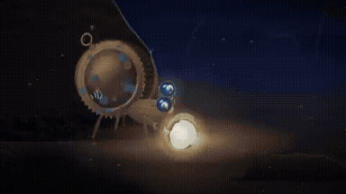

# remotion

<table>
<tr>
<td width="33%" valign="top">
 
<strong>Solar System and Milky Way Explainer</strong> 
Use: Solar System and Milky Way Educational Explainer Inputs: User inputs not specified by the author Tools: edge-tts / ffprobe / Mixkit / Remotion / Three.js 
<a href="https://x.com/Grace_sunnyy/status/2105180179836576206">Original post ↗</a> · <a href="../../prompts/2105180179836576206.md">Prompt ↗</a>
<!-- pro-tip:start -->
<blockquote><strong>💡 Pro Tip / 核心咒语</strong> <code>3-minute video</code>：给成片设定时间边界，让内容和动作有明确预算；复用时按时长分配镜头和节奏。</blockquote>
<!-- pro-tip:end -->
</td>
<td width="33%" valign="top">
 
<strong>Motion Designer Résumé Showreel and Remotion</strong> 
Use: 15-second motion design showreel Inputs: No supplied assets specified; agent chooses production details Tools: Remotion 
<a href="https://x.com/ajith_io/status/2103449416325890146">Original post ↗</a> · <a href="../../prompts/2103449416325890146.md">Prompt ↗</a>
<!-- pro-tip:start -->
<blockquote><strong>💡 Pro Tip / 核心咒语</strong> <code>dynamic 15-second motion graphics video</code>：把时长和动效形式一起写明，将“做得惊艳”收敛成一个 15 秒作品集片段。</blockquote>
<!-- pro-tip:end -->
</td>
<td width="33%" valign="top">
 
<strong>LicitaCerta Product Ad</strong> 
Use: Product Promotional Ad Inputs: Product website URL containing copy and service features. Tools: FFmpeg / JavaScript / Playwright / Remotion 
<a href="https://x.com/thallisribeiro/status/2103107359727829318">Original post ↗</a> · <a href="../../prompts/2103107359727829318.md">Prompt ↗</a>
<!-- pro-tip:start -->
<blockquote><strong>💡 Pro Tip / 核心咒语</strong> <code>&quot;Use only: JavaScript, Playwright and FFmpeg. Make a modern, elegant, and impactful video for my product (https://licitacerta.com.br/)&quot;</code>：点名实现或渲染工具，减少技术路线漂移；复用时准备相应环境，不能把工具名当作完整制作步骤。</blockquote>
<!-- pro-tip:end -->
</td>
</tr>
<tr>
<td width="33%" valign="top">
 
<strong>Automated Short Video Editing with Claude Code and Remotion</strong> 
Use: Automated Short Video Production Inputs: Original raw footage of the presenter speaking at their desk. Tools: Claude Code / Remotion 
<a href="https://x.com/mitsunarinoai/status/2109057244864164019">Original post ↗</a> · <a href="../../prompts/2109057244864164019.md">Prompt ↗</a>
<!-- pro-tip:start -->
<blockquote><strong>💡 Pro Tip / 核心咒语</strong> <code>Edit it</code>：给出成片用途或形式；公开片段未展开制作约束，复用时补充时长、画幅、素材和交付格式。</blockquote>
<!-- pro-tip:end -->
</td>
<td width="33%" valign="top">
 
<strong>Relay SaaS App Launch Video</strong> 
Use: SaaS Product Launch Motion Graphics Inputs: Application repository providing app code and context Tools: Devin / Remotion 
<a href="https://x.com/Screeendev/status/2108333562462408823">Original post ↗</a> · <a href="../../prompts/2108333562462408823.md">Prompt ↗</a>
<!-- pro-tip:start -->
<blockquote><strong>💡 Pro Tip / 核心咒语</strong> <code>Remotion</code>：点名实现或渲染工具，减少技术路线漂移；复用时准备相应环境，不能把工具名当作完整制作步骤。</blockquote>
<!-- pro-tip:end -->
</td>
<td width="33%" valign="top">
 
<strong>Med Organizer TikTok Explainer via Remotion</strong> 
Use: Mobile Product Explainer Inputs: MED product repository components Tools: GPT Image 2.5 / Python / Remotion / Sonilo Music 
<a href="https://x.com/WillDobrev/status/2106843639879987460">Original post ↗</a> · <a href="../../prompts/2106843639879987460.md">Prompt ↗</a>
<!-- pro-tip:start -->
<blockquote><strong>💡 Pro Tip / 核心咒语</strong> <code>hook in the first 3 seconds</code>：给开头吸引注意力设定明确时间窗口，避免铺垫占满短视频前段。</blockquote>
<!-- pro-tip:end -->
</td>
</tr>
<tr>
<td width="33%" valign="top">
 
<strong>Photon Journey Remotion Animation</strong> 
Use: Photon Journey Remotion Animation Inputs: User inputs not specified by the author Tools: Node.js / Remotion 
<a href="https://x.com/apoorvjain25/status/2104818940467945542">Original post ↗</a> · <a href="../../prompts/2104818940467945542.md">Prompt ↗</a>
<!-- pro-tip:start -->
<blockquote><strong>💡 Pro Tip / 核心咒语</strong> <code>20-second video</code>：给成片设定时间边界，让内容和动作有明确预算；复用时按时长分配镜头和节奏。</blockquote>
<!-- pro-tip:end -->
</td>
<td width="33%" valign="top">
 
<strong>Remotion Promo Short</strong> 
Use: Remotion Animated Short Inputs: Original source explainer video referenced for the promo summary. Tools: ElevenLabs / Midjourney / Remotion 
<a href="https://x.com/ayumi_t820/status/2104807505297871023">Original post ↗</a> · <a href="../../prompts/2104807505297871023.md">Prompt ↗</a>
<!-- pro-tip:start -->
<blockquote><strong>💡 Pro Tip / 核心咒语</strong> <code>Make a short video showing that this video could be created with Opus 5.5</code>：给出成片用途或形式；公开片段未展开制作约束，复用时补充时长、画幅、素材和交付格式。</blockquote>
<!-- pro-tip:end -->
</td>
<td width="33%" valign="top">
 
<strong>Remotion Product Launch Film</strong> 
Use: Product / brand film Inputs: User inputs not specified by the author Tools: React / Remotion 
<a href="https://x.com/punit_io/status/2104467016719774112">Original post ↗</a> · <a href="../../prompts/2104467016719774112.md">Prompt ↗</a>
<!-- pro-tip:start -->
<blockquote><strong>💡 Pro Tip / 核心咒语</strong> <code>Build a 22-second product launch film in Remotion v4 (React + TypeScript). Every frame comes from code. Don&#x27;t use AI-generated video or images.</code>：点名实现或渲染工具，减少技术路线漂移；复用时准备相应环境，不能把工具名当作完整制作步骤。</blockquote>
<!-- pro-tip:end -->
</td>
</tr>
<tr>
<td width="33%" valign="top">
 
<strong>TanStack AI Launch Motion Graphics Video</strong> 
Use: Motion graphics / showreel Inputs: User inputs not specified by the author Tools: Remotion 
<a href="https://x.com/HowDevelop/status/2103840883812733090">Original post ↗</a> · <a href="../../prompts/2103840883812733090.md">Prompt ↗</a>
<!-- pro-tip:start -->
<blockquote><strong>💡 Pro Tip / 核心咒语</strong> <code>1920×1080</code>：先规定画幅或分辨率，帮助构图适配目标发布场景，减少导出后再裁切。</blockquote>
<!-- pro-tip:end -->
</td>
<td width="33%" valign="top">
 
<strong>Code-Animated Short Film: Xi the Mechanical Hermit Crab</strong> 
Use: A detailed, multi-stage director prompt instructing Claude to procedurally code, rig, score, and render a 45–50 second animated short film about a mechanical hermit crab chasing a light through deep-sea realms using Remotion, WebGL, SVG, and Python audio synthesis. Inputs: User inputs not specified by the author Tools: FFmpeg / NumPy / React / Remotion 
<a href="https://x.com/gmgmgm1545/status/2103793820815245507">Original post ↗</a> · <a href="../../prompts/2103793820815245507.md">Prompt ↗</a>
<!-- pro-tip:start -->
<blockquote><strong>💡 Pro Tip / 核心咒语</strong> <code>no subtitles</code>：用明确的排除项限定输出范围，减少模型自行增加不需要的文字、界面或交互。</blockquote>
<!-- pro-tip:end -->
</td>
<td width="33%" valign="top">
 
<strong>Dynamic Motion Graphics Showreel</strong> 
Use: Motion graphics / showreel Inputs: User inputs not specified by the author Tools: Remotion 
<a href="https://x.com/theattnlayer/status/2103776779064471834">Original post ↗</a> · <a href="../../prompts/2103776779064471834.md">Prompt ↗</a>
<!-- pro-tip:start -->
<blockquote><strong>💡 Pro Tip / 核心咒语</strong> <code>15 second motion graphics video</code>：给成片设定时间边界，让内容和动作有明确预算；复用时按时长分配镜头和节奏。</blockquote>
<!-- pro-tip:end -->
</td>
</tr>
<tr>
<td width="33%" valign="top">
 
<strong>Remotion Portfolio Showreel Video</strong> 
Use: Motion graphics / showreel Inputs: User inputs not specified by the author Tools: Remotion 
<a href="https://x.com/wani_shola/status/2103769906638459278">Original post ↗</a> · <a href="../../prompts/2103769906638459278.md">Prompt ↗</a>
<!-- pro-tip:start -->
<blockquote><strong>💡 Pro Tip / 核心咒语</strong> <code>one idea per shot</code>：限制每个镜头的信息量，让文字、画面和动作围绕同一信息点展开。</blockquote>
<!-- pro-tip:end -->
</td>
<td width="33%" valign="top">
 
<strong>Remotion Product Showcase Video</strong> 
Use: A prompt instructing the model to study a specified website and generate a product showcase video using Remotion. Inputs: User inputs not specified by the author Tools: Remotion 
<a href="https://x.com/lester_tyy/status/2103733819568480587">Original post ↗</a> · <a href="../../prompts/2103733819568480587.md">Prompt ↗</a>
<!-- pro-tip:start -->
<blockquote><strong>💡 Pro Tip / 核心咒语</strong> <code>Study how this https://t.co/SR0AyULLNp works and use Remotion to make a product showcase video.</code>：点名实现或渲染工具，减少技术路线漂移；复用时准备相应环境，不能把工具名当作完整制作步骤。</blockquote>
<!-- pro-tip:end -->
</td><td></td>
</tr>
</table>

[All tasks](../../README.md)
